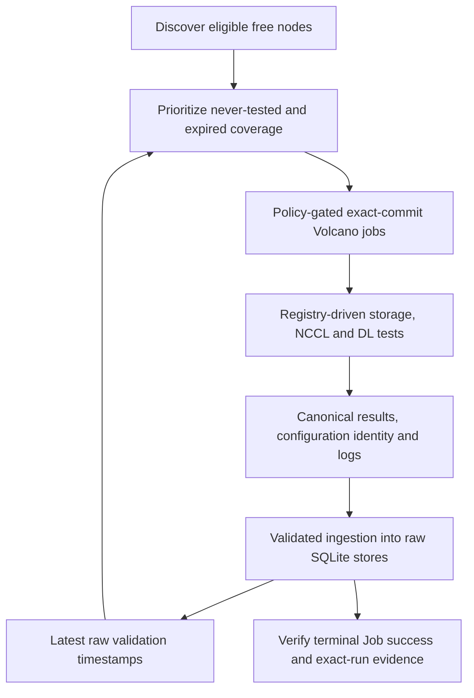

# c-val

c-val (Continuous Validation) runs repeatable, application-level tests on
available GPU nodes. It discovers eligible capacity, prioritizes missing or
stale validation coverage, submits exact-commit Volcano jobs, and preserves
test outcomes, metrics and diagnostic artifacts.

The goal is to expose selected correctness and performance problems that
Kubernetes readiness alone cannot establish, without running diagnostic GPU
workloads alongside active user GPU work.

The framework's scope ends with successful Job execution and verified logs,
results and raw SQLite ingestion on the PVC. It does not build performance
baselines, classify or score nodes, or run downstream evaluation or remediation.

Start with the [process flow guide](docs/architecture.md) for diagrams and the
[features and functionality guide](docs/cval-technical-overview.md) for the full
capability inventory.

## How It Works



1. Check node readiness, schedulability and available GPU, CPU, memory and RDMA resources.
2. Select never-tested nodes first, then expired nodes, oldest timestamp first.
3. Render a bounded batch and submit only with explicit authorization and an exact published commit.
4. Run enabled tests in registry order, retaining configuration identity, progress, results and logs.
5. Validate canonical evidence, complete test-owned raw ingestion, and verify Job success.

### Enabled Tests

| Family | What it exercises | Configuration |
| --- | --- | --- |
| Storage FIO | Shared-storage read/write performance, bandwidth and IOPS | [validation-tests/storage/test_config.toml](validation-tests/storage/test_config.toml) |
| NCCL and HCA bandwidth | Single-node AllReduce over InfiniBand with HCA transmit-bandwidth tracking | [validation-tests/nccl/test_config.toml](validation-tests/nccl/test_config.toml) |
| Deep-learning unit tests | Selected numerical, compute, collective and compute/communication-overlap behavior | [validation-tests/dltest/test_config.toml](validation-tests/dltest/test_config.toml) |

These tests are not an exhaustive hardware certification or a full multi-node
fabric/training benchmark. Busy nodes may retain stale results, and diagnostic
traffic can still affect shared storage and network services.

## Quick Start

### Install Locally

Use **Python 3.11 or newer**. Run these commands from the repository root;
the editable install keeps repository-local configuration, templates and test
descriptors available.

```bash
python3 -m venv .venv
source .venv/bin/activate
python -m pip install -e .
cval --help
```

Inspect configuration and test definitions without contacting the cluster:

```bash
cval --config config/cval.toml config
cval tests list
cval tests describe nccl
cval tests validate
```

`tests validate` checks descriptors and configured resource requirements; it
does not run GPU validation. Use `--config <path>` before the subcommand, or
set `CVAL_CONFIG`, to select a different configuration.

### Inspect the Cluster

Cluster commands require an authenticated `kubectl` context and appropriate
read/exec access. Validation additionally requires Volcano, the configured
namespace/queue, GPU/RDMA resources, a shared PVC and access to the configured
source repository and container image. Status/results use the PVC access pod.
Review these environment-specific settings before use.

```bash
cval nodes --output json
cval status --output json
```

Set `CVAL_GIT_REF` to an exact published lowercase 40-hex commit from the
configured repository, then inspect the priority queue:

```bash
cval plan --live-status --git-ref "${CVAL_GIT_REF:?Set an exact published commit}"
```

`plan` only returns ordered candidates; it never renders or submits Jobs.
Include `--live-status` to use existing validation history; without a history
input, candidates are treated as never tested. Add `--output json` for automation.
The live loop checks candidate eligibility, then renders only the selected node
at confirmed submission. There is no alternate planning mode. See the
[CLI mode inventory](docs/components_design/operator-interface-major-component.md#mode-inventory) for
remaining options and proposed retirements.

Inspect known job names or export raw results:

```bash
cval jobs --jobs "${CVAL_JOB_NAMES:?Set comma-separated job names}" --watch
cval results --test overall --output-dir ./exports
cval results --test nccl --output-dir ./exports
```

These commands do not change Kubernetes or source databases. `results` writes
local CSV files; its output is raw evidence, not derived health classifications.
Configuration output is always JSON and result exports are always CSV; neither
needs a format selector. Status and planning use JSON rather than legacy TSV.

## Configuration

[config/cval.toml](config/cval.toml) controls cluster access, scheduling, job
resources, storage paths and enabled tests. Each test owns its benchmark settings,
artifacts and raw export adapter in its descriptor.
See [docs/configuration.md](docs/configuration.md) for details.

| Setting | Checked-in default |
| --- | --- |
| Retest age | 7 days; an eligibility threshold, not a weekly coverage guarantee |
| Batch size / policy maximum | 3 / 5 jobs |
| Per-node submission cooldown | 4 hours |
| Job resources | 8 GPUs, 100 CPU, 1,500 GiB memory, one RDMA allocation; 256 GiB shared-memory volume |
| Container image | `nvcr.io/nvidia/pytorch:26.05-py3` |
| Monitoring | 100-minute timeout, 60-second polling, 20-minute pending-start timeout |

These values are explicitly configured in TOML, not code fallbacks. Missing
settings fail before work starts; use a complete reviewed main TOML and complete
test descriptors. The all-zero `job.git_ref` prevents accidental submission.
See the [strict configuration contract](docs/configuration.md#strict-two-level-contract)
for snapshot/session migration. Pinning source does not itself pin the image or
external test dependencies.

## Running Validation Safely

Phase 1 source implementation (1.1-1.6) is complete; fresh-cluster acceptance and
controller turnover remain pending separate approval. See the
[implementation/acceptance distinction](docs/components_design/redesign-development-plan.md#implementation-status).
Scheduling reads `status --coverage`; `results` supports exact `--node` and
`--timestamp` selectors without changing CSV columns. Metrics never fall back to
a different run's values.

### One-Node Validation

Submission is a live mutation: approve the exact command, target and rollback
before executing it. Use one fully free Ready node with sufficient resources;
the targeted path supports a drained, cordoned node without uncordoning it.
Unknown state or active GPU work must block submission.

```bash
cval validate --help
```

The targeted command requires the node name, an exact published commit, the
explicit submission flag and the exact `submit` confirmation. Help and local
configuration checks do not authorize execution.

All supported submitters also require a compatible pinned session on the configured
control host. Shared admission checks node/slot conflicts and fresh eligibility
under one short lock; it rejects legacy or missing sessions. See
[initialization and turnover requirements](docs/operations-runbook.md#shared-submission-admission).

Acceptance requires a successful terminal job phase, passing required tests,
canonical results, matching exact-timestamp raw rows and retained logs. A
Completed Job alone is not proof of successful validation. Disabled tests are
not passes; incomplete evidence must remain visible.

### Quick Test Workflow

The [quick test workflow](docs/operations-runbook.md#quick-test-workflow) first
exercises discovery without submission, then prepares a separately approved
[scheduler-selected Job](ymls/test-job.yml). Volcano chooses the node; the same
tests, canonical evidence and raw DB ingestion still run. It can remain Pending
when capacity is unavailable; this is not a shortened benchmark or a promise of
immediate scheduling.

Require discovery, terminal execution, logs/results and exact-run ingestion to
pass before deeper acceptance. The workflow does not automatically start the live
loop or replace targeted acceptance and fresh live-run verification.

### Continuous Loop

[scripts/cval-live.sh](scripts/cval-live.sh) supports persistent operation and
status inspection. Every submit-capable operational command requires exact
`CVAL_LIVE_CONFIRM=submit`. Operator-issued starts also require `CVAL_GIT_REF`
to match the current remote branch tip; the script re-fetches, rejects stale
explicit commits and pins the session.

Loop start/restart, pending-job pruning, job deletion and
backup/migration each need separate authorization and rollback planning.
Pruning has its own `CVAL_PRUNE_CONFIRM=delete-pending` gate. Stopping a loop
does not delete its Kubernetes jobs. Follow
[docs/operations-runbook.md](docs/operations-runbook.md) for operational procedures.

## Evidence

### Authoritative Raw Evidence

Raw databases live under the configured validation root, by default
`/data/continuous_validation/metadata/`:

| Database | Contents |
| --- | --- |
| `validation.db` | Per-test `pass`, `fail`, `incomplete` outcomes and the `latest_status` freshness view |
| `test-storage.db` | FIO metrics |
| `test-nccl.db` | NCCL aggregate and InfiniBand port metrics |
| Four `dltest_*.db` files | Numerical, compute, collective and overlap metrics |

Canonical artifacts include final `cval.results.v3`, `CVAL_EVENT` notifications
inside consolidated job/test logs, summaries and raw measurements. Each test owns
its `logger.py` and `summary.py`; new summaries and artifacts share its log
directory. Historical unversioned/v1/v2 results and files remain readable and
are not rewritten. The supervisor publishes the final result only after
ingestion acknowledgements and log/file checks.
Ingestion checks run identity, result digests, configuration and authorized
destinations. Tests own their persistence; there is no generic per-test database
or global transaction across all seven stores.

Preserve historical databases and artifacts. They are not automatically migrated
or pruned. SQLite audits use `mode=ro` and `query_only=ON`; unavailable,
forbidden, stale, empty and incomplete evidence are distinct conditions.

## Progress and Roadmap

See [docs/cval-progress.md](docs/cval-progress.md) for progress, reliability
context and next steps within raw validation. Downstream analysis and automatic
remediation are outside this repository's scope.

## Development

Tests use Python's `unittest`. For a focused local CLI check:

```bash
python -m unittest discover -s tests -p 'test_cli.py'
```

Local tests do not replace exact-commit cluster acceptance. A new validation
test registers a repository-local `cval.test.v1` descriptor and owns its setup,
execution, artifacts and optional raw-export adapters. Start with
`cval tests describe <test-id>` and
[docs/result-schema.md](docs/result-schema.md).

### Repository Maintenance

The [cleanup review](docs/cleanup-review.md) separates obsolete prototypes and
historical planning material from live dependencies, compatibility interfaces
and recovery tools. Evaluator code, deployment assets and test-owned baseline/
classification scripts have been removed. Existing PVC data and live resources
are not deleted by a source change. Keep raw evidence, logs and rollback assets.

## Documentation

| Topic | Document |
| --- | --- |
| Technical overview and research | [docs/cval-technical-overview.md](docs/cval-technical-overview.md) |
| Progress and future work | [docs/cval-progress.md](docs/cval-progress.md) |
| Framework architecture | [docs/architecture.md](docs/architecture.md) |
| Major components and measured codebase | [docs/components_design/major-components-overview.md](docs/components_design/major-components-overview.md) |
| Proposed architecture and redesign strategy | [docs/components_design/Redesign.md](docs/components_design/Redesign.md) |
| Configuration reference | [docs/configuration.md](docs/configuration.md) |
| Operations and backups | [docs/operations-runbook.md](docs/operations-runbook.md) |
| Results, progress and ingestion contracts | [docs/result-schema.md](docs/result-schema.md) |
| Cleanup candidates and retention decisions | [docs/cleanup-review.md](docs/cleanup-review.md) |
| Prioritized framework improvements | [docs/cval-improvement-plan.md](docs/cval-improvement-plan.md) |
