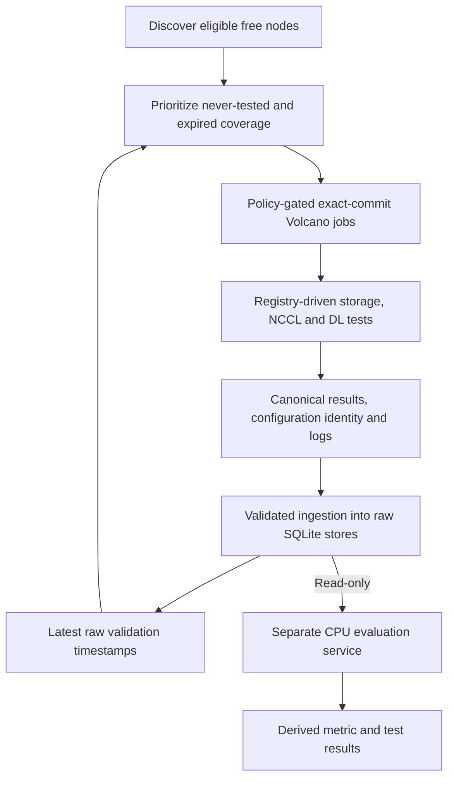

# c-val

c-val (Continuous Validation) runs repeatable, application-level tests on
available GPU nodes. It discovers eligible capacity, prioritizes missing or
stale validation coverage, submits exact-commit Volcano jobs, and preserves
test outcomes, metrics and diagnostic artifacts.

The goal is to expose selected correctness and performance problems that
Kubernetes readiness alone cannot establish, without running diagnostic GPU
workloads alongside active user GPU work.

This repository also contains a **separate CPU evaluation service** that reads
raw evidence, builds compatible baselines and publishes metric/test
classifications. The **raw c-val framework** does not evaluate, classify, score
or rank nodes. Neither component automatically cordons, drains or repairs nodes.

## How It Works



1. Check node readiness, schedulability and available GPU, CPU, memory and RDMA resources.
2. Select never-tested nodes first, then expired nodes, oldest timestamp first.
3. Render a bounded batch and submit only with explicit authorization and an exact published commit.
4. Run enabled tests in registry order, retaining configuration identity, progress, results and logs.
5. Validate canonical evidence before test-owned raw ingestion; evaluate separately.

### Enabled Tests

| Family | What it exercises | Configuration |
| --- | --- | --- |
| Storage FIO | Shared-storage read/write performance, bandwidth and IOPS | [validation-tests/storage/test_config.toml](validation-tests/storage/test_config.toml) |
| NCCL and HCA bandwidth | Single-node AllReduce over InfiniBand with HCA transmit-bandwidth tracking | [validation-tests/nccl/test_config.toml](validation-tests/nccl/test_config.toml) |
| Deep-learning unit tests | Selected numerical, compute, collective and compute/communication-overlap behavior | [validation-tests/dltest/test_config.toml](validation-tests/dltest/test_config.toml) |

These tests are not an exhaustive hardware certification or a full multi-node
fabric/training benchmark. Busy nodes may retain stale results, and diagnostic
traffic can still affect shared storage and network services.

## Quick Start

### Install Locally

Use **Python 3.11 or newer**. Run these commands from the repository root;
the editable install keeps repository-local configuration, templates and test
descriptors available.

```bash
python3 -m venv .venv
source .venv/bin/activate
python -m pip install -e .
cval --help
```

Inspect configuration and test definitions without contacting the cluster:

```bash
cval --config config/cval.toml config
cval tests list
cval tests describe nccl
cval tests validate
```

`tests validate` checks descriptors and configured resource requirements; it
does not run GPU validation. Use `--config <path>` before the subcommand, or
set `CVAL_CONFIG`, to select a different configuration.

### Inspect the Cluster

Cluster commands require an authenticated `kubectl` context and appropriate
read/exec access. Validation additionally requires Volcano, the configured
namespace/queue, GPU/RDMA resources, a shared PVC and access to the configured
source repository and container image. Status/results use the PVC access pod.
Review these environment-specific settings before use.

```bash
cval nodes --output json
cval status --output json
```

Set `CVAL_GIT_REF` to an exact published lowercase 40-hex commit from the
configured repository, then inspect the priority queue:

```bash
cval plan --live-status --git-ref "${CVAL_GIT_REF:?Set an exact published commit}"
```

`plan` only returns ordered candidates; it never renders or submits Jobs.
Include `--live-status` to use existing validation history; without a history
input, candidates are treated as never tested. Add `--output json` for automation.
The live loop checks candidate eligibility, then renders only the selected node
at confirmed submission. There is no alternate planning mode. See the
[CLI mode inventory](docs/components_design/cli-design.md#mode-inventory) for
remaining options and proposed retirements.

Inspect known job names or export raw results:

```bash
cval jobs --jobs "${CVAL_JOB_NAMES:?Set comma-separated job names}" --watch
cval results --test overall --output-dir ./exports
cval results --test nccl --output-dir ./exports
```

These commands do not change Kubernetes or source databases. `results` writes
local CSV files; its output is raw evidence, not derived health classifications.
Configuration output is always JSON and result exports are always CSV; neither
needs a format selector. Status and planning use JSON rather than legacy TSV.

## Configuration

[config/cval.toml](config/cval.toml) controls cluster access, scheduling, job
resources, storage paths, enabled tests and evaluator cadence. Each test owns
its benchmark settings, artifacts and optional evaluation policy in its
descriptor. See [docs/configuration.md](docs/configuration.md) for details.

| Setting | Checked-in default |
| --- | --- |
| Retest age | 7 days; an eligibility threshold, not a weekly coverage guarantee |
| Batch size / policy maximum | 3 / 5 jobs |
| Per-node submission cooldown | 4 hours |
| Job resources | 8 GPUs, 100 CPU, 1,500 GiB memory, one RDMA allocation; 256 GiB shared-memory volume |
| Container image | `nvcr.io/nvidia/pytorch:26.05-py3` |
| Monitoring | 100-minute timeout, 60-second polling, 20-minute pending-start timeout |
| Evaluator | Enabled in configuration; independently started/deployed, 60-second wake, 20 runs/test/pass |

Defaults can be overridden; a run's effective configuration is the relevant
reference. The all-zero default `job.git_ref` deliberately prevents accidental
submission. Pinning source does not by itself pin an image tag or external test
dependencies.

## Running Validation Safely

### One-Node Validation

Submission is a live mutation: approve the exact command, target and rollback
before executing it. Use one fully free Ready node with sufficient resources;
the targeted path supports a drained, cordoned node without uncordoning it.
Unknown state or active GPU work must block submission.

```bash
cval validate --help
```

The targeted command requires the node name, an exact published commit, the
explicit submission flag and the exact `submit` confirmation. Help and local
configuration checks do not authorize execution.

Acceptance requires a successful terminal job phase, passing required tests,
canonical results, matching exact-timestamp raw rows and retained logs. A
Completed Job alone is not proof of successful validation. Disabled tests are
not passes; incomplete evidence must remain visible.

### Quick Test Workflow

The [quick test workflow](docs/operations-runbook.md#quick-test-workflow) first
exercises discovery without submission, then prepares a separately approved
[scheduler-selected Job](ymls/test-job.yml). Volcano chooses the node; the same
tests, canonical evidence and raw DB ingestion still run. It can remain Pending
when capacity is unavailable; this is not a shortened benchmark or a promise of
immediate scheduling.

Require discovery, terminal execution, logs/results and exact-run ingestion to
pass before deeper acceptance. The workflow does not automatically start the live
loop or replace targeted acceptance and fresh live-run verification.

### Continuous Loop

[scripts/cval-live.sh](scripts/cval-live.sh) supports persistent operation and
status inspection. Every submit-capable operational command requires exact
`CVAL_LIVE_CONFIRM=submit`. Operator-issued starts also require `CVAL_GIT_REF`
to match the current remote branch tip; the script re-fetches, rejects stale
explicit commits and pins the session.

Loop start/restart, pending-job pruning, job deletion, evaluator deployment and
backup/migration each need separate authorization and rollback planning.
Pruning has its own `CVAL_PRUNE_CONFIRM=delete-pending` gate. Stopping a loop
does not delete its Kubernetes jobs. Follow
[docs/operations-runbook.md](docs/operations-runbook.md) for operational procedures.

## Evidence and Evaluation

### Authoritative Raw Evidence

Raw databases live under the configured validation root, by default
`/data/continuous_validation/metadata/`:

| Database | Contents |
| --- | --- |
| `validation.db` | Per-test `pass`, `fail`, `incomplete` outcomes and the `latest_status` freshness view |
| `test-storage.db` | FIO metrics |
| `test-nccl.db` | NCCL aggregate and InfiniBand port metrics |
| Four `dltest_*.db` files | Numerical, compute, collective and overlap metrics |

Canonical artifacts include `cval.results`, `cval.event.v1` progress, summaries
and logs. Historical `cval.results.v1` and `.v2` formats remain readable.
Ingestion checks run identity, result digests, configuration and authorized
destinations. Tests own their persistence; there is no generic per-test database
or global transaction across all seven stores.

Preserve historical databases and artifacts. They are not automatically migrated
or pruned. SQLite audits use `mode=ro` and `query_only=ON`; unavailable,
forbidden, stale, empty and incomplete evidence are distinct conditions.

### Separate Evaluation Service

The evaluator builds cohort-specific baselines from compatible observations
and publishes derived metric/test results to its own database, by default
`/evaluation/evaluation.db`. Raw sources remain read-only. Missing provenance,
thresholds or required coverage remain unclassified, not implicitly healthy.
Peer numerical consensus is not a certified correctness reference.

Validate its local settings without starting the worker or writing results:

```bash
python -m evaluation_engine --config config/cval.toml --check-config
```

Derived writes require explicit evaluation confirmation and an exact published
revision. Deployment also requires storage/locking checks and separate approval.
See [deploy/evaluation-engine/README.md](deploy/evaluation-engine/README.md) for
configuration, deployment, recovery and interpretation limits.

## Progress and Roadmap

| Milestone | Position |
| --- | --- |
| C-VAL 2.0 | Offline validation live, with separate metric/test evaluation |
| C-VAL 3.0 | Automation in development: cordoning, ticketing, vendor handoff and acceptance-gated return |
| C-VAL 4.0 | Online validation backlog: workload-correlated signals and hybrid verification |

These are capability milestones, not package versions or a fleet-health claim.
See [docs/cval-progress.md](docs/cval-progress.md) for progress, reliability
context and next steps. Automatic remediation is not current framework behavior.

## Development

Tests use Python's `unittest`. For a focused local CLI check:

```bash
python -m unittest discover -s tests -p 'test_cli.py'
```

Local tests do not replace exact-commit cluster acceptance. A new validation
test registers a repository-local `cval.test.v1` descriptor and owns its setup,
execution, artifacts and optional persistence/evaluation extensions. Start with
`cval tests describe <test-id>` and
[docs/result-schema.md](docs/result-schema.md).

### Repository Maintenance

The [cleanup review](docs/cleanup-review.md) separates obsolete prototypes and
historical planning material from live dependencies, compatibility interfaces
and recovery tools. The retired evaluation prototypes and historical planning
bundle (A and B) have been removed; the remaining candidates require separate
approval. Keep raw evidence, operational logs and rollback assets.

## Documentation

| Topic | Document |
| --- | --- |
| Technical overview and research | [docs/cval-technical-overview.md](docs/cval-technical-overview.md) |
| Progress and future work | [docs/cval-progress.md](docs/cval-progress.md) |
| Framework architecture | [docs/architecture.md](docs/architecture.md) |
| Configuration reference | [docs/configuration.md](docs/configuration.md) |
| Operations and backups | [docs/operations-runbook.md](docs/operations-runbook.md) |
| Results, progress and ingestion contracts | [docs/result-schema.md](docs/result-schema.md) |
| Evaluator deployment and operations | [deploy/evaluation-engine/README.md](deploy/evaluation-engine/README.md) |
| Cleanup candidates and retention decisions | [docs/cleanup-review.md](docs/cleanup-review.md) |
