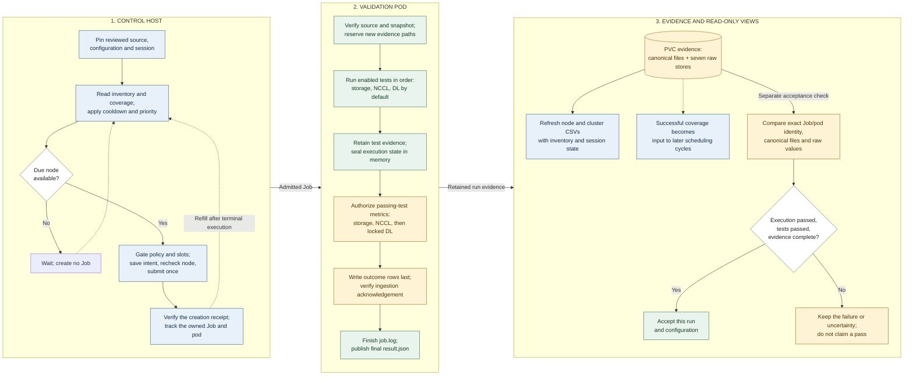
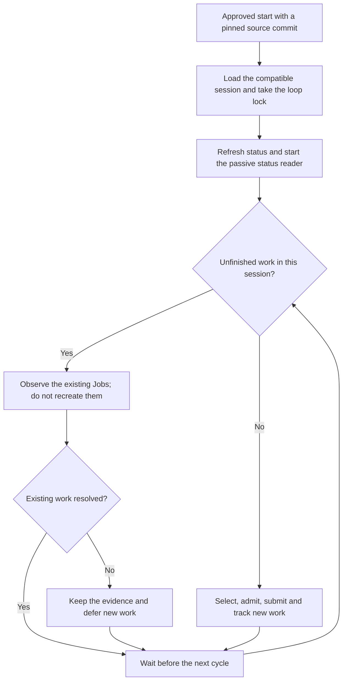
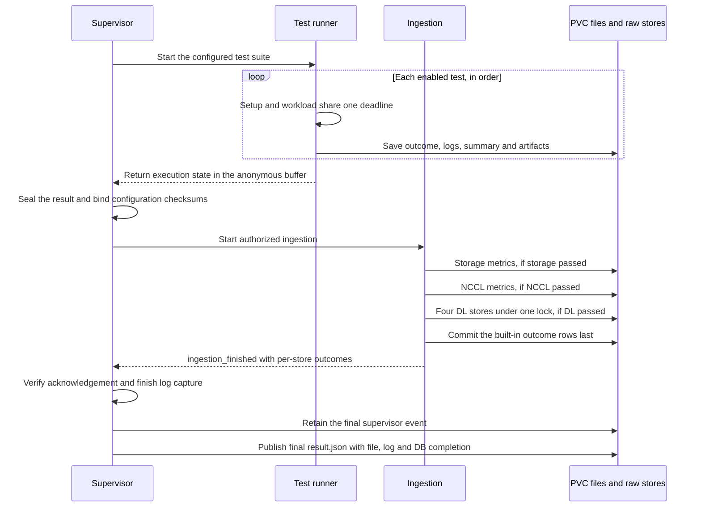

# c-val Process Flow

c-val finds available GPU nodes, runs the selected validation tests, and keeps
the results and measurements. This guide explains the implemented process,
including the decisions that allow work to continue or make it stop.

Read the [features and functionality guide](cval-technical-overview.md) for the
capability inventory and the [operations runbook](operations-runbook.md) for
approved operating procedures. This is a source-level guide, not a live-status
report or permission to start a workload.

## The Flow at a Glance

**Find a due node, prove it is available, submit once, run the tests, preserve
the evidence, then verify it.** The next scheduling decision uses successful
coverage, not merely the time of the last attempted test.

The diagram shows the normal continuous-loop path. Solid arrows show work or
data moving forward. Dotted arrows show observations and feedback. Detailed
failure handling appears below.



The loop observes and fills available slots; it does **not** perform the full
seven-store acceptance audit on every poll. The separate acceptance branch is
used by targeted validation and explicit run verification.

### A Few Useful Terms

| Term | Plain meaning |
| --- | --- |
| Controller | The host-side process that selects nodes and tracks work |
| Job / pod | A Volcano Job requests the work; its Kubernetes pod runs the container |
| Session | The pinned configuration, approval record and history for one controller scope |
| Intent / receipt | The saved request before creation / the returned creation evidence |
| Canonical evidence | The run's designated result files, logs, summaries and events |
| PVC / raw stores | Shared persistent storage / the original SQLite outcome and metric records |
| Acceptance | An evidence-backed decision that this exact run completed successfully |

## Documentation Map

Keep current contracts in the following references; design notes explain
rationale and label deferred proposals rather than repeating operating steps.

| Reference | Responsibility |
| --- | --- |
| This flow guide | Runtime flow, decisions and ownership boundaries |
| [Features and functionality](cval-technical-overview.md) | Implemented capabilities and their limits |
| [Configuration](configuration.md) | Effective settings and configuration sources |
| [Operations runbook](operations-runbook.md) | Planning contract and reviewed operational procedures |
| [Result schema](result-schema.md) | Canonical evidence and raw database contracts |
| [Operator interface](components_design/operator-interface-major-component.md#mode-inventory) | Current modes, retained compatibility and output limits |
| [Major components](components_design/major-components-overview.md) | Responsibility map, baseline measurements and component designs |
| [Redesign contracts](components_design/Redesign.md) | Implemented design decisions, evidence contracts and deferred work |
| [Development plan](components_design/redesign-development-plan.md) | Completed source phases, implementation evidence and deferred gates |

Code and effective configuration define behavior. Dated acceptance and rollout
records describe the observed revision, not an assertion of present live state.

## Controller Lifecycle

The controller runs on the control host. The tests run in Kubernetes pods.
Starting the controller does not mean a test has passed.



- One loop owner prevents two controllers from managing the same state root.
- The passive status reader refreshes reporting; it does not submit Jobs.
- Unresolved prior submissions must be observed before a new cycle can proceed.
- Stopping the controller does not delete its Kubernetes Jobs.
- Successful acceptance needs both terminal execution and verified evidence;
   a running controller or a `Completed` Job alone is insufficient.

Source: [controller lifecycle](../scripts/cval-live.sh).

## Runtime flow

### 1. Freeze the Inputs

The main TOML defines the cluster, paths, scheduling, resources and enabled tests.
Each test's TOML defines its own execution order, settings and artifacts. Both
levels must be complete; missing or unknown settings fail validation.

The effective configuration is encoded into a deterministic snapshot. When
`CVAL_CONFIG_SNAPSHOT_B64` is present, that snapshot takes precedence over loading
a TOML file. Restoring it also checks that the packaged test definitions match.
The snapshot transports reviewed settings; it is not an independent place to
invent new settings.

A submit-capable session binds the source commit, configuration, control host,
cluster, namespace and retained approval. An operator-issued loop start checks
the current published branch tip. The resulting session stays pinned; publishing
another commit does not automatically upgrade it.

Sources: [configuration loader](../cval/config.py),
[session admission](../cval/jobs/manager.py), [loop startup](../scripts/cval-live.sh).

### 2. Decide Which Nodes Are Due

For each open slot, the live loop:

1. Lists matching GPU node names. This inventory alone does not prove availability.
2. Reads successful-run coverage from raw history and canonical completion evidence.
3. Excludes nodes still within the submission cooldown.
4. Orders nodes without successful coverage first, then expired coverage oldest first.
5. Uses node name to break equal-timestamp ties and omits still-fresh coverage.

Checked-in defaults are a **seven-day coverage age**, **four-hour cooldown** and
**three concurrent Jobs**. The three-slot limit is not a limit of three Jobs per
cycle: terminal work can release a slot and the loop can refill it.

A failed recent attempt does not erase an older successful run or refresh its
coverage. The coverage reader looks back through a bounded history, currently
100 runs per node. Hitting that limit or losing access is not equivalent to
finding no history. Older passing records have an explicit age-only compatibility
path; coverage is not proof of compatibility with every image or dependency.

`plan` only shows candidates. It does not render or create Jobs. Standalone
`plan` and `run` can use a supplied node/history input; without history, nodes
appear never tested. The live loop always requests successful coverage explicitly.

Sources: [queue ordering](../cval/scheduler/priority.py),
[coverage reader](../cval/storage/status.py), [slot filling](../scripts/cval-live.sh).

### 3. Prove a Candidate Is Available

The controller walks the priority list until it finds a suitable node. One
shared eligibility implementation checks:

- An explicit Kubernetes `Ready=True` condition and GPU capacity.
- Scheduling enabled and no blocking taints for ordinary loop work.
- **Zero requested GPUs in active pods**, not just low measured GPU utilization.
- Enough unallocated GPU, CPU, memory and RDMA requests for the configured Job.
- Complete, supported node and pod evidence, including init-container requests,
  restartable init containers and pod overhead.

A busy or unsuitable node can be skipped. A failed or malformed observation stops
that selection attempt; it must not be reported as an empty cluster. Explicit
targeted validation can use a fully free Ready cordoned node without uncordoning
it. That exception does not apply to ordinary loop selection.

These checks reduce interference but are not a cluster-wide reservation against
other users. Kubernetes still schedules the pod; shared storage and network
traffic can affect other workloads.

Source: [shared node eligibility](../cval/k8s/discovery.py).

### 4. Admit and Submit Exactly Once

The selected node is rendered into the reviewed Job template. Under the shared
admission lock, the submission owner checks the configured host and cluster,
compatible session, namespace policy, confirmation, cooldown, existing Jobs and
unresolved intents. All supported package submitters share this gate.

It then saves the intent and `submitting` event, rechecks the node immediately
before creation, and calls Kubernetes once. The saved identity includes node,
timestamp, run ID, source commit, configuration digest, manifest hash and approval
hash. A successful response must match the request and provide a Job UID.

| Outcome | What happens next |
| --- | --- |
| Rejected before a create attempt | Retain `not_created` when an intent exists; do not create work |
| Valid create receipt | Retain UID and creation time; start tracking and record cooldown |
| Failed or lost create response | Retain uncertainty; reconcile by reading the existing Job, never by recreating it |
| Different UID or workload | Retain the conflict and block further admission |

The `submitting` record is deliberately saved before the external API call. This
means a crash or lost reply leaves evidence to reconcile, not an apparently empty
slot. Even a missing Job is not, by itself, proof that creation never happened.

Sources: [submission owner](../cval/jobs/manager.py),
[policy](../cval/policy.py), [renderer](../cval/jobs/renderer.py).

### 5. Execute and Preserve the Run

The bootstrap verifies the requested commit in the shared PVC Git checkout and
extracts that commit with `git archive` into a private per-Job workspace. Jobs do
not fetch code over the network or mount source ConfigMaps. It restores the
rendered runtime environment and starts the supervisor. The bootstrap itself is
embedded in the Job.

The supervisor creates a new, protected evidence layout for the run. It retains
open directory/file handles so symlinks, reused run directories or changed parent
paths cannot silently redirect canonical evidence. It also removes common
secret-bearing environment variables before starting its children.

The runner uses the registry, not a hard-coded shell chain:

| Stage | What it does |
| --- | --- |
| Initialize | Keep run identity, test definitions and starting state in an anonymous result buffer |
| Skip disabled tests | Record `enabled=false`, `selected=false`, `not_selected` and `incomplete` |
| Set up one enabled test | Run that test's setup script |
| Execute it | Run its entrypoint with the time remaining from the same test deadline |
| Record its outcome | Update buffered test state and append `CVAL_EVENT` notifications to the logs |
| Continue | Move to the next enabled test, even after an ordinary test failure |
| Finalize | Return buffered execution state to the supervisor; do not publish the final JSON yet |

The current descriptor contract requires continuation after test failure; there
is no supported fail-fast toggle. Setup failure, timeout and framework error
remain distinguishable. Interruption is different: it stops execution and leaves
the available evidence incomplete. Process-group cleanup terminates remaining
children rather than allowing benchmark processes to outlive their stage.

The default sequence is **storage (30-minute budget), NCCL (20 minutes), then
DL (40 minutes)**. Tests within one pod are sequential; separate admitted pods
can run concurrently. These are time limits, not promised completion times.

Sources: [bootstrap](../cval/jobs/bootstrap.sh),
[supervisor](../cval/validation/supervisor.py), [runner](../cval/validation/runner.py),
[child lifecycle](../cval/validation/execution.py), [test registry](../cval/validation/registry.py).

### 6. Write the Evidence

When the runner returns successfully as a program, the supervisor seals its
in-memory execution result and invokes the Python ingestion coordinator with the same
interpreter. An ordinary benchmark failure can still produce a valid result for
ingestion. A runner crash or invalid finalization is not treated as that case.

The coordinator validates node, timestamp, run ID, result checksum, frozen
configuration and allowed destinations. Every raw writer rechecks its own
authorization at the write boundary.



Registered ingestion hooks follow descriptor order, currently **storage, NCCL,
locked DL, then the atomic built-in status set**. Each hook declares its existing
raw destinations and returns per-store receipts; missing, duplicate or invalid
receipts cannot authorize the final status write. A failed or disabled test does not get fabricated performance metrics.
Its outcome can still be recorded. SQLite contention has bounded writer retries;
those retries do not rerun a test or recreate a Job.

There is no transaction across all seven databases. If a later writer fails,
earlier writes can remain. The coordinator records which stores committed or
remain unconfirmed, and acceptance stays false. The four DL stores also publish
receipts and a shared generation identifier to detect incomplete/concurrent writes.

The supervisor requires an identity-matching `ingestion_finished` acknowledgement.
An ingestion process exit code of zero, by itself, is not enough.

Sources: [ingestion coordinator](../cval/storage/run_ingest.py),
[write authorization](../cval/storage/write_provenance.py),
[storage writer](../validation-tests/storage/ingest.py),
[NCCL writer](../validation-tests/nccl/ingest.py),
[DL writer](../validation-tests/dltest/ingest.py).

### 7. Track Execution Without Confusing It With Acceptance

Normal tracking uses bounded Job/pod reads and structured progress from compact
logs. It batches Job/pod inventories, verifies ownership and follows timestamped
logs with a run-bound cursor. It does not repeatedly scan all raw stores.

Three outcomes have different meanings:

| Signal | Meaning |
| --- | --- |
| `tracking_complete` | Identity-bound execution is terminal; the slot can be released |
| `completion_confirmed` | Successful terminal execution agrees with the observed runtime and ingestion messages |
| `accepted` | The separate exact-run verifier also checked canonical files and required raw records |

A terminal failed Job can release a slot. A terminal Job with unavailable logs
can leave ingestion unconfirmed. Neither situation is a successful acceptance.
The phase-only `jobs --watch` command reports terminal/timeout state; it is not
the full evidence verifier and does not delete timed-out Jobs.

Sources: [shared observer and phase watcher](../cval/jobs/monitor.py),
[slot-release rules](../cval/jobs/manager.py).

### 8. Accept Only Matching Exact-Run Evidence

Targeted `validate` combines submission, bounded observation and exact verification.
An existing loop Job can be verified separately using its retained intent. Do
not call `validate` again to inspect it: that command requests new work.

The verification path checks:

1. The expected cluster, Job UID, requested workload and assigned owned pod.
2. Source commit, configuration and descriptor checksums against the submitted snapshot.
3. Final job result, per-test states, readable logs, summaries and ordered events.
4. A matching execution digest and successful file/log/database completion record.
5. Exact node/timestamp outcome rows and artifact-to-database metric values.
6. DL rank coverage, plan, iterations, receipts and a complete generation unchanged
   across the read.
7. Successful terminal execution, passing selected tests and no result errors.

Single-attempt acceptance also requires checking pod restart counts and exit
codes; retain those observations alongside the verifier report. Reads are bounded,
use SQLite `mode=ro` and `query_only=ON`, and never substitute a different run.

**Example:** storage fails, but the other tests finish and all required failure
evidence is recorded. Kubernetes can show `Completed`, recording can show
`fully_recorded`, and acceptance is still **false**. Execution, persistence and
test success answer different questions.

Sources: [targeted validation](../cval/orchestrator/validate.py),
[exact-run verifier](../cval/storage/verification.py).

The framework ends at verified raw evidence. No downstream evaluator,
classification, scoring or remediation service is part of this repository.

## Status Feedback

Reporting runs beside the controller. At startup and every configured refresh
interval, currently **300 seconds**, the passive reader collects node/pod state
and coverage/recording observations. It collects outside the short admission
lock, then publishes against the latest session intents. Durable intent updates
also refresh the status projection from the cached observation.

When the controller has the validation PVC mounted, successful-run coverage and
latest-status reads use the configured SQLite files directly with read-only,
query-only connections. Host-side commands without the mounted database retain
the configured PVC-reader-pod fallback. Exact Job acceptance continues to use
the dedicated bounded evidence reader; this optimization does not replace its
canonical-file and exact-run checks.

| Public output | What to read from it |
| --- | --- |
| Node-status CSV | One row per observed node: identity, coverage, attempt, recording, outcome, cooldown, availability and observation time |
| Cluster-status YAML | Matching node totals, coverage/readiness counts, recent fully recorded count and observation completeness |

The generated filenames are `node-status.csv` and `cluster-status.yaml`.
Both files carry the same `snapshot_id`. Each file is replaced atomically, but
the pair is not a single filesystem transaction. Readers must require matching
generation IDs; the framework rejects incomplete or mismatched pairs.

- `coverage_state` describes successful-run age: fresh, expired, missing or unverified.
- `recording_state` describes persistence: no results, results without a DB update,
  partial update, fully recorded or unverified.
- `test_outcome` describes pass, fail, incomplete or unknown.
- `observation_state` makes stale, unavailable, forbidden and conflicting evidence visible.

`fully_recorded` in the normal projection means canonical/status/digest agreement;
it is not a fresh seven-store acceptance audit. The recorded-in-24-hours count
can include fully recorded failures. Historical timestamps are retained when
possible without relabeling them as fresh observations. Row source/config fields
can describe an older run, not the current controller.

The CSVs are reporting outputs, not permission to submit. Admission uses fresh
checks and retained session evidence. The configured public directory contains
only these two CSVs; controller detail belongs in the private state root.

Source: [status collection and projection](../cval/storage/status.py).

## Repository Boundaries

The [live loop](../scripts/cval-live.sh) uses its
[session-state helper](../scripts/cval-live-state.py),
[cooldown helper](../scripts/cval-node-cooldown.py), CLI and configured
[pinned Job template](../ymls/specific-node-job.yml). That template launches the
supervisor, which runs the Python test runner and then directly starts
[the Python ingestion coordinator](../cval/storage/run_ingest.py). Both children
use the same interpreter; ingestion takes recorded software versions from the
sealed execution result and independently authorizes all writes. The final
public result is written only after ingestion and log/file checks. The
[environment script](../validation-tests/0-env.sh) and
[DB launcher](../validation-tests/db-update.sh) remain compatibility entry points,
not additional stages in the production supervisor path.

Both the pinned and scheduler-selected templates use one packaged
[bootstrap payload](../cval/jobs/bootstrap.sh). The
[renderer](../cval/jobs/renderer.py) embeds it before validating the executable
runtime contract. Each generated Job contains its full startup script; no
additional in-pod file or download is needed to obtain the bootstrap itself.

The controller fast-forwards the shared PVC checkout before session turnover;
each Job extracts its pinned commit from that checkout. Test directories own setup, benchmark,
log formatting, summary validation, raw parsers and SQL mapping. Their plugins
provide configuration validation, runtime/evidence projections, ingestion hooks
and read-only raw exports. The framework retains secure reservation, the safe
append primitive, process cleanup, write authorization, retries, locking and
final completion publication. Existing core writer imports forward to test-owned
implementations so historical callers remain supported. Backup, layout and SQLite journal tools belong to
evidence recovery, not post-test analysis. See the
[operator-interface inventory](components_design/operator-interface-major-component.md#phase-0-compatibility-inventory)
for compatibility decisions and the [operations runbook](operations-runbook.md)
for mutation and maintenance approval boundaries.

## Raw databases

| Store under the configured validation root | Contents |
| --- | --- |
| `metadata/validation.db` | Built-in outcome rows and the `latest_status` view |
| `metadata/test-storage.db` | FIO bandwidth and IOPS |
| `metadata/test-nccl.db` | Consolidated NCCL and HCA port measurements |
| `metadata/dltest_numerical_correctness.db` | Numerical observations from rank artifacts |
| `metadata/dltest_compute_performance.db` | Compute measurements |
| `metadata/dltest_collective_performance.db` | Collective-operation measurements |
| `metadata/dltest_overlap_performance.db` | Compute/communication overlap measurements |

`IB_HEALTH` is a retained raw table name. It contains measurements and does not
represent a framework health-class decision.

### Where a Run Lives

The default PVC root is `/data/continuous_validation`. A run ID is
`<node>-<epoch-seconds>`; timestamps are seconds, not milliseconds.

```text
<validation-root>/
   metadata/                                  authoritative raw SQLite files
   logs/job_logs/<node>/<run-id>/              job.log + final result.json
   logs/<test-id>/<node>/<run-id>/             job.log + summary.json + artifacts
      workdir/                               DL source/plan copy and rank JSON
```

Events are identifiable `CVAL_EVENT` lines in the consolidated logs. New runs
do not create separate stream/event files, result.env, per-test result.json or
an ingestion-digest file. Historical layouts remain readable and are not moved.

On the control host, `live.log_dir` holds the current-session pointer, session
state, approval/intents, Job projections, cooldown table and cycle logs. It is
separate from the PVC evidence and from `live.status_dir`, the public CSV location.

The same node, timestamp and run ID connect these layers. Source/configuration
checksums establish the experiment inputs; Job/pod UIDs distinguish actual
Kubernetes objects from another object with a reused name. The
[result schema](result-schema.md) defines the complete file and field contracts.

## Validation runtime

The [execution walkthrough](#5-execute-and-preserve-the-run) and
[ingestion sequence](#6-write-the-evidence) describe the runtime in detail.
`[tests.<id>]` selects a repository-local `cval.test.v1` descriptor. New tests can
use the same runner and canonical result format, with optional config, runtime,
export, log and ingest plugins. That extension point does not create a generic per-test database;
persistence remains test-owned. See the
[feature reference](cval-technical-overview.md#5-test-coverage-and-runtime-configuration).

## Safety boundaries

| Situation | Framework behavior / operating boundary |
| --- | --- |
| No due or currently available node | End/defer the cycle; do not manufacture a test |
| Discovery or coverage cannot be read | Fail that planning attempt; unknown is not empty |
| Submission is uncertain or conflicts with retained identity | Keep the reservation/evidence and require reconciliation; no blind replay |
| Pod remains Pending | Continue bounded observation; timeout is not permission to delete |
| Ordinary test failure | Retain failure evidence and continue later enabled tests |
| Interruption or stage timeout | Terminate the stage's process group and retain available evidence |
| Required raw write fails | Retain any earlier writes and failure acknowledgement; do not claim successful ingestion |
| Logs or evidence cannot be read | Keep unavailable/forbidden/incomplete states distinct; do not turn them into a pass |
| Controller is stopped | Stop controller activity, not already submitted Kubernetes Jobs |
| Backup, pruning, layout/journal changes or source activation | Separate maintenance workflow and explicit mutation approval |

Read-only inspection may write local reports or session projections; it does not
authorize Kubernetes changes or raw DB writes. The live loop has an optional
pending-Job pruning path behind its own confirmation gate. It is not ordinary
timeout behavior or permission to delete unrelated Jobs.

## What the Design Means

- **Coverage is opportunistic.** Seven days is an age threshold, not a guarantee
   that every busy node gets tested weekly.
- **The queue is advisory.** Node eligibility can change between planning and
   creation; admission rechecks it, and Kubernetes remains the scheduler.
- **Evidence is layered.** A terminal Job, complete recording and a passing run
   are separate facts. This prevents a failed test with good logs from appearing accepted.
- **Partial persistence is visible.** Status-last ordering, receipts and exact
   comparisons expose incomplete multi-store ingestion; they do not make seven
   stores one atomic transaction.
- **A commit is only part of reproducibility.** Image tags and external DL source
   can change. Run-local DL copies and recorded settings help trace a run, but
   there is no fleet-wide dependency-compatibility guarantee.
- **Maintenance is not the test loop.** Export, repair, backup and source delivery
   have separate entry points; none implies automatic deployment or remediation.

The original flow review used source `0760c78` on September 26, 2026; compact
logging and final-result ownership were updated on September 30. These describe
source behavior, not an activation claim. A live run is governed by its retained
snapshot, not by the defaults or examples in this document.