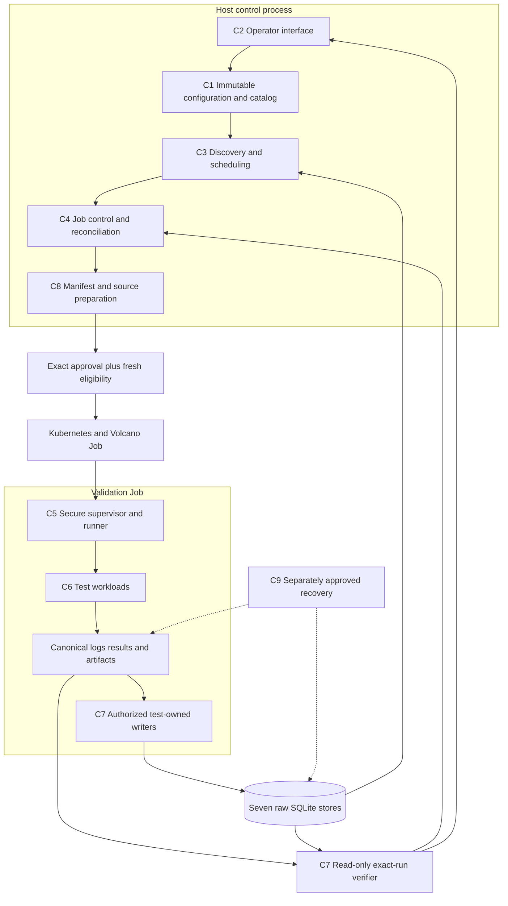
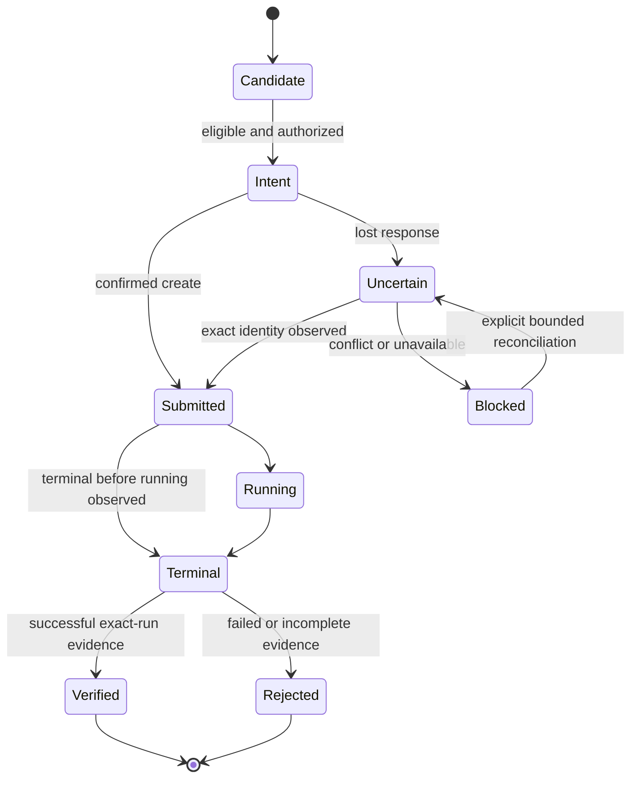

# c-val Framework Redesign

Status: design proposal, not implemented or approved for live mutation.
Baseline: `647848a6279d992d4327aecadece3a4aaf3e7b7e`, 2026-09-23.
Start with the [major-component map](major-components-overview.md); it owns the
component inventory, measured sizes and individual design links.

## Goal and Scope

Build a small, deterministic framework that discovers eligible GPU capacity,
executes registered validation tests and proves that each run's logs, results
and test-owned raw rows were retained correctly. Redesign ownership from first
principles, but migrate working behavior incrementally rather than replacing
the deployed framework in one rewrite.

The endpoint is verified raw evidence. There is no post-processing engine,
baseline service, health classification, ranking, remediation, automatic cordon
or automatic cleanup. Historical data from removed services stays untouched.

## Design Decisions

| Decision | Reason |
| --- | --- |
| One Python package; nine logical components | Separate responsibilities without nine services or new deployment overhead. |
| One active host controller per configured scope | Keep bounded scheduling and recovery understandable; multi-controller HA is not an initial goal. |
| One supervisor and registry-driven runner per Job | Preserve secure evidence ownership and test isolation. |
| Kubernetes/Volcano, kubectl and shared PVC remain | Reuse the current platform; do not add an operator, broker or scheduler backend. |
| Current seven raw stores remain test-owned | Preserve provenance and avoid a generic per-test database or dual-write history. |
| Existing Python/stdlib/PyYAML stack | No ORM, dependency-injection container or general plugin framework. FIO/PyTorch remain workload engines. |
| Exact source and immutable inputs | A run must be reproducible and attributable, not dependent on mutable ambient defaults. |

## Highest-Impact Gaps

These are source-review findings, not evidence of a current cluster incident.

| Area | Baseline Gap | Design Response |
| --- | --- | --- |
| Safety | Eligibility differs by call path; batch failures can lose receipts | C3 decision function plus C4 fresh create gate and durable reconciliation. |
| Correctness | Node-only metric joins and log/status-only acceptance | C7 exact-run verification reused by exports and acceptance. |
| Efficiency | Shell conversions, repeated subprocesses and duplicated monitors | One bounded Python lifecycle pass with structured inputs/results. |
| Maintainability | Dual evidence setup and repeated DL transaction bookkeeping | Reuse existing secure owners; consolidate mechanics without removing checks. |
| Reproducibility | Mutable benchmark dependencies and implicit runtime packaging | Pin C6 dependency identity and test C8 archive dependency closure. |

## Target Architecture

The controller owns lifecycle, not raw measurement interpretation. Test workloads
cannot authorize jobs. Evidence readers cannot repair databases. Source rendering
cannot activate a deployment. Recovery tools remain outside the normal run path.

## Component Contracts

Names below describe proposed in-process data contracts, not new public schemas.
Reuse existing dataclasses and serialization where possible.

| Contract | Owner | Minimum Contents | Consumer |
| --- | --- | --- | --- |
| Run definition | C1 | Exact source, immutable config/digests, ordered tests, resource requirements | C3-C8 |
| Observation/eligibility | C3 | Node identity, observation time, config identity, capacity, explicit state/reasons | C4 and CLI |
| Candidate | C3 | Node, complete coverage timestamp, priority reason | C4 |
| Intent/receipt | C4 | Run/job/node identity, manifest/config/source hashes, outcome and observed UID | Resume and reporting |
| Canonical result/events | C5 | Existing `cval.results` and `cval.event.v1`; paths, outcomes and provenance | C7 and operators |
| Test measurements | C6 | Test-owned summary/artifacts and explicit persistence requirements | Specific C7 writer |
| Evidence verification | C7 | Exact-run canonical checks, per-store rows/receipts, missingness and error states | C4 acceptance and C2 export |
| Source receipt | C8 | Published SHA, archive hash, immutable object identity | C4 and release approval |
| Maintenance plan/receipt | C9 | Scope, identities, capacity, backup/plan hashes and operation state | Approved recovery only |

Configuration is resolved once per operation. Snapshot or environment input that
disagrees with that definition is an error, not an override. New extension points
must have a real caller and a versioned contract; no speculative plugin capabilities.

## End-to-End Process

1. Resolve reviewed configuration and the test catalog; verify exact published
   source. Read-only commands remain useful without any mutation approval.
2. Read inventory and committed validation history with bounded calls. Build a
   deterministic queue; show unavailable history separately from an empty database.
3. C4 excludes cooldown/outstanding work and selects a slot. Render only that Job,
   fixing run/job identity, source/config identity and the manifest digest.
4. Record that exact intent durably and bind its approval. This operational record
   is not a raw result, a capacity reservation or permission for another action.
5. Recheck complete eligibility through C3 immediately before the approved create.
   Automatic scheduling excludes cordoned nodes; explicit targeted validation may
   use a drained cordoned node, never active GPU work or unknown state. Submit
   through the single mutation boundary and preserve each outcome immediately.
6. In-pod bootstrap verifies source; the supervisor reserves evidence and runs
   enabled tests in catalog order with bounded process-group cleanup.
7. Bind the canonical result. Write required passing-test metrics, then the final
   built-in status transaction. Preserve partial evidence on failure.
8. Observe terminal Job phase and run the C7 exact-run verifier. Acceptance requires
   successful execution, expected test outcomes, provenance, ingestion completion
   and matching raw evidence. A Completed Job alone is insufficient.
9. Retain logs, receipts, failures and unresolved work; proceed to another candidate
   only when slot state is known. No automatic prune, repair or rollout follows.

Freshness describes coverage, not health. A complete failing run is an observation;
missing required coverage is not fresh. Retry/cooldown must prevent failure storms
without hiding failures or redefining them as passes.

## Lifecycle and Failure Handling

| Failure | Required Behavior |
| --- | --- |
| Discovery timeout or forbidden read | Stop selection; do not treat it as no nodes or fresh history. |
| Node becomes busy | Reject/requeue without create; keep the reason. A prior read is not a reservation. |
| Create response lost | Reconcile the same identity; no blind resubmit or deletion. |
| Partial batch failure | Return created, uncertain, failed and unattempted identities. |
| Restart after create but before receipt | Recover from durable intent and matching Job identity; reject name/UID conflicts. |
| Job missing, API unavailable or unknown phase | Keep those distinct; none implies successful acceptance. |
| Test timeout/signal | Stop only owned child groups, retain logs and incomplete outcomes. |
| Metric write fails after another commits | No final status; retain partial stores; retry idempotently under the existing rules. |
| Evidence disagrees or cannot be read | Report unverified/conflicting/unavailable, never infer pass. |
| Maintenance interruption | Retain transaction manifest; separately approve validated resume or rollback. |

The supported deployment starts with one active controller. Local process locks
alone do not prove cross-host exclusivity; verify ownership before starting a
replacement. Do not claim exactly-once creation or race-free capacity from reads.

## Storage and Security

Keep canonical paths and historical readers. New schema changes are additive;
this redesign proposes no bulk migration, history deletion or normalized DB.
Authoritative raw evidence stays under metadata, separate from operational session
receipts and human-readable reports.

Retain descriptor-backed filesystem reservation, symlink/identity checks,
immutable result/config authorization, POSIX DL locking, completed-generation
checks, SQLite lock retries and status-last publication. Do not eliminate
write-boundary checks merely because the coordinator already validated inputs.

All audits use read-only SQLite connections and `query_only=ON`. Bounded reads
must surface partial coverage. Retain logs without secrets; approvals bind scope,
source/config/manifest identity and rollback. A CLI confirmation never authorizes
unrelated deletion, DB repair, backup, migration or workload restart.

## Lean Code Organization

Reuse the current package families; names below describe target responsibility,
not a requested directory migration:

| Existing Area | Target Responsibility |
| --- | --- |
| `config`, shared models, registry | Resolve immutable definitions and typed internal contracts. |
| CLI | Parse, call owners, format output; no duplicate lifecycle policy. |
| Kubernetes adapter and scheduler | Bounded structured reads and pure eligibility/priority functions. |
| Jobs and orchestrator | One controller state transition path, submission and reconciliation. |
| Validation runtime | Secure reservation, test state machine, process execution and result formats. |
| Workload directories | Test-specific setup, execution, summaries and adapters. |
| Storage | Explicit test writers plus shared read-only verification. |
| Scripts and templates | Thin launchers, source preparation and separately invoked recovery. |

Keep the useful code already present: candidate-only planning, the shared bootstrap,
the direct Python ingestion coordinator and the pure priority function. Avoid
rebuilding them. Reduce duplicated transitions and format conversions, not line
counts through dense code, moved files or deleted safety tests.

## Implementation Strategy

Each row is an independently reviewable phase, not permission for a live action.
Runtime changes must publish an isolated exact commit and pass separately approved
cluster acceptance before activation. Do not run old and new writers in parallel.

| Phase | Components | Change | Exit Evidence |
| --- | --- | --- | --- |
| 0. Agree boundaries | All | Review these docs; inventory external callers and representative fixtures. | Explicit ownership, retained contracts and scoped acceptance criteria. |
| 1. Close correctness gaps | C1-C4, C7 | Config propagation, one eligibility gate, partial receipts, exact-run exports/verification. | Busy/unknown/stale/partial-create regressions and passing exact-run fixtures. |
| 2. Consolidate control | C2-C4 | Replace duplicate shell orchestration one path at a time. | Equivalent cooldown/resume/prune behavior; lower measured subprocess/API counts. |
| 3. Simplify secure runtime | C1, C5-C6 | Shared evidence reservation and compatibility mapping; pin dependencies. | Hostile-path/signal tests; identical outcomes/artifacts; measured startup cost. |
| 4. Consolidate persistence | C6-C7 | Private DL transaction helper; bounded exact-run readers. | Unchanged seven-store rows/receipts and failure-injection results. |
| 5. Finish delivery/recovery | C8-C9 | Runtime bundle closure, combined recovery tests and CI checks. | Offline startup, smaller measured bundle, restore verification and preserved history. |
| 6. Retire proven redundancy | C2 and docs | Remove approved unused interfaces and stale duplicate explanations. | Caller migration evidence, link checks and no lost operational contract. |

Before each phase: use the narrowest existing tests and record baseline behavior.
For controller refactors, replay saved/fake observations without submitting Jobs.
For writers, compare temporary stores and failure cases, never shadow-write live
raw data. After acceptance, activate only the reviewed source/config; verify a
fresh run independently of push or ConfigMap creation.

Rollback is explicit, not automatic: stop only the approved controller, reconcile
its outstanding Jobs and choose a reviewed compatible source. Never downgrade a
writer after an incompatible storage change or restore raw DBs over newer writes.

## Verification and Efficiency Measures

| Measure | Evidence | Constraint |
| --- | --- | --- |
| Component size | Exact-commit physical counts in the overview | Source, config and tests separate; no arbitrary reduction quota. |
| Controller overhead | CLI subprocesses/API calls and duration per fixture/pass | No stale cached eligibility at create. |
| Startup cost | Setup seconds and GPU reservation time | Same benchmark settings and dependency identities. |
| Evidence correctness | Canonical digests, exact rows, receipts and generations | No mismatched timestamps or lost historical readers. |
| Bundle size | Compressed bytes and unpacked offline startup | Keep all runtime dependencies and prior rollback artifacts. |
| Recovery | Restored identities, rows, artifacts and metadata | Capacity/quiescence gates remain mandatory. |

CI should run offline unittest, shell syntax, descriptor validation and documentation
link checks. Reuse fixtures for pure state-machine and error-contract testing.
Local success is not deployed acceptance; no throughput or cost improvement is
claimed before measurement on a comparable workload.

## Documentation Strategy

| Document | Owns |
| --- | --- |
| [Major-component overview](major-components-overview.md) | Component map, baseline measurements and links. |
| This document | Proposed architecture, contracts, process and migration strategy. |
| Individual component pages | Current responsibility, issues, ratings and proposed design. |
| [Current architecture](../architecture.md) | Implemented runtime, not future promises. |
| [Configuration](../configuration.md), [runbook](../operations-runbook.md), [result schema](../result-schema.md) | Current settings, operating commands and data formats. |
| [Cleanup review](../cleanup-review.md) | Dated accepted work and preserved historical evidence. |

Carry useful current contracts into replacement pages before deleting superseded
notes. Repair all incoming links. Keep historical observations explicitly dated;
do not read or modify conversation archives or user-owned untracked files.

## Decisions Before Implementation

Confirm external users before retiring aliases/writer hooks; validate Kubernetes
request edge cases against the deployed version; agree coverage/freshness behavior
when enabled tests change; choose the pinned image/DL-source supply process.
These decisions affect implementation details, not the raw-only scope or safety
requirements. No new service, database or public plugin capability is authorized
by this document.
