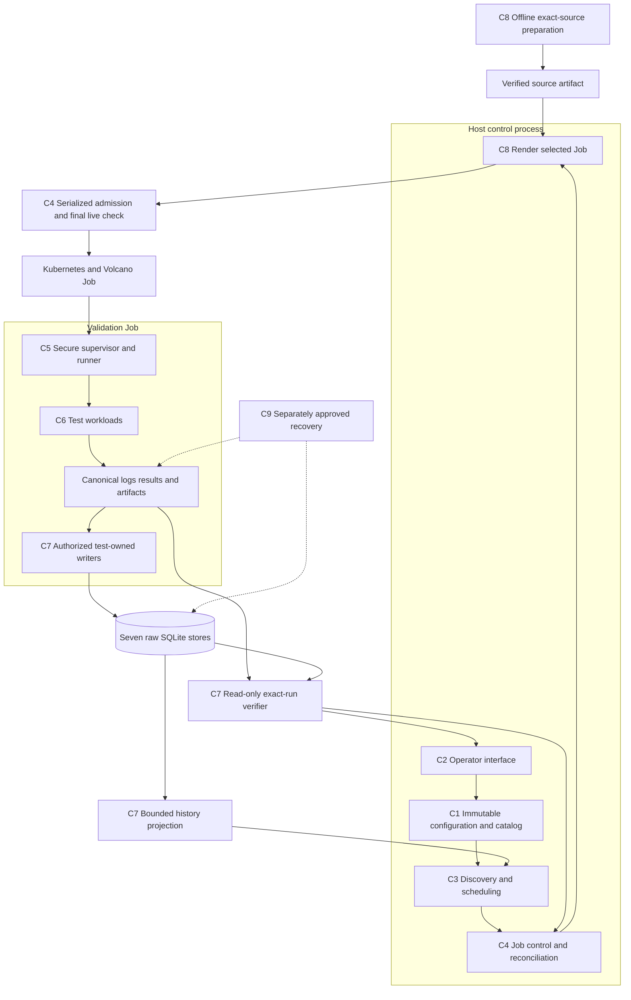
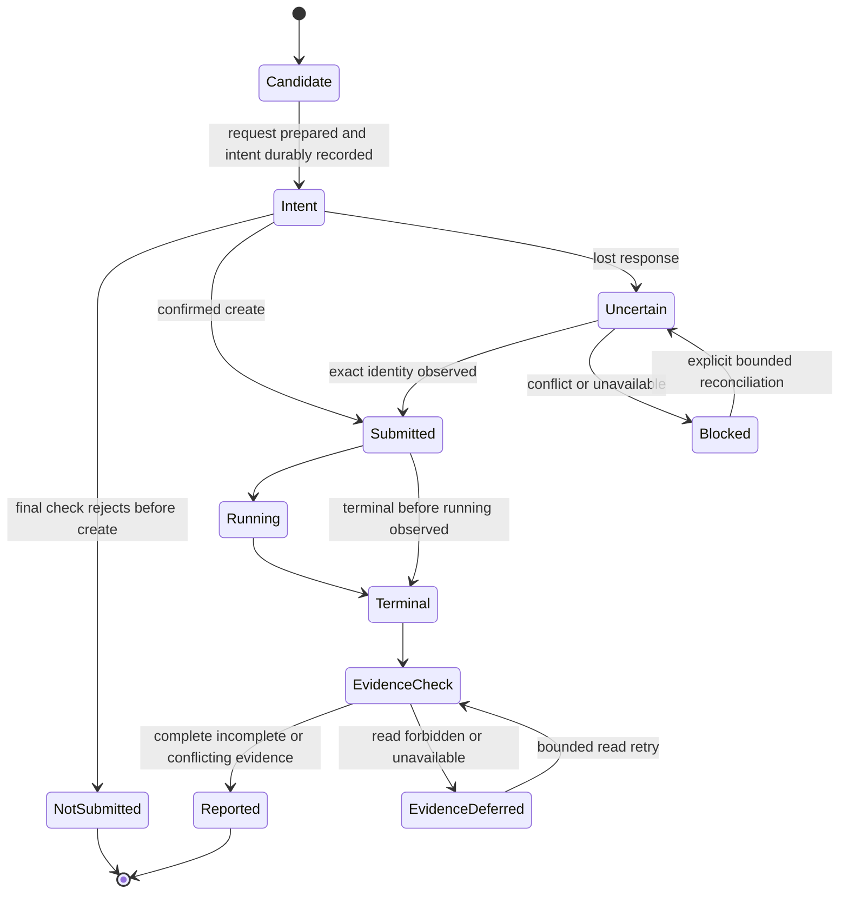

# c-val Framework Redesign

Status: design proposal, not implemented or approved for live mutation.
Baseline: `647848a6279d992d4327aecadece3a4aaf3e7b7e`, 2026-09-23.
Direction update after `301d109`: minimal component boundaries and real-node
runtime validation; source-size baseline unchanged.
Start with the [major-component map](major-components-overview.md); it owns the
component inventory, measured sizes and individual design links.

## In Simple Terms

The controller chooses when a test may start; the Job runs it; the evidence layer
checks what was saved. A failed test with complete records is useful evidence,
not a successful validation. A finished Job with unreadable records is unverified.
Simplification means fewer independent decisions, not fewer safety checks.

## Goal and Scope

Build a small, deterministic framework that discovers eligible GPU capacity,
executes registered validation tests and proves that each run's logs, results
and test-owned raw rows were retained correctly. Redesign ownership from first
principles, but migrate working behavior incrementally rather than replacing
the deployed framework in one rewrite.

The primary goal is clear ownership with less code: one decision in one place,
few handoffs and no duplicate execution paths. The nine component labels are a
working responsibility map, not a required module count. Merge a boundary that
only forwards data; keep separation where authority, lifecycle or data ownership differs.

The endpoint is verified raw evidence. There is no post-processing engine,
baseline service, health classification, ranking, remediation, automatic cordon
or automatic cleanup. Historical data from removed services stays untouched.

## Design Decisions

| Decision | Reason |
| --- | --- |
| One Python package; logical ownership boundaries | Reuse functions/modules; component names do not require new classes, wrappers or services. |
| One designated control host with serialized submitters | Controller, `run` and `validate` share admission state/locking; no automatic cross-host failover. |
| One supervisor and registry-driven runner per Job | Preserve secure evidence ownership and test isolation. |
| Kubernetes/Volcano, kubectl and shared PVC remain | Reuse the current platform; do not add an operator, broker or scheduler backend. |
| Current seven raw stores remain test-owned | Preserve provenance and avoid a generic per-test database or dual-write history. |
| Existing Python/stdlib/PyYAML stack | No ORM, dependency-injection container or general plugin framework. FIO/PyTorch remain workload engines. |
| Exact source and immutable inputs | Make inputs attributable; do not promise identical timings or hardware conditions. |

### Alternatives Not Selected

| Alternative | Why Not Now |
| --- | --- |
| New operator, broker or workflow engine | Adds state/deployment failure modes without solving the known local contracts. |
| Rewrite all components at once | Makes evidence and behavior differences hard to attribute or roll back. |
| Normalize every test into one new database | Conflicts with test-owned persistence and requires unnecessary historical migration. |
| Remove path/identity checks or historical readers for line count | Reduces safety/compatibility, not duplicated responsibility. |

Reconsider a choice only with measured need and a separately reviewed scope change.

## Highest-Impact Gaps

These are source-review findings, not evidence of a current cluster incident.

| Area | Baseline Gap | Design Response |
| --- | --- | --- |
| Safety | Eligibility differs by call path; batch failures can lose receipts | C3 decision function plus C4 fresh create gate and durable reconciliation. |
| Correctness | Node-only metric joins and log/status-only acceptance | C7 exact-run verification reused by exports and acceptance. |
| Efficiency | Shell conversions, repeated subprocesses and duplicated monitors | One bounded Python lifecycle pass with structured inputs/results. |
| Maintainability | Dual evidence setup and repeated DL transaction bookkeeping | Reuse existing secure owners; consolidate mechanics without removing checks. |
| Reproducibility | Mutable benchmark dependencies and implicit runtime packaging | Pin C6 dependency identity and test C8 archive dependency closure. |

## Target Architecture

The controller owns lifecycle, not raw measurement interpretation. Test workloads
cannot authorize jobs. Evidence readers cannot repair databases. Source rendering
cannot activate a deployment. Recovery tools remain outside the normal run path.
Source preparation happens once per reviewed release, not per candidate. C7 readers
run through the existing read-only PVC-access mechanism; no network data service
or full rank-metric scan is required for every scheduling pass.

## Component Contracts

Names below describe proposed in-process data contracts, not new public schemas.
Reuse existing dataclasses and serialization where possible.

| Contract | Owner | Minimum Contents | Consumer |
| --- | --- | --- | --- |
| Run definition | C1 | Exact source, immutable config/digests, selected test set, resource requirements | C3-C8 |
| Observation/eligibility | C3 | Node name/UID, observation time, config identity, capacity, state/reasons | C4 and CLI |
| Candidate | C3 | Node, compatible coverage timestamp, priority reason | C4 |
| Intent/receipt | C4 | Scope, run/job/node identity, requested-manifest/config/source hashes, approval binding and observed UID | Resume and reporting |
| Canonical result/events | C5 | Existing `cval.results` and `cval.event.v1`; paths, outcomes and provenance | C7 and operators |
| Test measurements | C6 | Test-owned summary/artifacts and explicit persistence requirements | Specific C7 writer |
| Evidence verification | C7 | Expected identity, raw outcome, outcome-specific completeness, per-source observations and limits | C4 acceptance and C2 export |
| Source receipt | C8 | Published SHA, archive hash, immutable object identity | C4 and release approval |
| Maintenance plan/receipt | C9 | Scope, identities, capacity, backup/plan hashes and operation state | Approved recovery only |

Configuration is resolved once per command or controller session, then frozen.
Snapshot/environment disagreement is an error, not an override. Restart/admission
must not silently adopt an edited config. New fields need compatibility/version
decisions; these conceptual contracts do not require a new type for every table row.

## Invariants and Trust

| Invariant | Owner and Enforcement Point |
| --- | --- |
| No create without matching approval, durable intent and fresh eligibility | C4 admission, using C1 inputs and C3 observations. |
| No supported submitter bypasses node/slot reservations | C4 shared admission lock on the designated host. |
| No acceptance from logs, Job phase or latest status alone | C4 acceptance over C7's exact-run evidence report. |
| No status publication after required metric-write failure | C7 coordinator plus independent writer authorization. |
| No run-ID reuse to retry workloads | C4 intent allocation and C5 canonical reservation. |
| No implicit backup, repair, prune or rollout | Separate C8/C9/operator approvals; not a consequence of another command. |

Trust reviewed repository/adapters and the controlled runtime image as executable
code. Hashes prove correspondence to trusted expected inputs, not authorship or
security against a privileged actor who can alter both evidence and expectations.
Descriptor/path guards are necessary but do not sandbox malicious workload code.
Keep credentials out of retained snapshots/logs and use the minimum required access.

## Outcome and Evidence Contract

Keep these dimensions separate in reports; do not replace existing raw outcome
values or historical formats with a new combined status.

| Dimension | Question | Examples |
| --- | --- | --- |
| Execution | What happened to the identified Job? | Pending, Running, terminal, Missing, observation unavailable |
| Test outcome | What did the selected tests report? | pass, fail, incomplete; disabled is not pass |
| Evidence | Are the records expected for that outcome present and consistent? | complete, incomplete, conflicting, forbidden, unavailable |
| Acceptance | Is this requested validation proven successful? | Accepted only when the nonempty requested test set and every positive check are satisfied |

### Run Result Categories

Proposed display labels, derived from existing Job observations, canonical results
and exact-run raw records. No new database, persisted status enum or reporting
framework is needed. Show the affected tests when a run has mixed progress.

| Category | Meaning | Required Distinction |
| --- | --- | --- |
| Not selected | The test was disabled or outside the reviewed request. | Not a pass; an unexpectedly omitted required test blocks acceptance. |
| Not started | No workload execution is confirmed, and available evidence establishes it has not run. | Show waiting/queued versus rejected, setup-failed or cancelled-before-start; missing logs alone prove neither. |
| Running | A selected workload is currently executing. | Results and DB writes are not yet expected to be complete. |
| Ran incompletely | Execution started but the requested workload did not finish. | Record timeout, interruption or remaining unrun tests; retained diagnostics may still be complete. |
| Finished without usable results | Execution finished, but its required canonical result or outputs are absent/unusable. | Process exit alone is not a valid test result. |
| Results produced; DB not updated | Usable results exist, but none of the required raw writes are confirmed. | With successful reads, distinguish pending/in-progress ingestion from an ended/failed ingestion. |
| Results produced; DB partly updated | Some required writes exist, but the exact-run metric/status publication is incomplete. | Keep partial rows; never call this complete or blindly rerun the workload. |
| Fully recorded | Execution finished, required results/logs are valid, and all required raw writes match. | Show test pass/fail separately; a fully recorded failed test is still failed. |

Do not force uncertainty into a progress category:

| Observation State | Meaning | Action |
| --- | --- | --- |
| Cannot verify | A necessary read is forbidden, unavailable or stale. | Preserve the specific cause and last known facts; do not infer not-run or no-DB-update. |
| Conflicting evidence | Observed identities, outcomes, digests or records disagree. | Show the conflict; do not choose whichever source looks successful. |

Choose the first unmet stage: selection, execution, usable results, then required
DB publication. Incomplete execution stays incomplete even when its diagnostic
records were fully saved. Always retain the independent test outcome and DB state
(`not required`, `pending`, `none`, `partial`, `complete`, or `unverified`).
A result-only test uses `not required`, not a false DB-write failure. A transient
pending/partial write while ingestion is active is progress, not yet a failed write.

Acceptance requires a successful terminal Job, a nonempty satisfied request,
passing required tests and complete verified evidence. Fully recorded failure,
incomplete execution and unverifiable results are not accepted.

Expected evidence depends on the immutable selected test set and each outcome.
Passing built-ins require their metric evidence; failed tests do not require
passing metrics that were deliberately not written. A registered result-only
test needs canonical evidence but no invented raw database. C6 defines these
test-owned requirements; C7 checks them and C4 decides acceptance.
Disabled catalog entries are not failures by themselves; disabling a test required
by the reviewed request makes that request unsatisfied. Preserve existing aggregate
semantics for all selected enabled tests; optional-pass behavior is not introduced.

Job observations come from Kubernetes; run/test identity and outcome come from
canonical results; ingestion completeness comes from matching raw rows/receipts
and provenance. Progress logs help diagnosis but cannot override any of these.
Contradictions are reported, not resolved by selecting the most favorable source.

## End-to-End Process

1. Resolve reviewed configuration and the test catalog. Admission verifies known-
   published exact source; local descriptor/config inspection does not require a
   remote query or mutation approval.
2. Read inventory and committed validation history with bounded calls. Build a
   deterministic queue; show unavailable history separately from an empty database.
3. C4 excludes cooldown/outstanding work and selects a slot. Render only that Job,
   fixing run/job identity, source/config identity and the manifest digest.
4. Record that exact intent durably and bind its approval. This operational record
   is not a raw result, a capacity reservation or permission for another action.
5. Recheck complete eligibility through C3 immediately before the approved create.
   Automatic scheduling excludes cordoned nodes; explicit targeted validation may
   use a drained cordoned node, never active GPU work or unknown state. Submit
   through the single mutation boundary and preserve each outcome immediately.
6. In-pod bootstrap verifies source; the supervisor reserves evidence and runs
   enabled tests in catalog order with bounded process-group cleanup.
7. Bind the canonical result. Write required passing-test metrics, then the final
   built-in status transaction. Preserve partial evidence on failure.
8. Observe terminal Job phase and run the C7 exact-run verifier. Report execution,
   test outcome and evidence separately; derive acceptance using the
   [outcome and evidence contract](#outcome-and-evidence-contract).
9. Retain logs, receipts, failures and unresolved work; proceed to another candidate
   only when slot state is known. No automatic prune, repair or rollout follows.

Freshness describes compatible workload coverage, not health or evidence completeness.
A setup failure can be fully documented without exercising the workload. C3 owns
the [coverage policy](discovery-scheduling-major-component.md#coverage-policy);
C4 owns observation age at create and cooldown. No retry storm or hidden pass inference.

## Lifecycle and Failure Handling

`Reported` means the facts are recorded, not that the run passed. Acceptance is
computed from the separate dimensions above. Deferred observation does not
rewrite a test outcome or authorize another Job for the same run.

| Failure | Required Behavior |
| --- | --- |
| Discovery timeout or forbidden read | Stop selection; do not treat it as no nodes or fresh history. |
| Node becomes busy | Reject/requeue without create; keep the reason. A prior read is not a reservation. |
| Intent cannot be persisted | Do not create; fix state durability before admitting work. |
| Create response lost | Reconcile the same identity; no blind resubmit or deletion. |
| One NotFound after a lost response | Preserve uncertainty; absence in one read does not prove the request never took effect. |
| Partial batch failure | Return created, uncertain, failed and unattempted identities. |
| Receipt write fails after successful create | Stop admission; retain intent and returned identity for recovery. |
| Restart after create but before receipt | Recover from durable intent and matching Job identity; reject name/UID conflicts. |
| Job missing, API unavailable or unknown phase | Keep those distinct; none implies successful acceptance. |
| Test timeout/signal | Stop only owned child groups, retain logs and incomplete outcomes. |
| Metric write fails after another commits | No final status; retain partial stores; retry idempotently under the existing rules. |
| Evidence disagrees or cannot be read | Report unverified/conflicting/unavailable, never infer pass. |
| Maintenance interruption | Retain transaction manifest; separately approve validated resume or rollback. |

Use the [C4 admission protocol](job-control-major-component.md#admission-and-recovery-protocol),
not separate `run`/`validate` locks. Unknown ownership, admission uncertainty and
pending required verification retain tracked capacity within the existing inflight
budget. No automatic ownership takeover follows a lost heartbeat or local lock.
Reconciliation compares expected workload fields as well as identities, not raw
object hashes after Kubernetes defaulting. Exactly-once creation is not promised.

## Storage and Security

Keep canonical paths and historical readers. New schema changes are additive;
this redesign proposes no bulk migration, history deletion or normalized DB.
Authoritative raw evidence stays under metadata, separate from operational session
receipts and human-readable reports.

Retain descriptor-backed filesystem reservation, symlink/identity checks,
immutable result/config authorization, POSIX DL locking, completed-generation
checks, SQLite lock retries and status-last publication. Do not eliminate
write-boundary checks merely because the coordinator already validated inputs.

All audits use read-only SQLite connections and `query_only=ON`. Bounded reads
must surface partial coverage. Retain logs without secrets; approvals bind scope,
source/config/manifest identity and rollback. A CLI confirmation never authorizes
unrelated deletion, DB repair, backup, migration or workload restart.
DL generation changes during a read cause a bounded retry/deferred report, not a
historical-data rewrite. Retain old-format readability without inventing missing
provenance. Passing evidence checks must use expected identity from the request,
not merely self-consistency among observed files.

## Lean Code Organization

Reuse the current package families; names below describe target responsibility,
not a requested directory migration:

| Existing Area | Target Responsibility |
| --- | --- |
| `config`, shared models, registry | Resolve immutable definitions and typed internal contracts. |
| CLI | Parse, call owners, format output; no duplicate lifecycle policy. |
| Kubernetes adapter and scheduler | Bounded structured reads and pure eligibility/priority functions. |
| Jobs and orchestrator | One controller state transition path, submission and reconciliation. |
| Validation runtime | Secure reservation, test state machine, process execution and result formats. |
| Workload directories | Test-specific setup, execution, summaries and adapters. |
| Storage | Explicit test writers plus shared read-only verification. |
| Scripts and templates | Thin launchers, source preparation and separately invoked recovery. |

Keep the useful code already present: candidate-only planning, the shared bootstrap,
the direct Python ingestion coordinator and the pure priority function. Avoid
rebuilding them. Reduce duplicated transitions and format conversions, not line
counts through dense code, moved files or deleted safety tests.

Before adding code, name the owner and the duplicate behavior being removed.
Selecting a node (C3), authorizing/creating its Job (C4), executing its tests
(C5/C6), and publishing its raw records (C7) remain distinct authorities.
Configuration, CLI and release tools support this path; they must not duplicate it.

## Implementation Strategy

The [redesign development plan](redesign-development-plan.md) owns the ordered
phases, task checklists, changes, dependencies and completion criteria. Agree
contracts first, close correctness gaps, then consolidate control, runtime and
persistence before delivery hardening and approved compatibility retirement.
The plan distinguishes preferred rollout order from actual prerequisites. Phase 0
defines real-node checks through existing tools, not a new automated-test framework.

Each change is independently reviewable, not permission for a live action.
Runtime changes must publish an isolated exact commit and pass the plan's
[release gate](redesign-development-plan.md#release-gate) before activation.
Do not run old and new writers in parallel.

Before each phase, record known behavior and the exact real-node verification needed.
Use retained real evidence for read-only comparisons. New execution, controlled
failures, DB writes and maintenance need their exact approvals; never run duplicate
writers or corrupt evidence for a check. After acceptance, activate only the
reviewed source/config and verify fresh execution independently of publication.

Rollback is explicit, not automatic: stop only the approved controller, reconcile
its outstanding Jobs and choose a reviewed compatible source. Never downgrade a
writer after an incompatible storage change or restore raw DBs over newer writes.

## Verification and Efficiency Measures

| Measure | Evidence | Constraint |
| --- | --- | --- |
| Component size | Exact-commit physical counts in the overview | Source, config and tests separate; no arbitrary reduction quota. |
| Controller overhead | CLI subprocesses/API calls and duration per real cycle/run | No stale cached eligibility at create. |
| Startup cost | Setup seconds and GPU reservation time | Same benchmark settings and dependency identities. |
| Evidence correctness | Canonical digests, exact rows, receipts and generations | No mismatched timestamps or lost historical readers. |
| Bundle size | Compressed bytes and successful startup in the real Job | Keep all runtime dependencies and prior rollback artifacts. |
| Recovery | Restored identities, rows, artifacts and metadata | Capacity/quiescence gates remain mandatory. |

### Real-Node Validation Policy

Runtime validation uses real workloads on fully free eligible real nodes at the
exact published commit. Reuse current submission, observation and read-only
evidence commands; no fake nodes/Jobs, fabricated results, simulation harnesses
or new wrapper scripts. Keep the procedure in the existing runbook.

Local syntax, manifest and documentation checks are useful content checks, not
runtime acceptance. Existing test code is not automatically deleted, but adding
synthetic coverage or a separate CI test project is not redesign work.

Record what was actually exercised. Retained real failures can support analysis;
unsafe or absent failure cases stay unverified. Do not fault a busy node, damage
raw data or weaken acceptance to complete a checklist. No live mutation is
authorized by this policy; use the exact approval and rollback gates each time.

## Documentation Strategy

| Document | Owns |
| --- | --- |
| [Major-component overview](major-components-overview.md) | Component map, baseline measurements and links. |
| This document | Proposed architecture, contracts, process and migration principles. |
| [Development plan](redesign-development-plan.md) | Ordered phases, task checklists, expected changes and completion gates. |
| Individual component pages | Current responsibility, issues, ratings and proposed design. |
| [Current architecture](../architecture.md) | Implemented runtime, not future promises. |
| [Configuration](../configuration.md), [runbook](../operations-runbook.md), [result schema](../result-schema.md) | Current settings, operating commands and data formats. |
| [Cleanup review](../cleanup-review.md) | Dated accepted work and preserved historical evidence. |

Carry useful current contracts into replacement pages before deleting superseded
notes. Repair all incoming links. Keep historical observations explicitly dated;
do not read or modify conversation archives or user-owned untracked files.

## Decisions Before Implementation

| Decision | Owner | Blocks |
| --- | --- | --- |
| Exact workload compatibility inputs and missing-history behavior | C1/C3/C6/C7 | Coverage-policy implementation, not read-only inventory. |
| Designated host, state durability and ownership-transfer procedure | C4 | Any new admission/reconciliation implementation. |
| Supported Kubernetes resource-accounting cases | C3 | Eligibility equivalence claims. |
| Immutable image/DL artifact supply and recorded identity format | C6/C8 | Dependency pinning rollout. |
| External users and migration window for each retired interface | C2 | Retirement only; fixes can preserve existing commands. |

Do not silently choose a new service, database, public plugin capability or
on-disk schema to resolve these decisions. Record the smallest compatible choice
and the counterexample its acceptance test must reject.

## Terms in Plain Language

| Term | Meaning |
| --- | --- |
| Admission | The final controlled decision to create this exact Job. |
| Intent / receipt | What was requested / what was actually observed to happen. |
| Canonical evidence | The designated result and artifact paths for this run. |
| Provenance | Recorded identity of code, settings, inputs and outputs. |
| DL generation | A shared publication marker across four stores, not a run ID. |
| Quiescence | The operation's required readers/writers are stopped, not merely the controller. |
