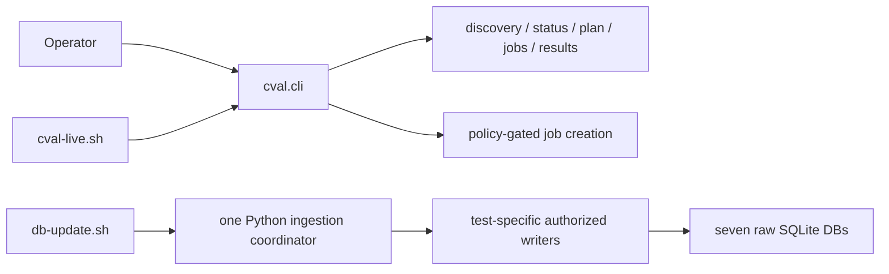
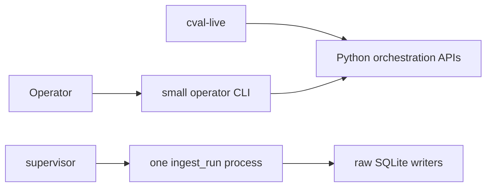

# CLI Design and Trim Plan

## Scope

[cval/cli.py](../../cval/cli.py) is the installed `cval` entry point, serving
three audiences:

1. operators reading cluster/raw state;
2. confirmed job submission workflows;
3. in-pod raw SQLite ingestion.

The CLI must preserve exact-commit submission, node eligibility checks,
read-only planning/monitoring, raw result export, immutable write provenance,
and fail-closed behavior.

## Current Surface

| Command | Mutation | Owner/purpose |
|---|---|---|
| `config` | no | Print effective configuration |
| `tests list/describe/validate` | no | Inspect registry and adapters |
| `nodes` | no | Inventory or check one node's eligibility |
| `status` | no | Read latest `validation.db` rows |
| `plan` | no | Inspect prioritized candidates; never render or submit Jobs |
| `jobs` | no | Read/watch Volcano phases |
| `results` | local CSV | Export latest raw statuses/metrics |
| `run` | creates jobs | Submit a confirmed planned batch |
| `validate` | creates one job | Submit, watch, and verify one exact run |

### Default Planning

Plain `plan` uses the existing priority queue without rendering Jobs.
Its JSON has `batch_size`, `days_threshold`, `free_nodes_count`, `queue_count`,
`git_ref`, and `candidates`. Each candidate has `node`, `priority`, `reason`,
`last_tested_timestamp`, and `age_days`; there is no Job name or YAML.
`queue_count` covers all due candidates; `--batch-size` limits the returned list.
With explicit `--free-nodes`, the input list is not proof of current eligibility.

Planning requires an exact commit. It does not validate a Job template or
authorize submission. The live loop keeps its targeted eligibility and
exact-source checks, then uses confirmed `run` to render and create only the
selected node's Job.

Removed: `plan --candidates-only`, `plan --include-yaml`, and plan-only uses of
`--timestamp`, `--template`, `--job-prefix`, `--git-repo`. `run` retains the
timestamp; job settings now come from the reviewed config. The `planned_jobs`
JSON shape is replaced by `candidates`, not kept as
an alternative. There is no internal `render_jobs` switch or rendered-plan
serialization path for inspection.

Old loop: rank -> render candidate Jobs -> check availability -> render selected
Job again -> submit. New loop: rank -> check availability -> render selected
Job once -> submit. Benefits are fewer manifest builds, smaller inspection
output and one planning contract; no measured end-to-end speedup is claimed.

## Mode Inventory

Inventory of the current c-val CLI and live-loop entry point, checked against
their parsers on 2026-09-23 after removing redundant settings. These controls
remain because they support operator inspection, the live loop, or selected-node
validation. Benchmark settings and standalone backup/migration tools are outside
this CLI inventory.

| Command or area | Current modes | Decision guidance |
| --- | --- | --- |
| `plan` | One default: candidate queue | Done; no rendering selector |
| `nodes` | Default discovery; `--inventory-only`; `--check-node NODE` | Keep: the live loop uses inventory and targeted checks for different stages |
| `plan`, `run` node input | Default discovery; explicit `--free-nodes` snapshot | Keep: the controller supplies its selected inputs; an empty explicit list must stay empty |
| `plan`, `run` history | No source (empty history); `--live-status`; `--db-status-json FILE` | Keep live reads and the loop's JSON snapshots; TSV input is removed |
| `tests` | `list`, `describe`, `validate`; `list --enabled-only` | Useful local inspection and validation; removing the subcommands is a separate interface decision |
| `jobs` | One snapshot by default; `--watch` | Keep: status snapshot and bounded monitoring are distinct |
| `validate` | One workflow: submit, watch, verify and report | Keep selected-node acceptance; ZIP download and its flags are removed |
| `results` content | `--test overall/all/storage/nccl/dltest`; `--no-metrics` | Tests choose data; `all`/`overall` is an alias pair. Preserve the ability to inspect status without joining metrics |
| `results` format | CSV, no selector | `--type` removed |
| `config` format | JSON, no selector | `--output` removed for this command |
| Other output formats | `--output table/json` for tests, nodes, status, plan, jobs, run and validate | Keep human-readable and automation output; TSV output is removed |
| Submission gates | `run` and `validate` require `--submit --confirm submit` and an exact `--git-ref` | Required safeguards, not redundant execution modes |
| Live-loop commands | `start`, `stop`, `status`, `attach`, `run-once`, internal `run-loop`, help | Keep lifecycle commands; `start` relies on internal `run-loop` |
| Live-loop mode controls | `CVAL_PLAN_LIMIT=all` or a positive limit; optional separately confirmed pruning | Retain bounded scanning and independent deletion authorization; pruning stays off by default |

Retained runtime controls are `--config`, `--node-filter`, `--threshold-days`,
`--batch-size`, exact revision/run timestamp, watch deadlines and export
destination. The live loop uses its existing config and snapshot inputs;
selected-node validation retains its explicit target and evidence verification.

### Removed Settings and Migration

| Removed public control | Replacement |
| --- | --- |
| `config --output json`, `results --type csv` | Fixed JSON and CSV output respectively |
| `status --output tsv`, `plan/run --db-status-tsv` | JSON output and `--db-status-json`, or `--live-status` |
| `validate --download`, `--download-dir` | Retained canonical PVC evidence; no automatic ZIP export |
| `validate --pvc-pod`, `status/results --pod`, `plan/run --status-pod` | `cluster.pvc_access_pod` |
| Public `--namespace`/`-n`, `plan/run --status-namespace` | `cluster.namespace` in the reviewed config |
| Public `--db-path`, `--nccl-db-path`, `--storage-db-path`, `--status-db-path` | The corresponding `[storage]` path |
| `run --template`, `--job-prefix`, `--git-repo` | `job.template_path`, `job.job_prefix`, `job.git_repo` |
| `run --allowed-namespace`, `--max-batch-size` | `policy.namespace_allowlist`, `policy.max_batch_size` |

Choose an alternate config with `--config` before the subcommand. The TOML
sections were not removed: cluster, scheduler, resources, timeouts, retry policy,
raw paths and the independent evaluator still use them. The config supplied to
`run` is passed through to rendering, including the exact source bundle and
resource settings. Oversized batches still fail policy validation before creation.
Hidden ingestion hooks retain explicit evidence/DB arguments and authorization.

### Internal Ingestion and Recovery

| Hook | Behavior selectors | Decision guidance |
| --- | --- | --- |
| `db-add-run-results` | Explicit result values; no inspection mode | Retained compatibility hook; the runtime coordinator calls the writer directly |
| `db-add-storage-result` | `--immutable`, optional `--run-id` | Retained compatibility hook with evidence/identity protection |
| `db-add-nccl-health` | `--immutable`, `--require-hca-samples`, `--recover-descriptor-ibbw-log` with `--confirm-recovery` | Recovery and completeness checks have distinct safety purposes |
| `db-add-dltest-run` | `--output table/json` | Retained individual writer hook; no dry-run/alternate storage mode |
| `db-rebuild-dltest-metrics` | `--only-missing`; `--output table/json` | Explicit maintenance policy, not ordinary live ingestion; do not remove as CLI clutter |

Result paths/digests, run IDs, versions and metric settings on these hooks are
provenance/data parameters. They are not candidates for silent removal.

## Implementation Boundary

Five hidden commands share the same parser: `db-add-run-results`,
`db-add-storage-result`, `db-add-nccl-health`, `db-add-dltest-run`, and
`db-rebuild-dltest-metrics`. They remain compatibility/maintenance interfaces;
normal ingestion no longer calls them. The thin
[validation-tests/db-update.sh](../../validation-tests/db-update.sh) launcher
executes [cval.storage.run_ingest](../../cval/storage/run_ingest.py), which uses
the same authorized raw-writer functions directly. Retiring individual hooks
or moving rebuild tooling is a separate interface decision.



## Design Assessment

The command boundaries are mostly sound: `plan` is visibly read-only, while
`run` and `validate` require `--submit --confirm submit`. Removing duplicate
flags reduces parser combinations without adding another configuration layer.

Additional CLI-adjacent weight includes:

- [orchestrator/validate.py](../../cval/orchestrator/validate.py): retained
  progress parsing, selected-node orchestration and reports; ZIP support removed.
- [validation-tests/db-update.sh](../../validation-tests/db-update.sh): thin
  entry point; ingestion ordering now lives in one Python coordinator.
- Dynamic result-export routing across `results_export.py`,
  `operational_targets.py`, `operations.py`, and plugin adapters.

Splitting `cli.py` into more files would improve navigation but not reduce the
codebase. Reduction requires deleting duplicate paths or optional behavior.

## Minimal Target

The following redesign remains a proposal. In the trim sequence below, only
items explicitly marked completed locally have been implemented; other items
do not authorize removing remaining commands.

Keep six operator commands:

```text
nodes   plan   run   status   jobs   results
```

Recommended semantics:

- `run --node NODE --watch --verify` replaces `validate` for single-node
  acceptance; batch `run` remains available to cval-live.
- Configuration and registry validation occur automatically at startup.
  Development-only inspection can be a small repository script, not installed
  production CLI surface.
- In-pod ingestion now uses `python -m cval.storage.run_ingest`; retirement of
  the individual hidden compatibility hooks remains a separate proposal.
- JSON is the automation contract. Human tables may remain only where they
  materially help (`nodes`, `jobs`, `plan`).



## Trim Sequence

### 1. Consolidate ingestion (completed locally)

One Python coordinator replaces the shell projections and four `db-add-*`
subprocesses. It loads the config snapshot once, creates shared authorization,
and calls the existing storage, NCCL, DL and final-status writers in order.
Every writer retains its own provenance checks and transaction boundaries.
The shared DL lock implementation is reused in-process and by its existing
standalone wrapper; generation/receipt logic and database schemas are unchanged.

Local tests cover all seven stores, a recoverable SQLite lock error before
finalization, no status publication on metric failure, interrupted lock release,
and real descriptor-bound supervisor ingestion. Exact-commit cluster acceptance
is still required before rollout. DL rebuild and hidden compatibility commands
were not removed as part of this change.

### 2. Remove optional ZIP export (completed locally)

Removed `validate --download`, ZIP/base64 collection and archive-only helpers.
Canonical PVC artifacts, ordinary text/JSON acceptance reports, progress and
fresh-status verification remain. Existing archives were not modified.

### 3. Merge `validate` into `run` (medium risk)

Add single-node watch/verify mode to the existing submission service, then
remove the duplicate single-node command/parser path. Drive progress from
structured events/result JSON and exact DB rows rather than legacy log regexes.
Expected reduction: about 250-450 lines after tests and shared helpers settle.

### 4. Remove redundant inputs (completed locally)

Removed TSV compatibility, one-choice format selectors and duplicate public
config-owned overrides listed above. Free nodes, JSON snapshots, threshold,
batch size, timestamp and exact Git SHA remain for the live loop. Validation,
monitoring and exports use the same reviewed target configuration.

### 5. Simplify result export only if extension is not required (optional)

The registry-driven test runner is core; dynamic plugin-defined CSV export is
not necessarily core. If only built-in exports are required, replace the
operational-target/plugin routing with fixed status, storage, NCCL, and DL raw
export functions. Potential reduction: 150-300 lines. Do not take this step if
third-party test exporters are a supported contract.

## Do Not Trim

- Separate read-only `plan` from confirmed mutation.
- Exact 40-hex commit checks and latest-published-tip enforcement.
- Node GPU/CPU/memory/RDMA eligibility checks at submission time.
- `jobs`, `status`, and exact-timestamp acceptance evidence.
- Immutable config/result authorization and canonical evidence validation.
- Registry-driven execution, secure supervisor descriptors, or raw DB writers.

## Expected Outcome

A realistic target is `cval/cli.py` at 250-350 lines and a net reduction of
roughly 600-1,000 lines across CLI, acceptance, and ingestion code. Measure net
repository lines after each phase; moving code between modules does not count
as trimming.