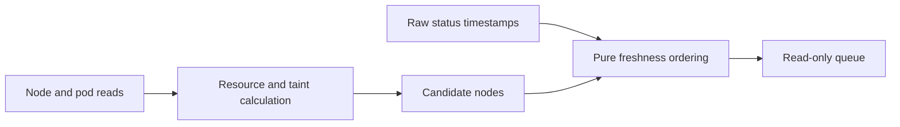

# C3: Discovery and Scheduling

Status: proposed redesign. Baseline/counting: [overview](major-components-overview.md#measurement-method).

## In Simple Terms

First ask whether a node is safe to use now. Separately ask whether its tests are
due. A recent failed test is still a recent observation, not a healthy result.

## Overview

Answer two separate questions: which nodes could run validation, and which nodes
are due? Observe and order candidates without rendering Jobs or authorizing work.

## Details and Purpose

| Input | Responsibility | Output |
| --- | --- | --- |
| Kubernetes node/pod data | Check Ready, GPU use, CPU/memory/RDMA capacity and scheduling restrictions. | Timestamped eligibility observations with reasons |
| Configured workload requirements | Apply the same resource/taint contract as submission. | Eligible/ineligible/unknown decisions |
| Raw status history and retest age | Order never-tested first, then oldest expired coverage. | Deterministic candidate queue |

Job control owns cooldown, outstanding submissions and available slots. Discovery
does not claim hardware health and the priority queue is not a node ranking.

## Current Process Flow

## Codebase Size

| Kind | Files | Physical Lines |
| --- | ---: | ---: |
| Code | 5 | 806 |
| Configuration | 0 | 0 |
| Tests | 3 | 479 |

Counted: [kubectl client](../../cval/k8s/client.py),
[discovery](../../cval/k8s/discovery.py), [priority](../../cval/scheduler/priority.py),
and the Kubernetes/scheduler package initializers. Tests:
[discovery](../../tests/test_discovery.py), [client](../../tests/test_k8s_client.py),
[priority](../../tests/test_priority.py). Shared models/settings belong to C1.

## Functionality Assessment

| Category | Functionality | Decision |
| --- | --- | --- |
| Critical | Explicit readiness, complete resource checks, bounded reads, deterministic queue | Preserve and make consistent. |
| Good | Targeted node/pod reads, inventory-only listing, diagnostic reasons | Reuse to avoid full-cluster reads for each candidate. |
| Not important | Optional queue shuffling | Retain only for a demonstrated caller; deterministic ordering is the default. |
| Useless | Duplicate node-table and node-JSON interpretations of one observation | Replace with one structured representation. |

## Current Issues

1. [Bulk discovery](../../cval/k8s/discovery.py#L189) reloads defaults and does not
   explicitly test Ready. Targeted validation uses a stricter path.
2. Node capacity tables and JSON are separate reads; their snapshots can differ.
3. GPU/resource quantities and pod requests are calculated in multiple helpers.
   Supported Kubernetes request cases need verified real-cluster evidence, not guesses.
4. [Scheduling history](../../cval/storage/status.py#L40) takes the newest timestamp
   across tests. A partial or disabled-test run can obscure missing coverage.

## Proposed Design

1. Use one pure eligibility function over structured node/pod observations and
   the effective config. Pass an explicit policy for automatic versus targeted
   cordoned-node validation; neither allows active GPU work or unknown readiness.
2. Inventory once per planning pass; check selected nodes again immediately before
   create through the same function. C3 owns coverage-age rules; C4 owns observation
   age at admission, cooldown and create timing. Record node UID to detect replacement.
3. Keep the small pure priority function. Apply the coverage policy below before
   ordering candidates. C7 supplies read-only history/provenance; do not add direct
   SQL or a second result store to the scheduler.
4. Keep snapshot inputs for offline inspection; they can never authorize submission.
   Retain bounded calls and distinguish empty capacity from inaccessible evidence.

## Coverage Policy

Proposed policy to agree in Phase 0 and verify against real evidence:

| Observation | Scheduling Meaning |
| --- | --- |
| One run fully executed the requested compatible test set with complete expected evidence | Use its timestamp for coverage, even if a fully executed test reported fail. |
| Setup failure, timeout, interruption or missing required test output | Not full coverage; cooldown still prevents immediate retry storms. |
| Newly enabled test or changed execution-relevant test inputs | Previous coverage does not satisfy the new request. |
| Docs-only or host polling change | Does not invalidate coverage when workload compatibility is established. |
| Readable history without proven compatible evidence | Due with an explicit reason; never invent a compatible identity. |
| Forbidden/unavailable history | Pause automatic admission; do not reinterpret it as never tested. |

Compare the required test set, descriptor/workload inputs and recorded dependency
identity, not only the global config digest or latest per-node timestamp. C1/C6
must specify which inputs affect compatibility. Do not combine unrelated per-test
runs into a complete run implicitly or rewrite historical rows to add missing identity.

## Observation Limits

Node and pod reads are not an atomic reservation. Use structured responses,
validate node identity and reject unsupported resource-accounting cases as unknown.
Check deployed-version pod/node observations for init containers, overhead and
quantity forms before claiming scheduler-equivalent accounting. Keep Kubernetes resource
requests and node placement constraints as the final scheduling protection.

Keep automatic and targeted policies distinct: a drained cordon exception is not
a bypass for quarantine taints, resource shortage or unknown workload state.

## Acceptance and Risk

Verify real discovery and approved real-node runs using current commands. Observe
busy/unready/quarantined nodes read-only; never submit to them to prove rejection.
Check coverage and resource calculations against retained real evidence, including
failure or changed-UID cases when available. Mark unsupported/unobserved cases
unknown. Preserve stable queue order and zero renders during planning; measure
calls per real cycle before claiming savings. Follow the
[real-node policy](Redesign.md#real-node-validation-policy); no new fixtures or simulators.
Priority P0; medium risk because a false positive permits unsafe work.
