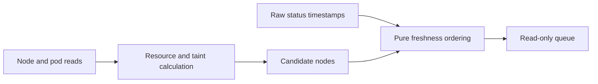

# C3: Discovery and Scheduling

Status: proposed redesign. Baseline/counting: [overview](major-components-overview.md#measurement-method).

## Overview

Answer two separate questions: which nodes could run validation, and which nodes
are due? Observe and order candidates without rendering Jobs or authorizing work.

## Details and Purpose

| Input | Responsibility | Output |
| --- | --- | --- |
| Kubernetes node/pod data | Check Ready, GPU use, CPU/memory/RDMA capacity and scheduling restrictions. | Timestamped eligibility observations with reasons |
| Configured workload requirements | Apply the same resource/taint contract as submission. | Eligible/ineligible/unknown decisions |
| Raw status history and retest age | Order never-tested first, then oldest expired coverage. | Deterministic candidate queue |

Job control owns cooldown, outstanding submissions and available slots. Discovery
does not claim hardware health and the priority queue is not a node ranking.

## Current Process Flow

## Codebase Size

| Kind | Files | Physical Lines |
| --- | ---: | ---: |
| Code | 5 | 806 |
| Configuration | 0 | 0 |
| Tests | 3 | 479 |

Counted: [kubectl client](../../cval/k8s/client.py),
[discovery](../../cval/k8s/discovery.py), [priority](../../cval/scheduler/priority.py),
and the Kubernetes/scheduler package initializers. Tests:
[discovery](../../tests/test_discovery.py), [client](../../tests/test_k8s_client.py),
[priority](../../tests/test_priority.py). Shared models/settings belong to C1.

## Functionality Assessment

| Category | Functionality | Decision |
| --- | --- | --- |
| Critical | Explicit readiness, complete resource checks, bounded reads, deterministic queue | Preserve and make consistent. |
| Good | Targeted node/pod reads, inventory-only listing, diagnostic reasons | Reuse to avoid full-cluster reads for each candidate. |
| Not important | Optional queue shuffling | Retain only for a demonstrated caller; deterministic ordering is the default. |
| Useless | Duplicate node-table and node-JSON interpretations of one observation | Replace with one structured representation. |

## Current Issues

1. [Bulk discovery](../../cval/k8s/discovery.py#L189) reloads defaults and does not
   explicitly test Ready. Targeted validation uses a stricter path.
2. Node capacity tables and JSON are separate reads; their snapshots can differ.
3. GPU/resource quantities and pod requests are calculated in multiple helpers.
   Supported Kubernetes request cases need explicit fixtures, not silent guesses.
4. [Scheduling history](../../cval/storage/status.py#L40) takes the newest timestamp
   across tests. A partial or disabled-test run can obscure missing coverage.

## Proposed Design

1. Use one pure eligibility function over structured node/pod observations and
   the effective config. Pass an explicit policy for automatic versus targeted
   cordoned-node validation; neither allows active GPU work or unknown readiness.
2. Inventory once per planning pass; check selected nodes again immediately before
   create through the same function. C4 owns freshness and mutation timing.
3. Keep the small pure priority function. Define freshness from a complete committed
   run covering required enabled tests; record outcome separately. A failed but
   complete run is evidence, not a reason for an uncontrolled retry storm.
4. Keep snapshot inputs for offline inspection; they can never authorize submission.
   Retain bounded calls and distinguish empty capacity from inaccessible evidence.

## Acceptance and Risk

Use fixtures for custom config, missing/false Ready, busy GPUs, partial CPU/memory/
RDMA, allowed cordon versus quarantine taints, malformed quantities, API failures
and stale coverage. Preserve stable queue order and zero renders during planning.
Measure Kubernetes calls per candidate pass before claiming efficiency gains.
Priority P0; medium risk because a false positive permits unsafe work.
