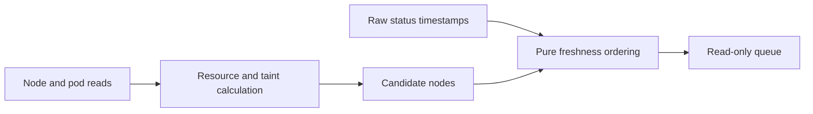

# C3: Discovery and Scheduling

Status: Phase 1.2 eligibility, Phase 1.6 coverage and Phase 2.5 successful freshness source implemented;
fresh real-node acceptance pending. Dependency compatibility activation remains
deferred until provenance is produced. Baseline/counting:
[overview](major-components-overview.md#measurement-method).

## In Simple Terms

First ask whether a node is safe to use now. Separately ask whether its tests are
due. A recent failed test is still a recent observation, not a healthy result.

## Overview

Answer two separate questions: which nodes could run validation, and which nodes
are due? Observe and order candidates without rendering Jobs or authorizing work.

## Details and Purpose

| Input | Responsibility | Output |
| --- | --- | --- |
| Kubernetes node/pod data | Check Ready, GPU use, CPU/memory/RDMA capacity and scheduling restrictions. | Timestamped eligibility observations with reasons |
| Configured workload requirements | Apply the same resource/taint contract as submission. | Eligible/ineligible/unknown decisions |
| Raw status history and retest age | Order never-tested first, then oldest expired coverage. | Deterministic candidate queue |

Job control owns cooldown, outstanding submissions and available slots. Discovery
does not claim hardware health and the priority queue is not a node ranking.

## Current Process Flow

## Codebase Size

| Kind | Files | Physical Lines |
| --- | ---: | ---: |
| Code | 5 | 806 |
| Configuration | 0 | 0 |
| Tests | 3 | 479 |

Counted: [kubectl client](../../cval/k8s/client.py),
[discovery](../../cval/k8s/discovery.py), [priority](../../cval/scheduler/priority.py),
and the Kubernetes/scheduler package initializers. Tests:
[discovery](../../tests/test_discovery.py), [client](../../tests/test_k8s_client.py),
[priority](../../tests/test_priority.py). Shared models/settings belong to C1.

## Functionality Assessment

| Category | Functionality | Decision |
| --- | --- | --- |
| Critical | Explicit readiness, complete resource checks, bounded reads, deterministic queue | Preserve and make consistent. |
| Good | Targeted node/pod reads, inventory-only listing, diagnostic reasons | Reuse to avoid full-cluster reads for each candidate. |
| Not important | Optional queue shuffling | Retain only for a demonstrated caller; deterministic ordering is the default. |
| Useless | Duplicate node-table and node-JSON interpretations of one observation | Replace with one structured representation. |

## Phase 1.2 Implementation

[Discovery](../../cval/k8s/discovery.py) now owns the shared structured eligibility
decision used by bulk discovery, CLI node checks and targeted validation. It
requires explicit Ready, idle GPUs, configured GPU/CPU/memory/RDMA capacity and
compatible taints. Only explicit targeted validation permits a drained Ready
cordon. Automatic checks reject cordons, and both policies reject NoExecute taints.
Node identity is `node_name` only; no replacement-node tracking is introduced.

Bulk discovery uses one pod inventory and one node JSON inventory. Pod grouping
and per-resource accounting are linear in inventory size, not repeated fleet-wide
for every node. Targeted reads still fetch only the selected node and its pods.
Existing CLI JSON fields remain unchanged; legacy capacity-table helper parameters
remain available, but eligibility requires structured JSON evidence.

Request quantities use the existing Decimal parser. Accounting includes app
containers, ordinary/restartable init containers and pod overhead, following the
[Kubernetes 1.32 resource helper](https://github.com/kubernetes/kubernetes/blob/v1.32.0/staging/src/k8s.io/component-helpers/resource/helpers.go).
Unsupported pod-level/in-place resize accounting or malformed per-node data
remains unverified. Bulk discovery excludes such nodes with stderr diagnostics;
targeted checks fail rather than invent resource counts. Missing/truncated
inventories fail globally. Bulk totals cover reported nodes only.

Read-only verification on 2026-09-24 UTC compared all 500 nodes in one retained
snapshot of 12,592 real pods: bulk and targeted decisions matched, with 469 busy,
two NotReady, 27 non-GPU and two eligible nodes. The snapshot included 13 active
pods with restartable init containers. A separate live bulk query also completed;
its candidate set differed as workloads changed. These are observations, not
reservations or GPU acceptance.

Retained local evidence: `run-logs/phase12-observations-20260924.json`,
`run-logs/phase12-shared-snapshot-check-20260924.json`, and
`run-logs/phase12-structured-discovery-retry-20260924.json`. No synthetic fixtures,
new test scripts, validation Jobs or DB writes were used. Ready drained-cordon,
malformed/unsupported input handling, and isolated resource-shortage cases were
not exercised as real incidents. Exact-published-commit execution, canonical
results and raw ingestion acceptance remain pending separate approval.

## Remaining Issues

1. Node and pod reads remain separate observations, not a reservation. Phase 1.3
   serializes cooperating submitters and rechecks before create, not other workloads.
2. Immutable workload/dependency provenance is not yet complete. Coverage explicitly
   retains the legacy age policy rather than claiming full execution compatibility.

## Phase 1.6 Implementation

[History reads](../../cval/storage/status.py) initially selected the newest single complete
run for the requested test set. `status --coverage` returns `cval.coverage.v1` with
the requested tests, per-node reasons, latest attempt, selected coverage timestamp,
skipped-run evidence and a timestamp projection. `plan --live-status` and the live
loop use the same reader; the loop retains this full report instead of reducing
latest test timestamps to an unrelated maximum. The pure priority rule remains
never-covered first, then oldest expired, with strict `age > days_threshold`.

Current envelopes must identify the node/run and selected tests, show each requested
test finished, match exact raw status and retain nonempty canonical summaries and
the ingestion digest. Phase 1 also allowed failed built-ins with test-owned
completion evidence; Phase 2.5 supersedes that rule with passing-only freshness.
Incomplete, failed or conflicting newer attempts do not replace
older qualifying coverage. Historical path relocation uses the existing explicit
map without rewriting artifacts.

Historical runs without current-format completion provenance can supply only
`legacy_complete_passing_status` coverage for a coherent passing built-in status
set. This is the deliberate legacy age rule, not proof of canonical execution,
current descriptors, image or external-DL compatibility. Missing current artifacts
cannot use that fallback. Reports state `legacy_age_only`; stronger compatibility
comparisons remain deferred. Phase 3's run-local source copy does not implement a
complete dependency-comparison policy.

Read denial/failure, malformed history or the configured per-node scan limit stops
planning; none becomes an empty history. Queried history without a qualifying run
originally had candidate reason `no-complete-coverage`; Phase 2.5 uses
`no-successful-coverage`, distinct from `never-tested`. New test
selection must match the report. Existing plain node/timestamp JSON maps remain
explicit offline planning inputs, not proof of live coverage or submission approval.

Read-only verification on 2026-09-24 UTC scanned 478 real nodes: the final retained
observation found 379 canonical, 97 legacy passing and two unproven records. Nodes
`0275` and `0418` planned as `no-complete-coverage`; recent `0192` coverage was excluded.
Coverage provenance is not an accepted health outcome. Evidence is retained in
`run-logs/phase16-final-coverage-20260924.json` and
`run-logs/phase16-plan-reasons-20260924.json`. Complete failed-run coverage and live
permission/retry/limit failures were not exercised; no synthetic history was used.

## Phase 2.5 Successful Freshness

The shared reader now emits policy `successful_complete_run`. Qualifying runs must
have passing exact status for all requested built-ins and overall, a passing overall
canonical result, and each selected requested test finished/passing with the existing
summaries and ingestion digest. A failed or incomplete attempt remains raw evidence
and `latest_attempt_timestamp`, but cannot refresh `coverage_timestamp`. The scan
continues to an older qualifying success; a still-fresh older success need not be
immediately retested because a newer attempt failed. Age and cooldown are unchanged.

The coherent legacy passing-status fallback remains explicitly limited to built-ins;
no dependency identity is fabricated. The consumer rejects `legacy_complete_run`
reports and any nonpassing coverage projection. Regenerate retained coverage reports
before planning with the new source. Plain timestamp maps remain explicit offline
inputs, not validated successful-run evidence or permission to submit.

A read-only real fleet scan on 2026-09-24 UTC found 478 nodes: 379 canonical and
97 legacy successful records, two without successful coverage, and seven skipped
failed attempts. Nodes `0252`, `0265`, `0454` and `0456` retained older successes
despite newer attempts. Failed `0418` and incomplete `0275` were the only candidates
in a four-node offline plan including recent passing `0192`/`0359`, with reason
`no-successful-coverage`. The supplied node list did not assert live eligibility.
No rows, summaries, logs or raw schemas changed. Evidence is retained under
`run-logs/phase25-coverage-fleet-20260924.json` and
`run-logs/phase25-offline-plan-20260924.json`.

Fresh post-failure scheduling/cooldown behavior and live controller execution remain
unverified and require separate approval. This is a freshness rule, not node health
classification or automatic remediation.

## Design Disposition

Implemented: one eligibility function, explicit targeted-cordon policy, fresh
per-create checks, `node_name` identity, successful-run coverage and the existing
pure priority ordering. Snapshot inputs remain inspection-only; they do not
authorize submission. Full dependency-based compatibility and a new scheduler or
history store are deferred, not unfinished Phase 6 requirements.

## Coverage Policy

Phase 0 policy amended by the reviewed Phase 2.5 success-based rule; source is
implemented but controller activation and fresh acceptance remain pending.

| Observation | Scheduling Meaning |
| --- | --- |
| One run passed the requested compatible test set with complete expected evidence | Use its timestamp for successful coverage; failed runs never refresh it. |
| Setup failure, timeout, interruption or missing required test output | Not full coverage; cooldown still prevents immediate retry storms. |
| Newly required test | A qualifying run must contain successful coverage for the requested test set. |
| Changed image, dependency or workload inputs | Values remain recorded, but full cross-run compatibility comparisons are not implemented. |
| Docs-only or host polling change | Does not itself invalidate the active age-based coverage. |
| Readable legacy passing built-in status set | May qualify under `legacy_age_only`; this is not proof of canonical evidence or matching dependencies. |
| Forbidden/unavailable history | Pause automatic admission; do not reinterpret it as never tested. |

Use the newest single qualifying successful run under the documented canonical
or legacy evidence rules. Do not combine unrelated runs or claim full dependency
compatibility from the active age policy.
An extra previously selected test does not invalidate coverage of the requested
subset; a newly required test needs its own coverage in that same run.

### Phase 0 Retest Decisions

Amended by the Phase 2.5 successful-freshness rule above.

| Decision | Rule |
| --- | --- |
| Age threshold | Retest when coverage age is strictly greater than configured `days_threshold`; the checked-in default is 7 days. At the boundary it is still fresh. |
| Full workload reported fail | Never refreshes successful coverage; retain all raw failure evidence. |
| Failed/incomplete latest attempt | Does not replace an older successful coverage timestamp. Retain the new outcome separately. |
| No compatible successful run | Due with a reason; no history differs from readable but unsuccessful/incompatible history. |
| Pending/uncertain Job | C4 reconciles identity and execution before releasing its reservation; failed ingestion is not an automatic benchmark retry. |
| Cooldown | Preserve the configured submission cooldown independently of coverage; checked-in default is 14,400 seconds. |
| Unknown history access | Pause automatic admission; a read failure is not permission to treat the node as never tested. |

Deferred strict compatibility would compare descriptor and workload code identity,
image/dependencies and external DL source/plan, not polling settings or documentation.
Current Git refs, descriptor digests, environment values and run-local copies are
evidence, not that comparison engine. Phase 3 added isolation without new provenance
fields or historical backfill. Retain the declared successful age policy and its
limits; no new compatibility DB or fleet-wide revalidation was added in Phase 6.

## Observation Limits

Node and pod reads are not an atomic reservation. Use structured responses,
validate node identity and reject unsupported resource-accounting cases as unknown.
Check deployed-version pod/node observations for init containers, overhead and
quantity forms before claiming scheduler-equivalent accounting. Keep Kubernetes resource
requests and node placement constraints as the final scheduling protection.

Keep automatic and targeted policies distinct: a drained cordon exception is not
a bypass for quarantine taints, resource shortage or unknown workload state.

## Acceptance and Risk

Verify real discovery and approved real-node runs using current commands. Observe
busy/unready/quarantined nodes read-only; never submit to them to prove rejection.
Check coverage and resource calculations against retained real evidence, including
failure cases when available. Mark unsupported/unobserved cases
unknown. Preserve stable queue order and zero renders during planning; measure
calls per real cycle before claiming savings. Follow the
[real-node policy](Redesign.md#real-node-validation-policy); no new fixtures or simulators.
Priority P0; medium risk because a false positive permits unsafe work.
