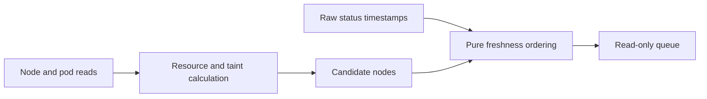

# C3: Discovery and Scheduling

Status: Phase 1.2 eligibility and Phase 1.6 coverage source implemented;
fresh real-node acceptance pending. Dependency compatibility activation remains
deferred until provenance is produced. Baseline/counting:
[overview](major-components-overview.md#measurement-method).

## In Simple Terms

First ask whether a node is safe to use now. Separately ask whether its tests are
due. A recent failed test is still a recent observation, not a healthy result.

## Overview

Answer two separate questions: which nodes could run validation, and which nodes
are due? Observe and order candidates without rendering Jobs or authorizing work.

## Details and Purpose

| Input | Responsibility | Output |
| --- | --- | --- |
| Kubernetes node/pod data | Check Ready, GPU use, CPU/memory/RDMA capacity and scheduling restrictions. | Timestamped eligibility observations with reasons |
| Configured workload requirements | Apply the same resource/taint contract as submission. | Eligible/ineligible/unknown decisions |
| Raw status history and retest age | Order never-tested first, then oldest expired coverage. | Deterministic candidate queue |

Job control owns cooldown, outstanding submissions and available slots. Discovery
does not claim hardware health and the priority queue is not a node ranking.

## Current Process Flow

## Codebase Size

| Kind | Files | Physical Lines |
| --- | ---: | ---: |
| Code | 5 | 806 |
| Configuration | 0 | 0 |
| Tests | 3 | 479 |

Counted: [kubectl client](../../cval/k8s/client.py),
[discovery](../../cval/k8s/discovery.py), [priority](../../cval/scheduler/priority.py),
and the Kubernetes/scheduler package initializers. Tests:
[discovery](../../tests/test_discovery.py), [client](../../tests/test_k8s_client.py),
[priority](../../tests/test_priority.py). Shared models/settings belong to C1.

## Functionality Assessment

| Category | Functionality | Decision |
| --- | --- | --- |
| Critical | Explicit readiness, complete resource checks, bounded reads, deterministic queue | Preserve and make consistent. |
| Good | Targeted node/pod reads, inventory-only listing, diagnostic reasons | Reuse to avoid full-cluster reads for each candidate. |
| Not important | Optional queue shuffling | Retain only for a demonstrated caller; deterministic ordering is the default. |
| Useless | Duplicate node-table and node-JSON interpretations of one observation | Replace with one structured representation. |

## Phase 1.2 Implementation

[Discovery](../../cval/k8s/discovery.py) now owns the shared structured eligibility
decision used by bulk discovery, CLI node checks and targeted validation. It
requires explicit Ready, idle GPUs, configured GPU/CPU/memory/RDMA capacity and
compatible taints. Only explicit targeted validation permits a drained Ready
cordon. Automatic checks reject cordons, and both policies reject NoExecute taints.
Node identity is `node_name` only; no replacement-node tracking is introduced.

Bulk discovery uses one pod inventory and one node JSON inventory. Pod grouping
and per-resource accounting are linear in inventory size, not repeated fleet-wide
for every node. Targeted reads still fetch only the selected node and its pods.
Existing CLI JSON fields remain unchanged; legacy capacity-table helper parameters
remain available, but eligibility requires structured JSON evidence.

Request quantities use the existing Decimal parser. Accounting includes app
containers, ordinary/restartable init containers and pod overhead, following the
[Kubernetes 1.32 resource helper](https://github.com/kubernetes/kubernetes/blob/v1.32.0/staging/src/k8s.io/component-helpers/resource/helpers.go).
Unsupported pod-level/in-place resize accounting or malformed per-node data
remains unverified. Bulk discovery excludes such nodes with stderr diagnostics;
targeted checks fail rather than invent resource counts. Missing/truncated
inventories fail globally. Bulk totals cover reported nodes only.

Read-only verification on 2026-09-24 UTC compared all 500 nodes in one retained
snapshot of 12,592 real pods: bulk and targeted decisions matched, with 469 busy,
two NotReady, 27 non-GPU and two eligible nodes. The snapshot included 13 active
pods with restartable init containers. A separate live bulk query also completed;
its candidate set differed as workloads changed. These are observations, not
reservations or GPU acceptance.

Retained local evidence: `run-logs/phase12-observations-20260924.json`,
`run-logs/phase12-shared-snapshot-check-20260924.json`, and
`run-logs/phase12-structured-discovery-retry-20260924.json`. No synthetic fixtures,
new test scripts, validation Jobs or DB writes were used. Ready drained-cordon,
malformed/unsupported input handling, and isolated resource-shortage cases were
not exercised as real incidents. Exact-published-commit execution, canonical
results and raw ingestion acceptance remain pending separate approval.

## Remaining Issues

1. Node and pod reads remain separate observations, not a reservation. Phase 1.3
   serializes cooperating submitters and rechecks before create, not other workloads.
2. Immutable workload/dependency provenance is not yet complete. Coverage explicitly
   retains the legacy age policy rather than claiming full execution compatibility.

## Phase 1.6 Implementation

[History reads](../../cval/storage/status.py) now select the newest single complete
run for the requested test set. `status --coverage` returns `cval.coverage.v1` with
the requested tests, per-node reasons, latest attempt, selected coverage timestamp,
skipped-run evidence and a timestamp projection. `plan --live-status` and the live
loop use the same reader; the loop retains this full report instead of reducing
latest test timestamps to an unrelated maximum. The pure priority rule remains
never-covered first, then oldest expired, with strict `age > days_threshold`.

Current envelopes must identify the node/run and selected tests, show each requested
test finished, match exact raw status and retain nonempty canonical summaries and
the ingestion digest. Failed built-ins additionally need test-owned completion
evidence: all DL ranks/plans/tasks completed, parseable complete storage artifacts,
or a validated NCCL completion summary. Failed custom tests without a completion
contract remain unproven. Incomplete or conflicting newer attempts do not replace
older qualifying coverage. Historical path relocation uses the existing explicit
map without rewriting artifacts.

Historical runs without current-format completion provenance can supply only
`legacy_complete_passing_status` coverage for a coherent passing built-in status
set. This is the deliberate legacy age rule, not proof of canonical execution,
current descriptors, image or external-DL compatibility. Missing current artifacts
cannot use that fallback. Reports state `legacy_age_only`; stronger compatibility
comparisons remain deferred until Phase 3 supplies immutable dependency identity.

Read denial/failure, malformed history or the configured per-node scan limit stops
planning; none becomes an empty history. Queried history without a qualifying run
has candidate reason `no-complete-coverage`, distinct from `never-tested`. New test
selection must match the report. Existing plain node/timestamp JSON maps remain
explicit offline planning inputs, not proof of live coverage or submission approval.

Read-only verification on 2026-09-24 UTC scanned 478 real nodes: the final retained
observation found 379 canonical, 97 legacy passing and two unproven records. Nodes
`0275` and `0418` planned as `no-complete-coverage`; recent `0192` coverage was excluded.
Coverage provenance is not an accepted health outcome. Evidence is retained in
`run-logs/phase16-final-coverage-20260924.json` and
`run-logs/phase16-plan-reasons-20260924.json`. Complete failed-run coverage and live
permission/retry/limit failures were not exercised; no synthetic history was used.

## Proposed Design

1. Use one pure eligibility function over structured node/pod observations and
   the effective config. Pass an explicit policy for automatic versus targeted
   cordoned-node validation; neither allows active GPU work or unknown readiness.
2. Inventory once per planning pass; check selected nodes again immediately before
   create through the same function. C3 owns coverage-age rules; C4 owns observation
   age at admission, cooldown and create timing. Identify nodes by `node_name` only.
3. Keep the small pure priority function. Apply the coverage policy below before
   ordering candidates. C7 supplies read-only history/provenance; do not add direct
   SQL or a second result store to the scheduler.
4. Keep snapshot inputs for offline inspection; they can never authorize submission.
   Retain bounded calls and distinguish empty capacity from inaccessible evidence.

## Coverage Policy

Phase 0 decision for implementation; current scheduling remains unchanged until
the relevant producer/reader changes pass real-node acceptance.

| Observation | Scheduling Meaning |
| --- | --- |
| One run fully executed the requested compatible test set with complete expected evidence | Use its timestamp for coverage, even if a fully executed test reported fail. |
| Setup failure, timeout, interruption or missing required test output | Not full coverage; cooldown still prevents immediate retry storms. |
| Newly enabled test or changed execution-relevant test inputs | Previous coverage does not satisfy the new request. |
| Docs-only or host polling change | Does not invalidate coverage when workload compatibility is established. |
| Readable history without proven compatible evidence | Due with an explicit reason; never invent a compatible identity. |
| Forbidden/unavailable history | Pause automatic admission; do not reinterpret it as never tested. |

Use the newest single compatible run that fully exercised every currently required
test and has complete outcome-appropriate evidence. Do not combine unrelated runs.
An extra previously selected test does not invalidate coverage of the requested
subset; a newly required test needs its own coverage in that same run.

### Phase 0 Retest Decisions

| Decision | Rule |
| --- | --- |
| Age threshold | Retest when coverage age is strictly greater than configured `days_threshold`; the checked-in default is 7 days. At the boundary it is still fresh. |
| Full workload reported fail | May refresh coverage, never acceptance, only when summaries prove the intended workload finished; `phase=finished` alone is insufficient. |
| Incomplete latest attempt | Does not replace an older valid coverage timestamp. Retain the new failure/incomplete outcome separately. |
| No compatible complete run | Due with a reason; no history differs from readable but incompatible/incomplete history. |
| Pending/uncertain Job or ingestion | C4 reconciles it before another workload is admitted for that node. A DB problem is not an automatic benchmark retry. |
| Cooldown | Preserve the configured submission cooldown independently of coverage; checked-in default is 14,400 seconds. |
| Unknown history access | Pause automatic admission; a read failure is not permission to treat the node as never tested. |

Compatibility inputs are required test IDs, per-test descriptor digest, workload/
setup/summary code identity, image/dependency identity, and external DL source/plan
identity where applicable. Global polling/cooldown settings and documentation do
not affect workload compatibility. Source SHA always remains exact-run provenance;
it is not a reason by itself to rerun unchanged workload content.

The baseline envelope records Git ref, descriptor digests, image name and framework
versions, but not a complete immutable external-DL identity. Decision: no backfill,
invented digest or new compatibility database. Phase 1 can expose coverage/reasons
from existing evidence; stronger dependency comparisons become active only after
Phase 3 records their reviewed inputs. Until then retain the declared legacy
timestamp policy with its provenance limitation, rather than silently claiming
strict compatibility or causing repeated fleet-wide revalidation.

## Observation Limits

Node and pod reads are not an atomic reservation. Use structured responses,
validate node identity and reject unsupported resource-accounting cases as unknown.
Check deployed-version pod/node observations for init containers, overhead and
quantity forms before claiming scheduler-equivalent accounting. Keep Kubernetes resource
requests and node placement constraints as the final scheduling protection.

Keep automatic and targeted policies distinct: a drained cordon exception is not
a bypass for quarantine taints, resource shortage or unknown workload state.

## Acceptance and Risk

Verify real discovery and approved real-node runs using current commands. Observe
busy/unready/quarantined nodes read-only; never submit to them to prove rejection.
Check coverage and resource calculations against retained real evidence, including
failure cases when available. Mark unsupported/unobserved cases
unknown. Preserve stable queue order and zero renders during planning; measure
calls per real cycle before claiming savings. Follow the
[real-node policy](Redesign.md#real-node-validation-policy); no new fixtures or simulators.
Priority P0; medium risk because a false positive permits unsafe work.
