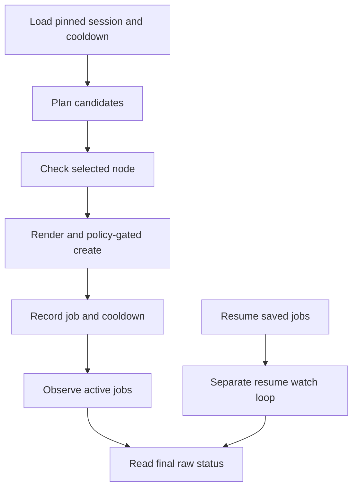

# C4: Job Control

Status: proposed redesign. Baseline/counting: [overview](major-components-overview.md#measurement-method).

## Overview

Own the complete lifecycle of an approved validation request: select an available
slot, recheck eligibility, submit once, track identity, reconcile uncertainty and
request exact-run verification. Run one active controller per configured scope.

## Details and Purpose

| Input | Owned Decision | Output |
| --- | --- | --- |
| Candidate queue and session receipts | Cooldown, outstanding jobs and bounded concurrency | Next selected candidate |
| Exact source, reviewed config and approval | Whether this precise create is authorized now | Submission intent and receipt |
| Kubernetes observations | Submitted/running/terminal/unknown; retain unresolved slots | Recoverable lifecycle state |
| C7 verification report | Whether a successful run is accepted as complete evidence | Operator report, never a health class |

Rendering belongs to C8, eligibility rules to C3 and evidence verification to C7.
No observation failure authorizes deletion, replacement or a duplicate submit.

## Current Process Flow

## Codebase Size

| Kind | Files | Physical Lines |
| --- | ---: | ---: |
| Code | 10 | 3,435 |
| Configuration | 0 | 0 |
| Tests | 6 | 2,620 |

Counted: [policy](../../cval/policy.py), [manager](../../cval/jobs/manager.py),
[monitor](../../cval/jobs/monitor.py), [workflow](../../cval/orchestrator/workflow.py),
[targeted validation](../../cval/orchestrator/validate.py),
[live loop](../../scripts/cval-live.sh), [session state](../../scripts/cval-live-state.py),
[cooldown](../../scripts/cval-node-cooldown.py), and jobs/orchestrator initializers.
Tests: job manager, validate, workflow, live loop, live state and node cooldown.
The shell loop alone is 1,871 lines; this is a concentration, not a deletion target.

## Functionality Assessment

| Category | Functionality | Decision |
| --- | --- | --- |
| Critical | Exact source, fresh eligibility, approval, bounded slots, receipts, cooldown and resume | Preserve under one lifecycle owner. |
| Good | Live progress, controlled one-node acceptance, recoverable interruption | Reuse for manual and continuous workflows. |
| Not important | Optional pending-job pruning | Keep separately gated and off by default. |
| Useless | Duplicate resume/active monitoring and repeated JSON-to-shell conversions | Consolidate behavior, not safeguards. |

## Current Issues

1. [Submission](../../cval/jobs/manager.py#L43) validates policy and Git syntax,
   but depends on callers for live eligibility. Explicit CLI node lists bypass it.
2. A later create failure raises before returning earlier batch receipts. A network
   timeout can also mean the Job exists even though no receipt reached the caller.
3. Resume and active-loop observation/pruning are implemented twice. Repeated CLI
   subprocesses reload config and translate the same state through JSON/TSV/CSV.
4. Targeted validation and the regular monitor have different deadline and evidence
   handling. Job phase alone is not proof of a complete successful run.

## Proposed Design

1. Keep shell only for process/session launch. Move one bounded lifecycle pass into
   existing Python orchestration and share it between continuous and targeted runs.
2. Before create, durably retain intent in existing session storage: job name,
   node/run identity, source SHA, configuration and manifest digests. This is
   operational state, not a new raw history database.
3. Recheck C3 eligibility at the create boundary. Preserve full-node resource
   isolation; a read is not a Kubernetes reservation and cannot eliminate races.
4. Record each result immediately. On timeout, reconcile exact name and identity;
   a match becomes an observed receipt, a conflict blocks, an unavailable read
   keeps the slot occupied. Never promise exactly-once Kubernetes delivery.
5. One state transition function handles both resume and active observation. Pass
   a shared deadline to calls; batch named-job reads without converting API errors
   into missing jobs. Retain UID once observed to detect replacements.
6. Request C7 verification after terminal execution. Persist partial outcomes and
   leave all evidence/jobs intact unless an independent action was approved.

## Acceptance and Risk

Test crashes before/after create and receipt persistence, second-create failure,
lost responses, UID conflict, unknown state, missing Jobs, clock/deadline limits,
cooldown repair and restart. Preserve [live-loop regressions](../../tests/test_cval_live.py).
Measure subprocess/API counts without caching eligibility across creates.
Priority P0 for correctness, P1 for consolidation; high mutation/restart risk.
