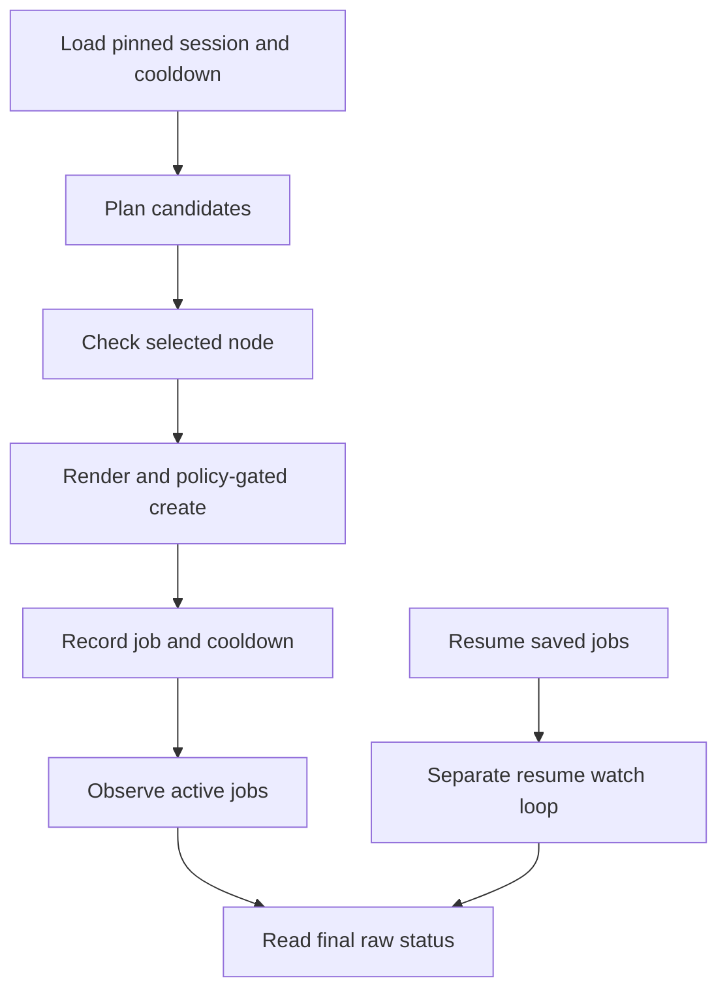

# C4: Job Control

Status: proposed redesign. Baseline/counting: [overview](major-components-overview.md#measurement-method).

## In Simple Terms

Before starting a Job, record exactly what should start. If the reply is lost,
look for that same Job instead of starting another one. A second command must
not bypass the first command's reservation of the node and validation slot.

## Overview

Own the complete lifecycle of an approved validation request: select an available
slot, recheck eligibility, submit once, track identity, reconcile uncertainty and
request exact-run verification. Run one active controller per configured scope.

## Details and Purpose

| Input | Owned Decision | Output |
| --- | --- | --- |
| Candidate queue and session receipts | Cooldown, outstanding jobs and bounded concurrency | Next selected candidate |
| Exact source, reviewed config and approval | Whether this precise create is authorized now | Submission intent and receipt |
| Kubernetes observations | Submitted/running/terminal/unknown; retain unresolved slots | Recoverable lifecycle state |
| C7 verification report | Apply the separate execution/outcome/evidence acceptance rule | Operator report, never a health class |

Rendering belongs to C8, eligibility rules to C3 and evidence verification to C7.
No observation failure authorizes deletion, replacement or a duplicate submit.

## Current Process Flow

## Codebase Size

| Kind | Files | Physical Lines |
| --- | ---: | ---: |
| Code | 10 | 3,435 |
| Configuration | 0 | 0 |
| Tests | 6 | 2,620 |

Counted: [policy](../../cval/policy.py), [manager](../../cval/jobs/manager.py),
[monitor](../../cval/jobs/monitor.py), [workflow](../../cval/orchestrator/workflow.py),
[targeted validation](../../cval/orchestrator/validate.py),
[live loop](../../scripts/cval-live.sh), [session state](../../scripts/cval-live-state.py),
[cooldown](../../scripts/cval-node-cooldown.py), and jobs/orchestrator initializers.
Tests: job manager, validate, workflow, live loop, live state and node cooldown.
The shell loop alone is 1,871 lines; this is a concentration, not a deletion target.

## Functionality Assessment

| Category | Functionality | Decision |
| --- | --- | --- |
| Critical | Exact source, fresh eligibility, approval, bounded slots, receipts, cooldown and resume | Preserve under one lifecycle owner. |
| Good | Live progress, controlled one-node acceptance, recoverable interruption | Reuse for manual and continuous workflows. |
| Not important | Optional pending-job pruning | Keep separately gated and off by default. |
| Useless | Duplicate resume/active monitoring and repeated JSON-to-shell conversions | Consolidate behavior, not safeguards. |

## Current Issues

1. [Submission](../../cval/jobs/manager.py#L43) validates policy and Git syntax,
   but depends on callers for live eligibility. Explicit CLI node lists bypass it.
2. A later create failure raises before returning earlier batch receipts. A network
   timeout can also mean the Job exists even though no receipt reached the caller.
3. Resume and active-loop observation/pruning are implemented twice. Repeated CLI
   subprocesses reload config and translate the same state through JSON/TSV/CSV.
4. Targeted validation and the regular monitor have different deadline and evidence
   handling. Job phase alone is not proof of a complete successful run.

## Proposed Design

1. Keep shell only for process/session launch. Move one bounded lifecycle pass into
   existing Python orchestration and share it between continuous and targeted runs.
2. Before create, durably retain intent in existing session storage: job name,
   node/run identity, source SHA, configuration and requested-manifest digests.
   Version changes need compatible readers; keep old records. This is operational
   state, not a new raw history database.
3. Recheck C3 eligibility at the create boundary. Preserve full-node resource
   isolation; a read is not a Kubernetes reservation and cannot eliminate races.
4. Record each result immediately. On timeout, reconcile exact name and identity;
   a match becomes an observed receipt, a conflict blocks, an unavailable read
   keeps the slot occupied. Never promise exactly-once Kubernetes delivery.
5. One state transition function handles both resume and active observation. Pass
   a shared deadline to calls; batch named-job reads without converting API errors
   into missing jobs. Retain UID once observed to detect replacements.
6. Request C7 verification after terminal execution. Apply the
   [outcome and evidence contract](Redesign.md#outcome-and-evidence-contract): a
   complete failure record is reportable but not accepted. Preserve jobs/evidence.

## Admission and Recovery Protocol

The initial deployment has one designated control host per cluster identity,
namespace and validation root. `run`, `validate` and the live loop must share
its admission library, state directory and lock. Read-only clients may run
elsewhere; another host must not submit without a separately approved ownership
transfer. Local locks do not provide cross-host fencing or automatic failover.
Scopes with overlapping node inventories must share admission ownership; changing
a job prefix or evidence root does not make concurrent controllers independent.

1. Under the admission lock, check ownership and existing reservations, choose a
   fresh run identity and render the exact request. Reject known name/run collisions;
   keep the same identity through retries. A prefix alone never proves ownership.
2. Persist the approved intent with atomic replacement and required file/directory
   durability. Reserve node and slot before any create. Persistence failure blocks
   creation; approval must match the request's source/config/manifest identity.
3. Recheck C3 eligibility immediately before the bounded create. Retain node UID
   and check for identity/config changes. Never hold the admission lock for the
   entire workload; use durable reservations and short serialized state transitions.
4. Persist the observed Job UID and outcome before admitting more work. Failed
   receipt persistence after creation stops admission; the prior intent and returned
   identity must remain available for reconciliation.
5. Reconcile using cluster/namespace, exact name, run/node bindings, source/config
   and expected workload fields; require the saved UID once known. Kubernetes adds
   defaults, so compare controlled fields, not a hash of the entire returned object.

The requested-manifest hash and annotations help identity checks but do not prove
the returned workload is unchanged. Do not adopt a foreign Job or changed UID
because its name happens to match.

| Situation | Slot and Retry Rule |
| --- | --- |
| Create response lost or timed out | Keep node/slot reserved; read the same identity with a bounded deadline. |
| Single NotFound after uncertain create | Not proof that creation never happened; no new identity or blind retry. |
| Matching Job observed | Retain receipt and derive cooldown from confirmed submission, not from a planning attempt. |
| Ownership conflict, state corruption or unavailable observation | Stop admission; retain unresolved work for explicit reconciliation. |
| Terminal execution, evidence read still unavailable | Retain pending verification in the existing inflight budget; do not resubmit the run. |
| Terminal run with complete failure evidence | Report failure and release its tracked slot; preserve normal cooldown. |

Once a bounded check proves evidence incomplete/conflicting rather than unreadable,
retain that report and release terminal execution tracking. Block same-run reuse;
any recovery or later validation has its own policy/approval and cooldown checks.

Use one deadline per bounded operation, including API reads and verification;
persist observation timestamps but use a monotonic clock for elapsed time.
Restart reads saved records and re-observes reality; it never invents a successful
submission, empty queue or fresh approval from missing/corrupt state.

## Acceptance and Risk

Use approved real-node runs and retained real session/Job records to verify
admission, receipts, cooldown and resume. Real lost responses or partial batches
must keep their original identities. Deliberate interruption, concurrency or
ownership-transfer exercises require exact approval; do not disrupt active work
to create a failure. Mark unobserved crash/write/UID-conflict cases unverified.
Measure calls per real run under the [real-node policy](Redesign.md#real-node-validation-policy),
without new fake clients or cached eligibility across creates.
Priority P0 for correctness, P1 for consolidation; high mutation/restart risk.
