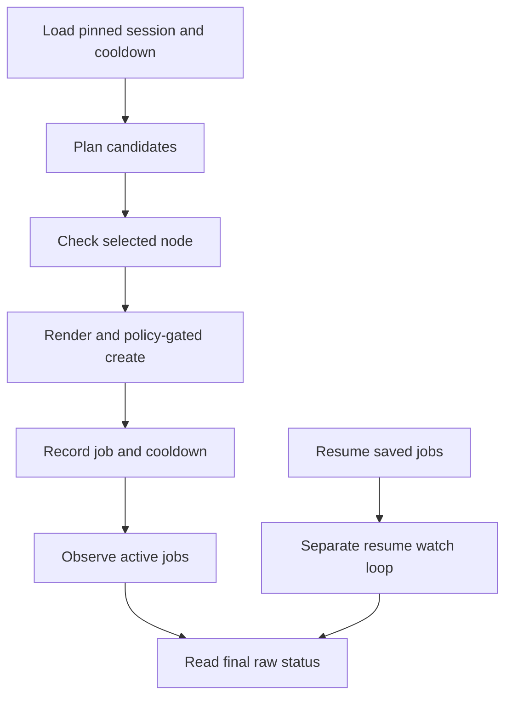

# C4: Job Control

Status: Phase 1.3 admission, Phase 1.4 durable intents and Phase 1.5 verification
source implemented; deployment acceptance pending. Control consolidation below
remains proposed. Baseline/counting:
[overview](major-components-overview.md#measurement-method).

## In Simple Terms

Before starting a Job, record exactly what should start. If the reply is lost,
look for that same Job instead of starting another one. A second command must
not bypass the first command's reservation of the node and validation slot.

## Overview

Own the complete lifecycle of an approved validation request: select an available
slot, recheck eligibility, submit once, track identity, reconcile uncertainty and
request exact-run verification. Run one active controller per configured scope.

## Phase 2 Tracking Contract

Reviewed proposal (2026-09-24), not the deployed Phase 1 behavior: keep everyday
tracking to Kubernetes Job/pod status and bounded container-log observations. The
shared tracker answers: has execution started, is it running or terminal, did the
tests pass/fail, and did the runtime explicitly finish retaining evidence and
ingesting the required raw results? No new service, tracking database, recovery
engine or per-poll full-store audit is needed.

Reuse the existing client, intent identity and `CVAL_EVENT` parser. Resolve the
owned pod/container for the exact submitted Job/run; do not adopt another pod's
success message. The supervisor provides the final compact summary, with test and
ingestion acknowledgements produced by their actual owners. Missing log output
means completion is unconfirmed, not successful. A Kubernetes Completed/Succeeded
phase plus passing test outcomes and explicit successful ingestion is the routine
completion signal, distinct from independently verified release acceptance.

Confirmed terminal failure ends this workload attempt. Preserve the Job/pod and
available evidence, record any missing or partial ingestion, free execution capacity
for other eligible work, and do not restart/recreate it. Preserve submission
cooldown and same-run identity protection. A controller restart observes retained
work; it must not restart its Jobs. Lost create replies, missing identity or API
failure still require bounded read-only reconciliation, never blind resubmission.

This deliberately changes Phase 1's coupling of routine tracking to full C7
verification. During implementation, separate an execution slot from a retained
unresolved evidence report; do not simply erase the report or mark it accepted.
C7 exact-run audits remain available for release acceptance, incidents and explicit
operator inspection. Any rollout still needs the existing exact approvals.

Later scheduler-selected work is a new run, not a retry of the failed Job. The
current writers may retain failure rows, and complete failed runs can currently
refresh coverage. Follow the [revised Phase 2 plan](redesign-development-plan.md#phase-2-consolidate-control)
when changing retest freshness; do not infer "never tested" from failure or delete
raw rows to manufacture expiry. No new recovery queue is implied.

## Details and Purpose

| Input | Owned Decision | Output |
| --- | --- | --- |
| Candidate queue and session receipts | Cooldown, outstanding jobs and bounded concurrency | Next selected candidate |
| Exact source, reviewed config and approval | Whether this precise create is authorized now | Submission intent and receipt |
| Kubernetes observations | Submitted/running/terminal/unknown; retain unresolved slots | Recoverable lifecycle state |
| C7 verification report | Apply the separate execution/outcome/evidence acceptance rule | Operator report, never a health class |

Rendering belongs to C8, eligibility rules to C3 and evidence verification to C7.
No observation failure authorizes deletion, replacement or a duplicate submit.

## Current Process Flow

## Codebase Size

| Kind | Files | Physical Lines |
| --- | ---: | ---: |
| Code | 10 | 3,435 |
| Configuration | 0 | 0 |
| Tests | 6 | 2,620 |

Counted: [policy](../../cval/policy.py), [manager](../../cval/jobs/manager.py),
[monitor](../../cval/jobs/monitor.py), [workflow](../../cval/orchestrator/workflow.py),
[targeted validation](../../cval/orchestrator/validate.py),
[live loop](../../scripts/cval-live.sh), [session state](../../scripts/cval-live-state.py),
[cooldown](../../scripts/cval-node-cooldown.py), and jobs/orchestrator initializers.
Tests: job manager, validate, workflow, live loop, live state and node cooldown.
The shell loop alone is 1,871 lines; this is a concentration, not a deletion target.

## Functionality Assessment

| Category | Functionality | Decision |
| --- | --- | --- |
| Critical | Exact source, fresh eligibility, approval, bounded slots, receipts, cooldown and resume | Preserve under one lifecycle owner. |
| Good | Live progress, controlled one-node acceptance, recoverable interruption | Reuse for manual and continuous workflows. |
| Not important | Optional pending-job pruning | Keep separately gated and off by default. |
| Useless | Duplicate resume/active monitoring and repeated JSON-to-shell conversions | Consolidate behavior, not safeguards. |

## Current Issues

1. Resume and active-loop observation/pruning are implemented twice. Repeated CLI
   subprocesses reload config and translate the same state through JSON/TSV/CSV.
2. Targeted validation and the regular monitor have different deadline and evidence
   handling. Job phase alone is not proof of a complete successful run.
3. New-source submission, crash recovery and evidence-release transitions still
   need separately approved live acceptance. Do not activate an incomplete Phase 1 stack.

## Phase 1.3 Implementation

The existing [manager](../../cval/jobs/manager.py) now owns one short, nonblocking
admission lock shared by `run`, targeted `validate`, and the live loop's `run`
calls. The existing [state helper](../../scripts/cval-live-state.py) uses that same
lock for initialization and updates. Common session/Job readers are reused rather
than duplicated; atomic state replacement now fsyncs its parent directory.

Explicit main-TOML host and cluster settings bind admission to the designated
control host. The absolute shared log directory prevents worktrees from acquiring
independent locks. The existing active-session pointer must identify a session
whose additive `admission_scope`, source and full pinned configuration match.
Missing/corrupt/legacy or incompatible state is rejected, not migrated. New session
initialization refuses to overwrite the active pointer. All old writers must be
stopped and reconciled through approved turnover before activation.

Inside the lock, the manager rerenders the request from the pinned configuration,
checks live Jobs plus unreconciled session rows for node/slot conflicts and name
reuse, then rechecks policy and C3 eligibility immediately before each create.
Automatic mode excludes cordons; only targeted validation requests the drained
Ready cordon exception. Node identity is `node_name`, with no replacement tracking.
The lock is never held through the benchmark or monitor.

Read-only evidence on 2026-09-24 UTC rejected actual busy node `0307`, an outstanding
Pending Job on `0262`, and the current legacy session without changing its records.
Real local OS processes verified lock contention, permissions and release in an
isolated temporary directory. Strict config snapshots round-tripped and the actual
control host/cluster matched. Retained evidence is under
`run-logs/phase13-*-20260924.json`. No fake Kubernetes clients, new test scripts,
GPU submissions or live state mutations were used.

Successful create, new-session initialization, slot saturation and concurrent real
submitters remain unverified and approval-gated. The new lock cannot fence an old
writer or another host. Existing shell cooldown behavior is unchanged. Durable
intent/receipt persistence and evidence-based reservation release are described
below. Do not treat this
source change as exactly-once delivery or completed cluster acceptance.

## Phase 1.4 Implementation

New sessions use `cval.live-state.v2` in the existing state file. V1 remains readable
without conversion and cannot admit new-source writes. Initialization requires an
explicit approval/rollback record; its text, path and digest are retained in the
session. Each intent binds that digest, exact source/config/manifest, node_name,
timestamp/run ID, confirmation and cordon policy. An approval record is evidence,
not a substitute for separately approved commands and mutation preconditions.

Before create, the shared manager durably records `prepared` and `submitting`, then
performs the final node read. A known pre-create failure records `not_created`.
Create requests return JSON; full responses and errors are saved before proceeding
to another Job. A verified response adds its Job UID and creation time. Both file
and parent directory are fsynced. A failed outcome write stops admission, leaving
the earlier intent/response for reconciliation; appending always reloads the latest
durable state so a failed CSV projection cannot erase a saved event.

The existing eight-column jobs CSV is derived from intents, including uncertain
attempts whose CLI replies were lost. Before further admission, retained attempted
intents are observed by exact Job name. Requested fields and the complete pod
workload must match, along with any previously received Job UID. Server metadata
and additional Job/task defaults are not treated as requested fields. Unexpected
pod-template normalization fails closed and needs reviewed evidence; no scheduler
equivalence claim is made from the current historical observation.

Missing or unavailable observations remain `uncertain`; mismatches become
`conflict`. Neither frees the node/slot or triggers another create. Prepared-only
crash records and conflicts require explicit reconciliation. A terminal matching
Job retains its reservation until the Phase 1.5 evidence decision described below. The
existing state-helper `job` operation can retain a bounded exact observation under
the same lock; a supplied phase alone cannot establish identity. No new retry mode,
service, test script or raw DB was introduced.

`run` now emits accumulated batch records with a nonzero exit on later failure;
successful response fields remain unchanged. Durable intents remain authoritative
if output transport or projection fails. The shell's existing nonzero-exit path
stops the cycle without a replacement Job. Broader resume-loop consolidation and
automatic recovery from every crash boundary are not claimed complete here.

Verification on 2026-09-24 UTC used an actual Pending Job, an actually absent prior
approved Job, a byte-identical historical session copy, and real local OS write
failures in temporary directories. File-size exhaustion preserved old state; a
CSV replacement failure preserved the new state event, and a stale caller could
append without erasing it. Identity comparison used a requested-field projection
of an observed historical Job, not a historical original intent. Retained evidence:
`run-logs/phase14-observation-check-20260924.json`,
`run-logs/phase14-durable-io-check-20260924.json`, and
`run-logs/phase14-partial-persistence-check-20260924.json`.

No fake Kubernetes clients or benchmark fixtures were used. Successful creation,
actual lost-create replies, partial live batches, fsync failure after replacement,
and concurrent real submitters were not exercised. Raw SQLite was not changed.
Live session turnover/activation is deferred until Phase 1 is finished.

## Phase 1.5 Integration

Terminal reconciliation and the existing state-helper `job` operation invoke the
[C7 exact-run verifier](raw-evidence-major-component.md#phase-15-implementation).
The resulting `verification_finished` event retains the report in v2 intent history.
The shared release predicate checks the original node/run/source/config/manifest
and known Job UID, not just a terminal phase or a caller-supplied success flag.

Known complete, incomplete or conflicting terminal evidence may release tracking
without accepting the run. Any inaccessible evidence, unstable generation, changed
Job/pod identity or nonterminal execution keeps the reservation. Fully recorded
failed tests remain failures. Same-run reuse stays blocked, and ordinary cooldown
and approval requirements remain; verification never deletes or retries a Job.

Targeted validation no longer uses latest status or log markers as acceptance proof.
It checks exact evidence, retains the decision under the existing admission lock,
and reports per-source state. Historical read-only evidence validated the consumer
and release predicates, but no live state was released in development. Actual
turnover and fresh execution remain deferred until Phase 1 is finished.

## Proposed Design

### Phase 1 Integration Completion

Shared admission now applies the existing cooldown helper to retained table entries
and confirmed creation times in durable intents, covering manual commands as well
as the loop. Uncertain attempts never invent a submission time. The existing state
helper's `update --reconcile` lets resume recover from authoritative v2 intents even
if CLI receipt output was lost. Missing derived CSV is rebuilt after reconciliation;
missing or corrupt authoritative state is never recreated. All intent observations
in one reconciliation pass share the configured deadline.

The live-loop resume path uses this state before selecting work; it does not infer
an empty queue from missing or malformed receipt output. Existing receipt-reader
helpers remain for historical interface compatibility, not as active admission
authority. No new service or runtime module was added for these changes. Actual
lost replies, concurrent creates and new-source live turnover still need approved
acceptance; local checks used the real cooldown table and retained real identities.

### Remaining Design

1. Keep shell only for process/session launch. Move one bounded lifecycle pass into
   existing Python orchestration and share it between continuous and targeted runs.
2. Before create, durably retain intent in existing session storage: job name,
   node/run identity, source SHA, configuration and requested-manifest digests.
   Version changes need compatible readers; keep old records. This is operational
   state, not a new raw history database.
3. Recheck C3 eligibility at the create boundary. Preserve full-node resource
   isolation; a read is not a Kubernetes reservation and cannot eliminate races.
4. Record each result immediately. On timeout, reconcile exact name and identity;
   a match becomes an observed receipt, a conflict blocks, an unavailable read
   keeps the slot occupied. Never promise exactly-once Kubernetes delivery.
5. One state transition function handles both resume and active observation. Pass
   a shared deadline to calls; batch named-job reads without converting API errors
   into missing jobs. Retain UID once observed to detect replacements.
6. Request C7 verification after terminal execution. Apply the
   [outcome and evidence contract](Redesign.md#outcome-and-evidence-contract): a
   complete failure record is reportable but not accepted. Preserve jobs/evidence.

## Admission and Recovery Protocol

The initial deployment has one designated control host per cluster identity,
namespace and validation root. `run`, `validate` and the live loop must share
its admission library, state directory and lock. Read-only clients may run
elsewhere; another host must not submit without a separately approved ownership
transfer. Local locks do not provide cross-host fencing or automatic failover.
Scopes with overlapping node inventories must share admission ownership; changing
a job prefix or evidence root does not make concurrent controllers independent.

1. Under the admission lock, check ownership and existing reservations, choose a
   fresh run identity and render the exact request. Reject known name/run collisions;
   keep the same identity through retries. A prefix alone never proves ownership.
2. Persist the approved intent with atomic replacement and required file/directory
   durability. Reserve node and slot before any create. Persistence failure blocks
   creation; approval must match the request's source/config/manifest identity.
3. Recheck C3 eligibility for `node_name` immediately before the bounded create
   and check for config changes. Never hold the admission lock for the
   entire workload; use durable reservations and short serialized state transitions.
4. Persist the observed Job UID and outcome before admitting more work. Failed
   receipt persistence after creation stops admission; the prior intent and returned
   identity must remain available for reconciliation.
5. Reconcile using cluster/namespace, exact name, run/node bindings, source/config
   and expected workload fields; require the saved UID once known. Kubernetes adds
   defaults, so compare controlled fields, not a hash of the entire returned object.

The requested-manifest hash and annotations help identity checks but do not prove
the returned workload is unchanged. Do not adopt a foreign Job or changed UID
because its name happens to match.

| Situation | Slot and Retry Rule |
| --- | --- |
| Create response lost or timed out | Keep node/slot reserved; read the same identity with a bounded deadline. |
| Single NotFound after uncertain create | Not proof that creation never happened; no new identity or blind retry. |
| Matching Job observed | Retain receipt and derive cooldown from confirmed submission, not from a planning attempt. |
| Ownership conflict, state corruption or unavailable observation | Stop admission; retain unresolved work for explicit reconciliation. |
| Terminal execution, evidence read still unavailable | Retain pending verification in the existing inflight budget; do not resubmit the run. |
| Terminal run with complete failure evidence | Report failure and release its tracked slot; preserve normal cooldown. |

Once a bounded check proves evidence incomplete/conflicting rather than unreadable,
retain that report and release terminal execution tracking. Block same-run reuse;
any recovery or later validation has its own policy/approval and cooldown checks.

Use one deadline per bounded operation, including API reads and verification;
persist observation timestamps but use a monotonic clock for elapsed time.
Restart reads saved records and re-observes reality; it never invents a successful
submission, empty queue or fresh approval from missing/corrupt state.

## Phase 0 State Contract

Decision for Phase 1 implementation; no session files are changed in Phase 0.
The Phase 0 helper wrote `cval.live-state.v1`; the
[current helper](../../scripts/cval-live-state.py) writes v2 for new sessions,
with a strict eight-column `jobs.csv` and derived summary.
Use the existing session directory and helpers, not a new database or event engine.

| Record | Required Content |
| --- | --- |
| Session identity | Cluster identity without credentials, namespace, canonical validation root, approved control-host identity and session ID. |
| Pinned inputs | Exact source SHA, immutable effective config snapshot/digest and source artifact identity; recorded once per session. |
| Per-Job intent | Existing job/run/node_name/timestamp identity, requested manifest digest and retained approval/rollback reference. |
| Create observation | Whether create was attempted, known/uncertain outcome, returned/observed Job UID and timestamps; unknown fields stay unknown. |
| Recovery evidence | Existing submission response and exact-observation artifacts; no regenerated approval or new run ID after a lost reply. |

Use `cval.live-state.v2` for new sessions requiring intent records. Keep `jobs.csv`
columns and operator summary as compatible projections; v2 intent/receipt data is
authoritative for admission. Read historical v1 records without rewriting them.
V1 sessions lacking intent identity need explicit reconciliation before takeover;
do not pretend a legacy row proves a modern admission check.

One local scope-wide admission lock serializes prepare/check/create/receipt and
state updates across supported submitters. Keep it separate from the existing
long-lived loop-owner lock. Persist intent before create, including file and parent
directory durability; the cooldown helper already demonstrates that write pattern.
Do not hold the short lock while a workload runs, and do not use an unverified
shared-PVC lock as cross-host ownership proof.

All submitters bind the same active session. A different host, scope, source or
effective configuration requires an explicitly reviewed session turnover after
outstanding work is reconciled; it is not silently merged. Initially this may
refuse a manual command while an incompatible live session exists. No request
queue, RPC service or multi-controller failover is introduced.

Rollback never points a v1-only writer at v2 state or rewrites v2 as v1. Preserve
both records; reconcile tracked Jobs before starting a separately approved compatible
session. Missing/corrupt state or failed receipt persistence stops new admission.

## Acceptance and Risk

Use approved real-node runs and retained real session/Job records to verify
admission, receipts, cooldown and resume. Real lost responses or partial batches
must keep their original identities. Deliberate interruption, concurrency or
ownership-transfer exercises require exact approval; do not disrupt active work
to create a failure. Mark unobserved crash/write/UID-conflict cases unverified.
Measure calls per real run under the [real-node policy](Redesign.md#real-node-validation-policy),
without new fake clients or cached eligibility across creates.
Priority P0 for correctness, P1 for consolidation; high mutation/restart risk.
