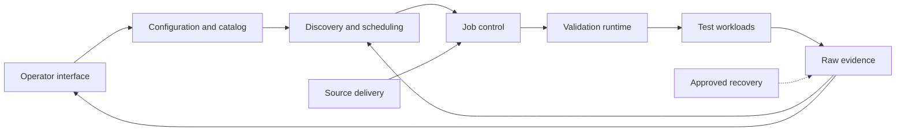

# Major Components Overview

Design baseline: `647848a6279d992d4327aecadece3a4aaf3e7b7e` (2026-09-23).
This is a proposed redesign, not implemented behavior or live-state evidence.

## Scope

c-val discovers eligible capacity, runs registered tests and verifies retained
logs, results and test-owned raw ingestion. It does not classify, rank, score,
repair or automatically cordon nodes. Post-processing is outside this framework.

Nine logical components are proposed below. They share one Python package and
bounded command-line adapters; they are not nine services or new frameworks.

Read [Redesign.md](Redesign.md) for architecture and contracts, and the
[development plan](redesign-development-plan.md) for phases and task checklists.
Component pages describe the baseline first, then proposed changes.

| ID | Major Component | Purpose | Current Anchor |
| --- | --- | --- | --- |
| C1 | [Configuration and test catalog](configuration-catalog-major-component.md) | One immutable definition of settings, tests and resource requirements. | [Configuration](../../cval/config.py) |
| C2 | [Operator interface](operator-interface-major-component.md) | Translate inspection and approved commands into application calls. | [CLI](../../cval/cli.py) |
| C3 | [Discovery and scheduling](discovery-scheduling-major-component.md) | Observe capacity and order due candidates without mutation. | [Discovery](../../cval/k8s/discovery.py) |
| C4 | [Job control](job-control-major-component.md) | Own submission, reconciliation, cooldown and bounded monitoring. | [Job manager](../../cval/jobs/manager.py) |
| C5 | [Validation runtime](validation-runtime-major-component.md) | Reserve evidence safely and supervise registry-driven execution. | [Supervisor](../../cval/validation/supervisor.py) |
| C6 | [Test workloads](test-workloads-major-component.md) | Own storage, NCCL and DL execution, settings and measurements. | [Test descriptors](../../config/cval.toml) |
| C7 | [Raw evidence](raw-evidence-major-component.md) | Authorize test-owned writes and expose exact-run verification and exports. | [Ingestion](../../cval/storage/run_ingest.py) |
| C8 | [Source delivery](source-delivery-major-component.md) | Build verified, exact-commit source and self-contained Job startup. | [Source renderer](../../scripts/cval-source.py) |
| C9 | [Recovery and maintenance](recovery-maintenance-major-component.md) | Inspect, back up and restore evidence under separate approval. | [Backup](../../scripts/cval-backup.py) |

## Proposed Flow



Tests, documentation and release acceptance apply across components. Raw database
ownership stays test-specific; shared orchestration does not justify a generic
per-test database, a message broker or another long-running service.

## Baseline Size

Counts use current files assigned to their proposed primary owner. They are not
estimates of the future implementation or a reason to discard tests.

| ID | Code Files | Code Lines | Config Files | Config Lines | Test Files | Test Lines |
| --- | ---: | ---: | ---: | ---: | ---: | ---: |
| C1 | 8 | 2,227 | 1 | 89 | 5 | 1,074 |
| C2 | 1 | 1,064 | 0 | 0 | 1 | 841 |
| C3 | 5 | 806 | 0 | 0 | 3 | 479 |
| C4 | 10 | 3,435 | 0 | 0 | 6 | 2,620 |
| C5 | 9 | 3,595 | 0 | 0 | 5 | 1,973 |
| C6 | 16 | 1,298 | 9 | 189 | 1 | 1,743 |
| C7 | 14 | 5,150 | 0 | 0 | 8 | 3,532 |
| C8 | 3 | 757 | 3 | 241 | 1 | 669 |
| C9 | 4 | 2,389 | 1 | 80 | 3 | 1,146 |
| Total | 70 | 20,721 | 14 | 599 | 33 | 14,077 |

## Measurement Method

1. Use tracked blobs at the full baseline commit above, not the working tree.
2. Count physical text lines including comments, docstrings and blanks; include
    the final unterminated line. Initializer files count even when empty. These
    are not executable statements or logical source lines.
3. Code includes Python and shell under the package, scripts and workload roots.
    Configuration includes TOML, YAML templates and FIO jobs. Test counts cover
    host unittest files separately; cross-component coverage is assigned once.
4. Component pages list their owned file sets. Every measured file has one owner;
    shared filesystem helpers remain C5 and shared SQLite helpers C7.
5. Exclude documentation, Git metadata, bytecode, run logs, generated artifacts,
    external benchmark source and third-party dependencies. Workspace agent
    customization is outside the nested repository and this redesign.

For example, this read-only count reproduces one owned source file:

```bash
git show 647848a6279d992d4327aecadece3a4aaf3e7b7e:cval/config.py | awk 'END {print NR}'
```

## Functionality Ratings

| Rating | Meaning | Default Action |
| --- | --- | --- |
| Critical | Required execution, correctness, safety or evidence contract | Preserve and test. |
| Good | Useful capability with a clear consumer | Retain unless costs outweigh use. |
| Not important | Convenience or lower-priority behavior | Defer; assess callers before retiring. |
| Useless | Proven redundant behavior or unsupported addition | Remove duplication, not safeguards; require evidence of non-use. |

"None proven" is deliberate where no safe deletion candidate was established.
Implementation risks and completion checks are recorded in each component page.

## Documentation Replacement

The former CLI design note is replaced by C2, including its current mode and
migration inventories. The raw database note is replaced by C7, including its
dated observations. The PVC layout note is replaced by C9, distinguishing current
configured paths from historical inventories. They remain recoverable in Git.
Untracked/user-owned files and retained runtime evidence are not part of this replacement.
