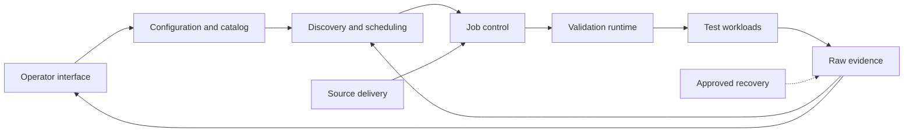

# Major Components Overview

Design baseline: `647848a6279d992d4327aecadece3a4aaf3e7b7e` (2026-09-23).
Phases 1-5 source work is implemented; Phase 6 reconciles this map with the code.
Fresh exact-commit acceptance and activation remain pending. Baseline counts below
are historical; they are not current source counts or live-state evidence.

## In Simple Terms

There are three jobs: decide when validation may run, execute the tests, and check
the saved evidence. The nine components divide responsibility for those jobs;
they are not nine programs to deploy or nine new abstractions to build.

## Scope

c-val discovers eligible capacity, runs registered tests and verifies retained
logs, results and test-owned raw ingestion. It does not classify, rank, score,
repair or automatically cordon nodes. Post-processing is outside this framework.

Nine logical responsibilities are mapped below, not nine mandatory modules.
They share one Python package and existing command-line entry points; no new
service or abstraction is implied.

Read [Redesign.md](Redesign.md) for architecture and contracts, and the
[development plan](redesign-development-plan.md) for phases and task checklists.
Component pages retain baseline counts and identify implemented work and limits.

## Reading Guide

1. Use this page for boundaries and measured size.
2. Read the [architecture](Redesign.md) for shared contracts and failure decisions.
3. Read an individual component for its source implementation and remaining limits.
4. Use the [development plan](redesign-development-plan.md) for tasks and gates.

Source implementation does not imply cluster acceptance. Remaining proposals are
explicitly deferred or retained; the task list is not rollout approval.

The main goal is one clear owner for each decision with minimal code. Prefer
existing functions to new classes, layers or wrappers; remove duplicated logic
before moving files. Preserve safety/data boundaries, not a fixed component count.
Runtime changes use [real-node validation](Redesign.md#real-node-validation-policy),
without building fake-cluster or synthetic-test infrastructure.

| ID | Major Component | Purpose | Current Anchor |
| --- | --- | --- | --- |
| C1 | [Configuration and test catalog](configuration-catalog-major-component.md) | One immutable definition of settings, tests and resource requirements. | [Configuration](../../cval/config.py) |
| C2 | [Operator interface](operator-interface-major-component.md) | Translate inspection and approved commands into application calls. | [CLI](../../cval/cli.py) |
| C3 | [Discovery and scheduling](discovery-scheduling-major-component.md) | Observe capacity and order due candidates without mutation. | [Discovery](../../cval/k8s/discovery.py) |
| C4 | [Job control](job-control-major-component.md) | Own submission, reconciliation, cooldown and bounded monitoring. | [Job manager](../../cval/jobs/manager.py) |
| C5 | [Validation runtime](validation-runtime-major-component.md) | Reserve evidence safely and supervise registry-driven execution. | [Supervisor](../../cval/validation/supervisor.py) |
| C6 | [Test workloads](test-workloads-major-component.md) | Own storage, NCCL and DL execution, settings and measurements. | [Test descriptors](../../config/cval.toml) |
| C7 | [Raw evidence](raw-evidence-major-component.md) | Authorize test-owned writes; read history and report exact-run evidence completeness. | [Ingestion](../../cval/storage/run_ingest.py) |
| C8 | [Source delivery](source-delivery-major-component.md) | Extract a verified exact commit from the shared PVC checkout into an isolated Job workspace. | [Shared bootstrap](../../cval/jobs/bootstrap.sh) |
| C9 | [Recovery and maintenance](recovery-maintenance-major-component.md) | Inspect, back up and restore evidence under separate approval. | [Backup](../../scripts/cval-backup.py) |

## Phase 0 Ownership Contract

These decisions now have the source owners below; fresh runtime acceptance remains
pending. No new service, directory split or forwarding wrapper was required.

| Owner | Receives | Owns / Returns | Must Not Own |
| --- | --- | --- | --- |
| C1 Configuration/catalog | Reviewed config and test descriptors | Frozen settings, selected tests and input identity | Cluster observations or job creation |
| C2 CLI | Operator arguments and component responses | Parsing, compatible output and exit behavior | A second scheduler, writer or acceptance policy |
| C3 Selection | Node/pod observations, C1 requirements and C7 history | Eligibility reasons and ordered due candidates | Rendering, reservations or submission |
| C4 Job control | Candidates, exact request and approval | Slot/node admission, create, receipts, observation and acceptance | Test metric interpretation or raw DB writes |
| C5 Runtime | Admitted run identity and C6 catalog | Protected evidence paths, process lifecycle and canonical results | Node selection or benchmark-specific metric meaning |
| C6 Workloads | Settings and runtime-provided paths | Actual tests, measurements and required output definitions | Job creation or framework-wide persistence |
| C7 Evidence | Canonical results, test-owned outputs and expected identity | Authorized raw writes; read-only exact-run/history reports | Resubmission, node-health verdicts or automatic repair |
| C8 Delivery | Exact source/config and placement inputs | Verified source artifacts and rendered manifests | Approval or activation decisions |
| C9 Maintenance | Reviewed scope, identities and approval | Separately gated backup/layout/journal operations | Automatic work in the validation loop |

Keep C2/C8 as adapters to existing functions. C5/C6 share the in-pod execution
path but retain different responsibilities: process/evidence safety versus test
meaning. C7 retains explicit per-test writers. Merge duplicate implementations
inside these owners, not their safety boundaries.

The [plan handler](../../cval/cli.py) remains read-only; the
[submission manager](../../cval/jobs/manager.py) owns shared admission and fresh
eligibility for both batch and targeted callers. A supplied node list is not
eligibility proof. Normal tracking uses shared Job/pod/log observation; detailed
raw verification is reserved for explicit acceptance and diagnosis.

## Source Flow



Tests, documentation and release acceptance apply across components. Raw database
ownership stays test-specific; shared orchestration does not justify a generic
per-test database, a message broker or another long-running service.

## Execution Boundaries

| Where | Components | May Do |
| --- | --- | --- |
| Designated control host | C1-C4; C8 rendering | Inspect, prepare and serialize approved submissions. |
| Validation Job | C1 snapshot; C5-C6; C7 writers | Run tests and write only authorized evidence. |
| Controller with PVC / read-only PVC reader | C2; C7 readers | Read local mounted coverage or inspect/export; never silently repair data. |
| Release or maintenance command | C8-C9 | Prepare artifacts offline; mutate only under separate approval. |

C7 is shared library code used in different processes, not a new data service.
Configuration, observation and storage helpers are reused across these boundaries.
See the [outcome contract](Redesign.md#outcome-and-evidence-contract) for why
complete evidence and a passing validation are different results.

## Baseline Size

Counts use baseline files assigned to their primary owner. They are not current
measurements or a reason to discard tests. Phase 6 final deltas are recorded in
the [development plan](redesign-development-plan.md).

| ID | Code Files | Code Lines | Config Files | Config Lines | Test Files | Test Lines |
| --- | ---: | ---: | ---: | ---: | ---: | ---: |
| C1 | 8 | 2,227 | 1 | 89 | 5 | 1,074 |
| C2 | 1 | 1,064 | 0 | 0 | 1 | 841 |
| C3 | 5 | 806 | 0 | 0 | 3 | 479 |
| C4 | 10 | 3,435 | 0 | 0 | 6 | 2,620 |
| C5 | 9 | 3,595 | 0 | 0 | 5 | 1,973 |
| C6 | 16 | 1,298 | 9 | 189 | 1 | 1,743 |
| C7 | 14 | 5,150 | 0 | 0 | 8 | 3,532 |
| C8 | 3 | 757 | 3 | 241 | 1 | 669 |
| C9 | 4 | 2,389 | 1 | 80 | 3 | 1,146 |
| Total | 70 | 20,721 | 14 | 599 | 33 | 14,077 |

### Phase 0 Baseline Record

Measured at published source `b79a5e04803277a261285556d014b2885e8c1868`.
All 117 counted code/config/test blobs match the `647848a` inventory byte-for-byte;
the component table above therefore remains the valid source-size baseline.

| Measure | Baseline | Evidence / Limit |
| --- | --- | --- |
| Historical source bundle | 276,294 compressed bytes | Measured for the retired ConfigMap transport; current Jobs archive the exact commit from the shared PVC checkout. |
| Bundle SHA-256 | `183165e8876d174d39b15d1385591d5d352ccbfebdfd8bc4ed21336e6050c5ae` | Embedded Git identity matches the full baseline SHA. |
| Live-loop CLI call sites | 11 | Static source sites across five commands; not calls per executed cycle. |
| Executed subprocess/API counts | Unavailable | No instrumented real cycle at this exact revision; no synthetic substitute. |
| Startup/execution/ingestion timings | Unavailable | No newly approved exact-baseline validation was run in Phase 0. |

Read-only context at `2026-09-23T23:45:23Z`: the live-status collector observed a
running session pinned to `1abde89`, whose saved Job records contained eight
Completed and one Pending. These are recorded session observations, not a new
canonical/raw acceptance audit, and not evidence that `b79a5e0` is active.
The collector output and full measurement JSON are retained locally under run-logs,
outside the published source. No live Job, source object or controller was changed.

## Measurement Method

1. Use tracked blobs at the full baseline commit above, not the working tree.
2. Count physical text lines including comments, docstrings and blanks; include
    the final unterminated line. Initializer files count even when empty. These
    are not executable statements or logical source lines.
3. Code includes Python and shell under the package, scripts and workload roots.
    Configuration includes TOML, YAML templates and FIO jobs. Test counts cover
    host unittest files separately; cross-component coverage is assigned once.
4. Component pages list their owned file sets. Every measured file has one owner;
    shared filesystem helpers remain C5 and shared SQLite helpers C7.
5. Exclude documentation, Git metadata, bytecode, run logs, generated artifacts,
    external benchmark source and third-party dependencies. Workspace agent
    customization is outside the nested repository and this redesign.

For example, this read-only count reproduces one owned source file:

```bash
git show 647848a6279d992d4327aecadece3a4aaf3e7b7e:cval/config.py | awk 'END {print NR}'
```

## Functionality Ratings

| Rating | Meaning | Default Action |
| --- | --- | --- |
| Critical | Required execution, correctness, safety or evidence contract | Preserve and test. |
| Good | Useful capability with a clear consumer | Retain unless costs outweigh use. |
| Not important | Convenience or lower-priority behavior | Defer; assess callers before retiring. |
| Useless | Proven redundant behavior or unsupported addition | Remove duplication, not safeguards; require evidence of non-use. |

"None proven" is deliberate where no safe deletion candidate was established.
Implementation risks and completion checks are recorded in each component page.

## Documentation Replacement

The former CLI design note is replaced by C2, including its current mode and
migration inventories. The raw database note is replaced by C7, including its
dated observations. The PVC layout note is replaced by C9, distinguishing current
configured paths from historical inventories. They remain recoverable in Git.
Untracked/user-owned files and retained runtime evidence are not part of this replacement.
