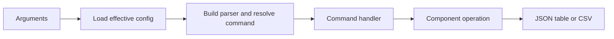

# C2: Operator Interface

Status: proposed redesign. Baseline/counting: [overview](major-components-overview.md#measurement-method).

## In Simple Terms

Commands should clearly say what was requested, what happened and what remains
unknown. An empty answer means there were no records, not that a read failed.

## Overview

Give people and automation one predictable interface to inspection and explicitly
approved work. Parse input and format output here; business decisions belong to
configuration, discovery, job control and evidence owners.

## Details and Purpose

Inputs are command arguments plus reviewed configuration. Outputs are stable JSON,
human-readable tables, raw CSV exports and meaningful exit codes. Read-only
inspection must remain independently usable when mutation is not authorized.
An approval flag is not permission to delete, prune, restart or migrate anything.

## Current Process Flow

## Codebase Size

| Kind | Files | Physical Lines |
| --- | ---: | ---: |
| Code | 1 | 1,064 |
| Configuration | 0 | 0 |
| Tests | 1 | 841 |

Counted: [CLI](../../cval/cli.py) and [CLI tests](../../tests/test_cli.py).
The installed entry-point declaration is counted under C8. Handlers span other
responsibilities today; this attribution does not imply they should keep doing so.

## Functionality Assessment

| Category | Functionality | Decision |
| --- | --- | --- |
| Critical | Read-only commands, explicit submission gates, exact source identity, failure exit codes | Preserve. |
| Good | JSON for automation, tables for people, descriptor inspection | Retain a small predictable interface. |
| Not important | Alias pairs and individual writer hooks no longer used by normal ingestion | Review external users before deprecation. |
| Useless | New single-choice output selectors or duplicate config overrides | Do not reintroduce removed controls. |

## Current Issues

1. One parser mixes operators, ingestion compatibility and repair commands.
2. `run` and `validate` use different orchestration paths; explicit node lists in
   `run` can bypass discovery. CLI parsing cannot be the final safety boundary.
3. JSON errors are not one stable contract, and some lower readers collapse
   unavailable observations into empty output. Shared result/error handling is needed.

## Proposed Design

Keep the public names during migration. Route `run` and `validate` through one
job-control operation and admission lock; `validate` adds watch and evidence verification. Keep
`plan` strictly read-only. Move decisions out of handlers only when this removes
duplicate behavior, not merely to create more files.

Return structured operation outcomes, including partial submission receipts and
forbidden/unavailable states. Keep diagnostics on stderr and automation data on
stdout. Inventory external usage before retiring hidden hooks; retain required
rebuild/recovery operations outside normal ingestion.

### Reporting Contract

Use the shared [outcome and evidence contract](Redesign.md#outcome-and-evidence-contract).
An inspection command can succeed while returning failed test results. Successful
command execution is not a promise that the inspected validation passed.

| Operation Result | Output and Exit Behavior |
| --- | --- |
| Read completed, no records | Successful empty result, with scope/time when supported. |
| Read forbidden, unavailable or malformed | Nonzero exit and explicit reason; never substitute an empty list. |
| Some creates succeeded, others failed/uncertain | Nonzero exit with every known receipt and unattempted identity retained. |
| Validation evidence complete but a selected test failed | Report the failure and complete evidence; validation acceptance is false. |
| Export read failed | Do not publish an apparently complete CSV; retain diagnostics separately. |

Normalize results internally, then adapt to existing command schemas. Do not wrap
all current JSON outputs in a new envelope or change numeric exit codes without
caller tests and migration notes. Buffer/atomically publish local exports only
after a complete read; define any intentional partial export explicitly.

## Mode Inventory

Current supported contracts carried forward from the former CLI design note:

| Surface | Supported Behavior |
| --- | --- |
| `config`; `tests list/describe/validate` | Effective JSON config; descriptor inspection and local validation. |
| `nodes` | Discovery, inventory-only, or targeted node check. |
| `plan` | Candidate queue only; no rendered Job and no mutation. |
| `plan/run` inputs | Live discovery or explicit node list; no history, live history or JSON snapshot. Explicit empty nodes remain empty. |
| `run`; `validate` | Confirmed batch submission; confirmed one-node submission/watch/verification. |
| `jobs`; `status` | Snapshot/watch of named Jobs; read-only latest raw status. |
| `results` | Raw CSV; test selection, `all`/`overall` alias and status-only option. |
| Live-loop commands | Start, stop, status, attach, run-once and internal run-loop; separate prune approval. |
| Hidden writer hooks | `db-add-run-results`, `db-add-storage-result`, `db-add-nccl-health`, `db-add-dltest-run`. |
| Maintenance hook | `db-rebuild-dltest-metrics`; explicit repair rather than normal execution. |

Exact source, run timestamp, deadlines, selection filters and export destination
remain purposeful inputs. NCCL recovery confirmation, immutable-result arguments
and rebuild `--only-missing` are safety/data contracts, not cosmetic clutter.

## Phase 0 Compatibility Inventory

Source/caller review at `b79a5e0`; not usage telemetry. Scope: tracked runtime,
scripts, descriptors/templates, runbook and workspace operational collectors.
Private external callers are unknown, so Phase 1 preserves every interface below.

| Retained Interface | Observed Caller / Evidence | Compatibility Decision |
| --- | --- | --- |
| `nodes`, `status`, `plan`, `run`, `jobs` | [Live loop](../../scripts/cval-live.sh#L775) consumes these commands and JSON. | Keep command/flag names, explicit empty node input and consumed JSON fields; fix decisions behind them. |
| `validate` | [Targeted workflow](../../cval/orchestrator/validate.py#L351) and operator runbook. | Keep exact node/ref/timestamp, confirmation, watch and report semantics; no automatic cleanup. |
| `config`, `tests list/describe/validate` | CLI operator interfaces; descriptor inspection is local, not GPU testing. | Keep effective config and catalog access without creating cluster work. |
| `results` and plugin exports | [CLI export dispatch](../../cval/cli.py#L673) and registered config/export adapters. | Preserve CSV columns/aliases until an explicit migration; no new wrapper JSON envelope. |
| Four `db-add-*` hooks and `db-rebuild-dltest-metrics` | [Parser](../../cval/cli.py#L287); normal ingestion calls writers directly. External use unknown. | Retain guarded compatibility/maintenance paths; not approved for retirement. |
| Runner, environment and ingestion entry points | [Supervisor](../../cval/validation/supervisor.py#L495) and [DB launcher](../../validation-tests/db-update.sh). | Preserve child exit/signal behavior and authorized evidence handoff. |
| Top-level and per-test shell aliases | [Runner alias](../../validation-tests/run-test.sh), storage/NCCL/DL wrappers; descriptors select canonical per-test runners. | Keep aliases while external use is unknown; no new aliases. |
| Live lifecycle, source and maintenance scripts | Runbook, workspace live-status collector and source-shipping workflow. | Preserve status/start/stop and independent mutation gates; helpers may be consolidated behind stable entry points. |

Decision: no public command, output format, alias or writer hook is removed in
Phase 1. C2 stays a thin adapter; retain existing implementation until its owner
can replace it without stranding callers. Unknown external usage blocks retirement,
not correctness fixes that preserve the interface. Python helpers are internal;
all repository call sites must move together if an internal signature changes.

## Removed Settings and Migration

These removals predate the redesign; they are not new implementation work.

| Removed Controls | Current Replacement |
| --- | --- |
| `config --output`; `results --type`; TSV status/history | Fixed JSON config, CSV exports, JSON automation/history. |
| `plan --candidates-only`, `--include-yaml` and render options | One candidate-only plan; render on confirmed submission. |
| `validate --download`, `--download-dir` | Retained canonical PVC evidence; no automatic ZIP export. |
| Public namespace, PVC-pod and raw-DB overrides | Reviewed cluster/storage configuration. |
| Public template, prefix, repository and policy-limit overrides | Reviewed job/policy configuration; exact Git ref remains explicit. |

## Acceptance and Risk

Preserve tested command/help/output contracts or publish a deliberate migration.
Verify existing commands against real node/Job/evidence observations and approved
submissions. Record partial receipts from real failures when available; do not
manufacture a second-create failure with a fake client. Keep empty/unavailable and
failed-test/failed-command distinctions under the
[real-node policy](Redesign.md#real-node-validation-policy). Unobserved cases remain explicit.
Priority P1 for interface cleanup, P0 for bypass
closure; medium risk to external callers. No command retirement is authorized here.
