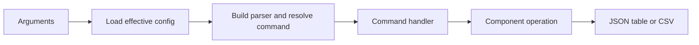

# C2: Operator Interface

Status: Phases 1-2 routing implemented; Phase 6 compatibility review complete.
Fresh runtime acceptance remains pending. Counts below are the historical
[baseline](major-components-overview.md#measurement-method), not current measurements.

## In Simple Terms

Commands should clearly say what was requested, what happened and what remains
unknown. An empty answer means there were no records, not that a read failed.

## Overview

Give people and automation one predictable interface to inspection and explicitly
approved work. Parse input and format output here; business decisions belong to
configuration, discovery, job control and evidence owners.

## Details and Purpose

Inputs are command arguments plus reviewed configuration. Outputs are stable JSON,
human-readable tables, raw CSV exports and meaningful exit codes. Read-only
inspection must remain independently usable when mutation is not authorized.
An approval flag is not permission to delete, prune, restart or migrate anything.

## Current Process Flow

## Codebase Size

| Kind | Files | Physical Lines |
| --- | ---: | ---: |
| Code | 1 | 1,064 |
| Configuration | 0 | 0 |
| Tests | 1 | 841 |

Counted: [CLI](../../cval/cli.py) and [CLI tests](../../tests/test_cli.py).
The installed entry-point declaration is counted under C8. Handlers span other
responsibilities today; this attribution does not imply they should keep doing so.

## Functionality Assessment

| Category | Functionality | Decision |
| --- | --- | --- |
| Critical | Read-only commands, explicit submission gates, exact source identity, failure exit codes | Preserve. |
| Good | JSON for automation, tables for people, descriptor inspection | Retain a small predictable interface. |
| Not important | Alias pairs and individual writer hooks no longer used by normal ingestion | Review external users before deprecation. |
| Useless | New single-choice output selectors or duplicate config overrides | Do not reintroduce removed controls. |

## Current Boundaries

`run` and `validate` both use `submit_workflow_plan` in
[job control](../../cval/jobs/manager.py), including shared admission and fresh
per-create eligibility checks. An explicit node list does not bypass submission
safety. `validate` adds bounded observation and exact-run verification; `plan`
remains read-only. The live loop delegates durable reconciliation and shared
Job/pod/log observation to the same owners.

The parser retains operator commands, guarded writer compatibility hooks and
explicit repair entry points. This is a compatibility boundary, not a reason to
split the CLI or add a new error framework. Partial submission receipts and
unknown/forbidden/unavailable observations remain distinct from empty results.
Command-specific JSON and exit behavior are retained; a universal output envelope
is not implemented or required. External usage of hidden hooks is unknown.

### Reporting Contract

Use the shared [outcome and evidence contract](Redesign.md#outcome-and-evidence-contract).
An inspection command can succeed while returning failed test results. Successful
command execution is not a promise that the inspected validation passed.

| Operation Result | Output and Exit Behavior |
| --- | --- |
| Read completed, no records | Successful empty result, with scope/time when supported. |
| Read forbidden, unavailable or malformed | Nonzero exit and explicit reason; never substitute an empty list. |
| Some creates succeeded, others failed/uncertain | Nonzero exit with every known receipt and unattempted identity retained. |
| Validation evidence complete but a selected test failed | Report the failure and complete evidence; validation acceptance is false. |
| Export read failed | Do not publish an apparently complete CSV; retain diagnostics separately. |

Preserve existing command schemas and numeric exit behavior. Do not introduce a
new envelope without a separate caller migration. Export reads complete before
the local writer runs, but CSV files are written directly to their destination:
an interrupted local write can leave a partial file. Atomic file publication is
deferred, not an implemented guarantee or a Phase 6 writer change.

## Mode Inventory

Current supported contracts carried forward from the former CLI design note:

| Surface | Supported Behavior |
| --- | --- |
| `config`; `tests list/describe/validate` | Effective JSON config; descriptor inspection and local validation. |
| `nodes` | Discovery, inventory-only, or targeted node check. |
| `plan` | Candidate queue only; no rendered Job and no mutation. |
| `plan/run` inputs | Live discovery or explicit node list; no history, live history or JSON snapshot. Explicit empty nodes remain empty. |
| `run`; `validate` | Confirmed batch submission; confirmed one-node submission/watch/verification. |
| `jobs`; `status` | Snapshot/watch of named Jobs; read-only latest raw status. |
| `results` | Raw CSV; test selection, `all`/`overall` alias and status-only option. |
| Live-loop commands | Start, stop, status, attach, run-once and internal run-loop; separate prune approval. |
| Hidden writer hooks | `db-add-run-results`, `db-add-storage-result`, `db-add-nccl-health`, `db-add-dltest-run`. |
| Maintenance hook | `db-rebuild-dltest-metrics`; explicit repair rather than normal execution. |

Exact source, run timestamp, deadlines, selection filters and export destination
remain purposeful inputs. NCCL recovery confirmation, immutable-result arguments
and rebuild `--only-missing` are safety/data contracts, not cosmetic clutter.

## Phase 0 Compatibility Inventory

Source/caller review at `b79a5e0`; not usage telemetry. Scope: tracked runtime,
scripts, descriptors/templates, runbook and workspace operational collectors.
Phase 6 rechecked the affected interfaces against current owners below. Private
external callers remain unknown; every public interface is retained.

| Retained Interface | Observed Caller / Evidence | Compatibility Decision |
| --- | --- | --- |
| `nodes`, `status`, `plan`, `run`, `jobs` | [Live loop](../../scripts/cval-live.sh) consumes CLI output; discovery, scheduling and [job control](../../cval/jobs/manager.py) own decisions. | Keep command/flag names, explicit empty node input and consumed JSON fields. Shared admission rechecks each create. |
| `validate` | [Targeted workflow](../../cval/orchestrator/validate.py) uses shared submission and [observation](../../cval/jobs/monitor.py), then exact-run verification. | Keep exact node/ref/timestamp, confirmation, watch and report semantics; no automatic cleanup. |
| `config`, `tests list/describe/validate` | CLI operator interfaces; descriptor inspection is local, not GPU testing. | Keep effective config and catalog access without creating cluster work. |
| `results` and plugin exports | [CLI export dispatch](../../cval/cli.py), [export writer](../../cval/storage/results_export.py) and registered adapters. | Preserve CSV columns, exact-run selectors and aliases; no new wrapper JSON envelope. |
| Four `db-add-*` hooks and `db-rebuild-dltest-metrics` | [Parser](../../cval/cli.py); normal [ingestion](../../cval/storage/run_ingest.py) calls writers directly. External use unknown. | Retain guarded compatibility/maintenance paths; no retirement approved. |
| Runner, environment and ingestion entry points | [Supervisor](../../cval/validation/supervisor.py) starts the runner and `python -m cval.storage.run_ingest`; [DB launcher](../../validation-tests/db-update.sh) remains a compatibility entry point. | Preserve child exit/signal behavior and authorized evidence handoff. Normal ingestion does not repeat shell environment/version detection. |
| Top-level and per-test shell aliases | [Runner alias](../../validation-tests/run-test.sh), storage/NCCL/DL wrappers; descriptors select canonical per-test runners. | Keep aliases while external use is unknown; no new aliases. |
| Live lifecycle, source and maintenance scripts | Runbook, workspace live-status collector and source-shipping workflow. | Preserve status/start/stop and independent mutation gates; helpers may be consolidated behind stable entry points. |

Decision carried through Phase 6: no public command, output format, alias or writer
hook is removed. C2 stays an adapter to existing owners. Unknown external usage
blocks retirement, not correctness fixes that preserve the interface. Private
helpers may be removed only with repository/dynamic caller review and a focused
check. No command or maintenance invocation was executed to prove live acceptance.

## Removed Settings and Migration

These removals predate the redesign; they are not new implementation work.

| Removed Controls | Current Replacement |
| --- | --- |
| `config --output`; `results --type`; TSV status/history | Fixed JSON config, CSV exports, JSON automation/history. |
| `plan --candidates-only`, `--include-yaml` and render options | One candidate-only plan; render on confirmed submission. |
| `validate --download`, `--download-dir` | Retained canonical PVC evidence; no automatic ZIP export. |
| Public namespace, PVC-pod and raw-DB overrides | Reviewed cluster/storage configuration. |
| Public template, prefix, repository and policy-limit overrides | Reviewed job/policy configuration; exact Git ref remains explicit. |

The subsequent C1 simplification also retires fixed node-filter, scheduling and
monitoring flags while retaining `plan --batch-size` as an inspection limit. See
the [flag-to-TOML migration table](../configuration.md#retired-setting-flags).
The Phase 6 compatibility inventory above remains a record of that earlier review;
other public commands, plugin interfaces and result formats are unchanged.

## Acceptance and Risk

Preserve tested command/help/output contracts or publish a deliberate migration.
Verify existing commands against real node/Job/evidence observations and approved
submissions. Record partial receipts from real failures when available; do not
manufacture a second-create failure with a fake client. Keep empty/unavailable and
failed-test/failed-command distinctions under the
[real-node policy](Redesign.md#real-node-validation-policy). Unobserved cases remain explicit.
Admission bypass closure is source-implemented; exact-commit runtime acceptance is
pending. Public retirement and a universal output redesign are deferred, not Phase 6
requirements. No command retirement is authorized here.
