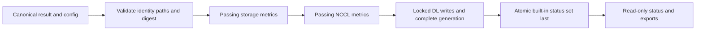

# C7: Raw Evidence

Status: Phase 1.5 verification and Phase 1.6 exact exports/coverage reads implemented;
Phase 4 writer consolidation source implemented. Real-node acceptance is deferred
until all phases are implemented, as requested on 2026-09-25.
Baseline/counting: [overview](major-components-overview.md#measurement-method).

## In Simple Terms

Check the records for the exact run you asked about, not whichever rows are newest.
A failing test can have complete evidence. A database read failure means the
evidence could not be checked, not that the test passed or its records are absent.

## Overview

Turn canonical test outputs into authorized test-owned raw records, then expose
read-only verification and exports. Raw measurements and execution outcomes are
the endpoint; no baselines, scores, rankings or classifications are produced.

## Details and Purpose

Inputs are immutable run/config identity, result digest and retained test artifacts.
Outputs are seven existing raw stores, ingestion events and exact-run read reports.
The [canonical envelope contract](../result-schema.md) remains the current-format
reference. C5 owns safe evidence creation; this component owns write authorization
and read consistency. No transaction spans all seven stores.

## Current Process Flow

Failed or disabled tests do not create passing metrics. Any required metric-write
failure prevents final status publication; already committed metric rows remain
evidence of a partial ingestion, not a successful run.

## Codebase Size

| Kind | Files | Physical Lines |
| --- | ---: | ---: |
| Code | 14 | 5,150 |
| Configuration | 0 | 0 |
| Tests | 8 | 3,532 |

Counted: all 11 Python files under [storage](../../cval/storage/__init__.py),
[export dispatch](../../cval/validation/operations.py),
[DL lock helper](../../scripts/dl-metric-lock.py), and
[ingestion launcher](../../validation-tests/db-update.sh).
Tests: ingest, DL ingest, exports, metric readers, operational export compatibility,
SQLite retry/URI and status. Workload plugins belong to C6; config paths to C1.

## Functionality Assessment

| Category | Functionality | Decision |
| --- | --- | --- |
| Critical | Writer-boundary authorization, idempotency, locks, receipts, status-last publication, read-only audits | Preserve. |
| Good | Raw CSV, bounded exact-run queries, relocation-aware historical readers | Keep identity and missingness visible. |
| Not important | Multiple display-time formats and convenience aliases | Keep only where callers need them. |
| Useless | Independent latest metrics presented as belonging to newer status | Remove the misleading join, not historical metrics. |

## Current Issues

1. [Standard/overlap DL writers](../../cval/storage/dltest_ingest.py#L738) now share
   transaction bookkeeping; fresh write/rollback acceptance remains pending.
2. Historical runs may lack current provenance. Readable legacy rows are not
   equivalent to canonical verification or current dependency compatibility.

## Phase 1.5 Implementation

The [shared verifier](../../cval/storage/verification.py) is the read-only C7 owner
used by targeted validation and terminal admission reconciliation. The caller
supplies its retained intent and frozen configuration; expected values never come
from the canonical result being checked. Job UID/controlled fields, submitted
snapshot digest, test descriptors, destinations, owned pod/node/runtime and stable
terminal Job phase bind the audit to the requested execution.

Canonical checks cover the result/config identity, exact ingestion digest marker,
per-test results and logs, passing summaries, and execution/ingestion event order.
Text summaries remain text. Custom result-only tests need no invented metric table.
Passing storage/NCCL tests require artifact-derived metric values to match exact
node/timestamp rows, including NCCL HCA samples. Passing DL requires the configured
plan/iterations/GPU count, complete ranks, exact artifact-derived rows and receipts.
Stored DL run keys are read, not reconstructed from a presumed historical prefix.
Failed or disabled tests do not require passing metric rows.

Status reads query `runs` at the exact timestamp, not `latest_status`. Identical
historical status duplicates can be deduplicated; conflicting rows cannot. All
SQLite opens use `mode=ro` and `query_only=ON`, with file identity checks and bounded
queries. DL reads sample all four completed generations before and after; a changed
or in-progress generation retries within configured SQLite retry counts/delays and
the common remaining deadline. This is not a cross-store transaction.

The reader streams the checked-out Python modules into an in-memory importer in
the configured PVC reader pod. It writes no code, bytecode or temporary DB there,
and never invokes writer authorization. It reuses existing parsers and SQLite
identity helpers. Explicit `monitoring.verification_max_bytes` and
`monitoring.verification_max_files` bound artifact reads; exceeding either is
unavailable, not missing. Reports retain per-source states, artifact hashes and
the reader-source hash. Unreadable sources keep reservations even when another
source is known to conflict.

The `cval.verification.v1` report separates `complete`, `accepted` and `release`.
Acceptance requires the verified successful terminal Job/pod and a nonempty set
of passing requested tests. A fully recorded failed test remains failed. With
stable execution identity, bounded proof of incomplete/conflicting evidence can
release terminal tracking without accepting the run; forbidden/unavailable or
identity-conflicting observations cannot. C4 durably binds this decision to the
original request before releasing a reservation. No Job or raw evidence is deleted.

On 2026-09-24 UTC, a read-only historical audit of
`slc01-cl02-hgx-0192-1790178532` used independently retained submitted Job context:
four status rows, 12 storage metrics, NCCL values/12 sampled HCAs, and DL row counts
2,168/3,040/384/1,536 across eight ranks all matched. Both generation samples were
`1790179992764511-ab1a1cbce1e34bc798db3c7412e2ce49`. The requested plan was
`80gb-example`, 100 iterations. Applying that report to another actual request
was rejected. The actual absent `0307-1790221580` run was incomplete; a retained
failed Job lacking an identifiable pod was unavailable and not eligible for release.

Evidence is retained under `run-logs/phase15-*-20260924.json`, including
`phase15-final-historical-verification-20260924.json` and
`phase15-failed-historical-verification-20260924.json`. This verifies historical
reads, not a new-source workload. Complete failed-run evidence, live generation
changes, deadline exhaustion, forbidden access, and live reservation release were
not exercised. No synthetic nodes/DBs or GPU Jobs were created. Controller
activation remains deferred until Phase 1 is finished.

## Phase 1.6 Export Contract

`results --test <target> --node <node_name> --timestamp <epoch>` queries `runs` at
that exact identity. Both selectors are required together; no latest fallback is
allowed. An empty exact status selection exits nonzero without producing a CSV.
Without selectors, existing latest-per-test selection remains. The established CSV
columns and plugin export contract are unchanged; `latest_timestamp` is the selected
status timestamp even for historical exports.

Storage/NCCL and overall exports query metrics at each selected status timestamp.
Formatters also enforce equality, so a newer or older metric cannot be labeled with
another run's status. Missing exact metrics yield blank cells, not a substituted
run. Access failures stop export and preserve a forbidden/unavailable diagnostic;
they are not exported as empty metrics. DL's existing export remains status-only,
not a newly introduced generic metric CSV.

The three metric readers share one parameterized read-only query path. Status
parsing rejects malformed/conflicting rows and deduplicates identical observations.
Historical metric helper names remain supported; optional exact timestamp maps are
additive. Compact metric models now retain optional timestamps; unbound metric
objects are not eligible for a status join.

Real CLI exports for `slc01-cl02-hgx-0192-1790178532` passed for overall, storage,
NCCL and DL status. The absent approved `0307-1790221580` run produced no CSV;
the formatter rejected a real newer metric against an older `0307` status. No raw
schema, metric unit or stored value changed. Evidence is retained under
`run-logs/phase16-exact-*-20260924/` and `phase16-export-final-check-20260924.json`.

## Phase 4 Writer Consolidation

Both DL writers retain their public signatures, connection lifetime, table/index
definitions, iteration migration and INSERT columns. One private `_write_metric_rows`
helper in the same module owns the previously duplicated sequence: receipt-table
setup, scoped row/receipt replacement, insertion, receipt writing, generation state
and commit. No new transaction boundary or exception handler was introduced;
connection closure still rolls back an uncommitted transaction on failure.

Cross-store completion remains outside this helper. Current ingestion authorizes
the run, writes all four stores as in-progress, compares receipts, then finalizes
the generation. The coordinator retains its POSIX lock through retries and writes
final validation status only after required metric writers return. Authorization,
SQLite durability, readers, configuration and test environment values are unchanged.

Local verification expanded the extracted helper in memory and compared both
writer ASTs with published baseline `5dd2a0ff5de66604fe659686bd4e90766cc9ef83`:
identical signatures, SQL, serialization and statement order. All other code in the
module is AST-identical; eight surrounding protection/reader/config files are
byte-identical. Import and editor checks passed. Evidence is retained in
`run-logs/phase4-equivalence-20260925.json` and
`run-logs/phase4-preservation-20260925.json`.

This is source-equivalence evidence, not an executed DB transaction test. No
synthetic DB, live write, row migration or node test was used. Real row/receipt,
retry, rollback and partial-generation behavior will be checked after all phases
are implemented, under separate approval. Reader optimization has no measured
need in this phase; no new cache, index or query path was added.

## Proposed Design

1. Keep one coordinator and explicit test-owned writers. Share only private DL
   transaction bookkeeping; keep fixed schemas/SQL visible. Do not build an ORM,
   generic per-test DB or a second raw history store.
2. Keep result/config/path revalidation at every writer boundary. Retry only bounded
   BUSY/LOCKED operations; retain the same DL lock during retries. Never roll back
   prior stores by deleting raw rows after a later store fails.
3. Provide one read-only exact-run verifier for C2/C4 using the protocol below.
   Return raw outcomes and evidence completeness separately; C4 applies acceptance.
   Follow C6's test-owned requirements, including result-only custom tests.
4. Query the requested run, not only `latest_status`; a newer completed run must
   not hide evidence for the run being accepted. Export exact-run joins or expose
   separate metric timestamps/age and missing values.
5. Keep reads bounded with `mode=ro` and `query_only=ON`; measure query plans before
   proposing additive indexes. Do not silently repair or migrate an audit target.

## Exact-Run Verification Protocol

1. Start from the caller's expected run/job/source/config identity, not values
   copied from the observed result and then compared to themselves. Resolve only
   the reviewed evidence root and test-owned destinations.
2. Read the canonical envelope safely; verify identity, schema and the bound
   ingestion digest. Derive the selected tests from that run's immutable definition,
   not the operator's current config. Unknown historical fields stay unknown.
3. Derive expected outputs from the outcome: passing built-ins require their
   metrics; failures require the relevant diagnostic evidence; disabled tests do
   not require metrics. Do not invent a DB or receipt table for a result-only test.
4. Read the exact status set and required metric rows/receipts. Check duplicate
   consistency, values, units/shape, rank coverage and matching run identity.
5. When DL metrics are required, sample all four completed generations before and
   after reading. Changed/in-progress generations mean a bounded retry or deferred
   observation, not proof that an older run is corrupt. Stable generations do not
   make all seven stores one atomic transaction.
6. Return per-source observation state, retained evidence references and completeness.
   A complete failed run remains a valid observation, but fails validation acceptance.

Missing expected evidence after confirmed terminal ingestion is incomplete;
contradictory records are conflicting. Transport denial/failure is forbidden or
unavailable, never converted to missing. Every read/retry shares the caller's
remaining deadline; audits never repair data or acquire writer authority.

## Read Cost and Write Failures

Scheduling needs a bounded history/provenance projection, not a complete rank-metric
scan for every node on every cycle. C7 owns that projection; C3 owns its
[coverage policy](discovery-scheduling-major-component.md#coverage-policy).
Use node/run keys and existing indexes, with explicit coverage limits.

A failed required metric write cannot authorize final status. Failure after the
final commit, such as writing a terminal log event, can leave committed rows without
a completion acknowledgement. Retain both facts; never delete rows or claim no
write occurred. C4 must stop automatic admission on unresolved storage failures.

Disk-full, permission and durability errors need explicit diagnosis, not evidence
pruning. Retrying the same authorized ingestion is distinct from rerunning the
benchmark; divergent digests require investigation rather than replacement.

## Existing Store Contract

All filenames below are relative to the configured metadata directory.

| Database | Main Table | Row Identity |
| --- | --- | --- |
| `validation.db` | `runs`, `latest_status` view | node, test, timestamp; built-in statuses plus `all` |
| `test-storage.db` | `storage_performance` | node, timestamp; FIO IOPS/bandwidth |
| `test-nccl.db` | `IB_HEALTH` | Node, timestamp; bandwidth, latency, HCA maxima |
| `dltest_numerical_correctness.db` | `numerical_correctness` | run_key, rank, task_group, task_name, metric_name |
| `dltest_compute_performance.db` | `compute_performance` | Same standard DL identity |
| `dltest_collective_performance.db` | `collective_performance` | Same standard DL identity |
| `dltest_overlap_performance.db` | `overlap_performance` | Same identity; also coll_name and layer_name |

DL rows retain node, cval_timestamp, iterations, sample_dir, test_plan,
dltest_run_id, status, metric_value and source_file. Each DL database also holds
`cval_ingested_runs`, `cval_ingest_metadata` and `cval_ingest_migrations`.
The generation is a publication marker, not a run ID or arrival-order cursor.

Read stored `run_key` values; historical prefixes differ. Join DL
`node, cval_timestamp` to status `node, timestamp`. Identical historical status
duplicates can be deduplicated for reads; conflicting duplicates are indeterminate.
Require consistent completed DL generations before and after multi-store reads,
plus exact-run receipts and expected rank coverage. Submission timestamps do not
establish ingestion order; late arrivals must not be skipped.

Current DL connections require DELETE journaling and FULL durability; existing
WAL is rejected. The persistent `metadata/.dl-metric-ingest.lock` uses POSIX
record locking. Directory `flock` was ineffective in the recorded NFS preflight.
Changing journaling requires the separately approved recovery workflow.

## Historical Observations

Carried from the superseded raw database note; not remeasured or a live-state claim.
Do not use these values to size a new backup or approve a rollout.

Dated measurements and accepted-run examples

| Database | 2026-09-04 Size | Recorded Rows/Runs |
| --- | ---: | --- |
| validation | 954,368 B | 6,984 statuses; 477 nodes |
| storage | 446,464 B | 2,008 rows; 477 nodes |
| NCCL | 1,318,912 B | 1,834 current rows; 477 nodes |
| numerical DL | 3.57 GB | 3,861,208 metrics; 1,781 runs |
| compute DL | 5.03 GB | 5,414,240 metrics; 1,781 runs |
| collective DL | 632 MB | 683,904 metrics; 1,781 runs |
| overlap DL | 3.04 GB | 2,735,616 metrics; 1,781 runs |

That inventory reported approximately 12 GiB total and 80 TiB PVC free, matching
DL receipt sets and one complete generation. `quick_check` ran on validation,
storage, NCCL and collective DL only. A January duplicate group contained three
identical `all=pass` rows; 800 older NCCL rows lacked samples. Historical ranking
objects remained untouched.

The 2026-09-08 sampled read observed node `slc01-cl02-hgx-0368`, timestamp
`1788680072`, matching passing status/metrics, generation
`1788818284360325-f35f4c9a11ca48d6b15003cbdc3ab65d`, and DL sizes approximately
3.75/5.29/0.66/3.18 GB. It was not a full audit.

Earlier accepted example: `slc01-cl02-hgx-0106-1788475963`, source
`9678f1756c60e2b3b82f32f070712332ce8604e6`; four passing statuses; storage
randread/randwrite IOPS 32683.598307/20242.567658; NCCL BUS_BW/LATENCY
44.530298/628.785377 with 29 samples; sample DL metrics norm_output 82.0,
bp_cpu_time 0.062, collective cpu_time 0.102 and overlap coll_mean 6.581.

## Acceptance and Risk

Verify required stores, schemas, exact-run rows, receipts and generations after
approved real-node runs. Inspect retained partial/failed runs read-only and report
them using the [run result categories](Redesign.md#run-result-categories).
No synthetic DBs, fabricated receipts or corruption of raw provenance for testing.
Controlled writer interruption or a real ingestion retry needs separate approval;
cases not observed remain unverified under the [real-node policy](Redesign.md#real-node-validation-policy).
Priority P0 for read correctness, P1 for simplification; high integrity risk.
