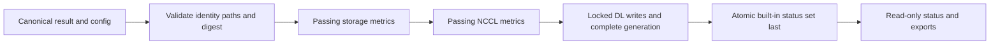

# C7: Raw Evidence

Status: proposed redesign. Baseline/counting: [overview](major-components-overview.md#measurement-method).

## Overview

Turn canonical test outputs into authorized test-owned raw records, then expose
read-only verification and exports. Raw measurements and execution outcomes are
the endpoint; no baselines, scores, rankings or classifications are produced.

## Details and Purpose

Inputs are immutable run/config identity, result digest and retained test artifacts.
Outputs are seven existing raw stores, ingestion events and exact-run read reports.
The [canonical envelope contract](../result-schema.md) remains the current-format
reference. C5 owns safe evidence creation; this component owns write authorization
and read consistency. No transaction spans all seven stores.

## Current Process Flow

Failed or disabled tests do not create passing metrics. Any required metric-write
failure prevents final status publication; already committed metric rows remain
evidence of a partial ingestion, not a successful run.

## Codebase Size

| Kind | Files | Physical Lines |
| --- | ---: | ---: |
| Code | 14 | 5,150 |
| Configuration | 0 | 0 |
| Tests | 8 | 3,532 |

Counted: all 11 Python files under [storage](../../cval/storage/__init__.py),
[export dispatch](../../cval/validation/operations.py),
[DL lock helper](../../scripts/dl-metric-lock.py), and
[ingestion launcher](../../validation-tests/db-update.sh).
Tests: ingest, DL ingest, exports, metric readers, operational export compatibility,
SQLite retry/URI and status. Workload plugins belong to C6; config paths to C1.

## Functionality Assessment

| Category | Functionality | Decision |
| --- | --- | --- |
| Critical | Writer-boundary authorization, idempotency, locks, receipts, status-last publication, read-only audits | Preserve. |
| Good | Raw CSV, bounded exact-run queries, relocation-aware historical readers | Keep identity and missingness visible. |
| Not important | Multiple display-time formats and convenience aliases | Keep only where callers need them. |
| Useless | Independent latest metrics presented as belonging to newer status | Remove the misleading join, not historical metrics. |

## Current Issues

1. [Standard/overlap DL writers](../../cval/storage/dltest_ingest.py#L738) repeat
   receipt, replacement, generation and commit mechanics.
2. [Exports](../../cval/storage/results_export.py#L131) join metrics by node; the
   NCCL path can substitute an older metric timestamp while retaining newer status.
3. [Acceptance](../../cval/orchestrator/validate.py#L539) reads logs and latest status,
   not a shared exact-run canonical/metric verification result.
4. Latest-status readers and PVC-pod resolution hide some observation detail;
   unavailable, forbidden, empty and conflicting evidence need separate reporting.

## Proposed Design

1. Keep one coordinator and explicit test-owned writers. Share only private DL
   transaction bookkeeping; keep fixed schemas/SQL visible. Do not build an ORM,
   generic per-test DB or a second raw history store.
2. Keep result/config/path revalidation at every writer boundary. Retry only bounded
   BUSY/LOCKED operations; retain the same DL lock during retries. Never roll back
   prior stores by deleting raw rows after a later store fails.
3. Provide one read-only exact-run verifier for C2/C4. Require node/timestamp,
   source/config identity, canonical result and digest, expected statuses, required
   metric evidence/receipts and stable DL generation. Return per-store evidence
   with explicit pass/fail/incomplete/unavailable reasons, not a health verdict.
4. Query the requested run, not only `latest_status`; a newer completed run must
   not hide evidence for the run being accepted. Export exact-run joins or expose
   separate metric timestamps/age and missing values.
5. Keep reads bounded with `mode=ro` and `query_only=ON`; measure query plans before
   proposing additive indexes. Do not silently repair or migrate an audit target.

## Existing Store Contract

All filenames below are relative to the configured metadata directory.

| Database | Main Table | Row Identity |
| --- | --- | --- |
| `validation.db` | `runs`, `latest_status` view | node, test, timestamp; built-in statuses plus `all` |
| `test-storage.db` | `storage_performance` | node, timestamp; FIO IOPS/bandwidth |
| `test-nccl.db` | `IB_HEALTH` | Node, timestamp; bandwidth, latency, HCA maxima |
| `dltest_numerical_correctness.db` | `numerical_correctness` | run_key, rank, task_group, task_name, metric_name |
| `dltest_compute_performance.db` | `compute_performance` | Same standard DL identity |
| `dltest_collective_performance.db` | `collective_performance` | Same standard DL identity |
| `dltest_overlap_performance.db` | `overlap_performance` | Same identity; also coll_name and layer_name |

DL rows retain node, cval_timestamp, iterations, sample_dir, test_plan,
dltest_run_id, status, metric_value and source_file. Each DL database also holds
`cval_ingested_runs`, `cval_ingest_metadata` and `cval_ingest_migrations`.
The generation is a publication marker, not a run ID or arrival-order cursor.

Read stored `run_key` values; historical prefixes differ. Join DL
`node, cval_timestamp` to status `node, timestamp`. Identical historical status
duplicates can be deduplicated for reads; conflicting duplicates are indeterminate.
Require consistent completed DL generations before and after multi-store reads,
plus exact-run receipts and expected rank coverage. Submission timestamps do not
establish ingestion order; late arrivals must not be skipped.

Current DL connections require DELETE journaling and FULL durability; existing
WAL is rejected. The persistent `metadata/.dl-metric-ingest.lock` uses POSIX
record locking. Directory `flock` was ineffective in the recorded NFS preflight.
Changing journaling requires the separately approved recovery workflow.

## Historical Observations

Carried from the superseded raw database note; not remeasured or a live-state claim.
Do not use these values to size a new backup or approve a rollout.

| Database | 2026-09-04 Size | Recorded Rows/Runs |
| --- | ---: | --- |
| validation | 954,368 B | 6,984 statuses; 477 nodes |
| storage | 446,464 B | 2,008 rows; 477 nodes |
| NCCL | 1,318,912 B | 1,834 current rows; 477 nodes |
| numerical DL | 3.57 GB | 3,861,208 metrics; 1,781 runs |
| compute DL | 5.03 GB | 5,414,240 metrics; 1,781 runs |
| collective DL | 632 MB | 683,904 metrics; 1,781 runs |
| overlap DL | 3.04 GB | 2,735,616 metrics; 1,781 runs |

That inventory reported approximately 12 GiB total and 80 TiB PVC free, matching
DL receipt sets and one complete generation. `quick_check` ran on validation,
storage, NCCL and collective DL only. A January duplicate group contained three
identical `all=pass` rows; 800 older NCCL rows lacked samples. Historical ranking
objects remained untouched.

The 2026-09-08 sampled read observed node `slc01-cl02-hgx-0368`, timestamp
`1788680072`, matching passing status/metrics, generation
`1788818284360325-f35f4c9a11ca48d6b15003cbdc3ab65d`, and DL sizes approximately
3.75/5.29/0.66/3.18 GB. It was not a full audit.

Earlier accepted example: `slc01-cl02-hgx-0106-1788475963`, source
`9678f1756c60e2b3b82f32f070712332ce8604e6`; four passing statuses; storage
randread/randwrite IOPS 32683.598307/20242.567658; NCCL BUS_BW/LATENCY
44.530298/628.785377 with 29 samples; sample DL metrics norm_output 82.0,
bp_cpu_time 0.062, collective cpu_time 0.102 and overlap coll_mean 6.581.

## Acceptance and Risk

Compare all seven stores, schemas, receipts and generations on fixtures before
and after consolidation. Inject lock contention, divergent receipts, partial
ingestion, stale exports, unavailable readers and corrupt provenance. Reuse
[ingest](../../tests/test_ingest.py), [DL](../../tests/test_dltest_ingest.py) and
[export](../../tests/test_operational_export_compatibility.py) tests.
Priority P0 for read correctness, P1 for simplification; high integrity risk.
