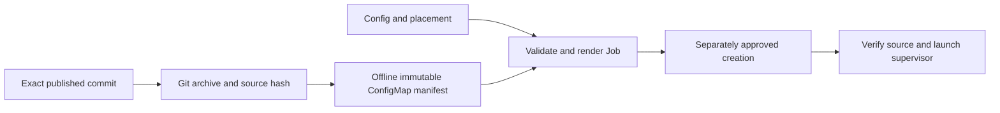

# C8: Source Delivery

Status: Phase 5 scope reviewed on 2026-09-25; bundle exclusions are not implemented.
Real-node acceptance waits until all phases are implemented. Baseline/counting:
[overview](major-components-overview.md#measurement-method).

## In Simple Terms

Publishing code, making it available to the cluster and starting Jobs with it are
three different actions. Keep proof of the exact code and settings at every step;
a hash only helps when its expected value came from a reviewed source.

## Overview

Make approved validation Jobs run the exact reviewed source with a verified,
self-contained startup contract. Prepare artifacts offline; publication,
ConfigMap creation, acceptance and activation remain separate stages.

## Details and Purpose

Inputs are an exact published commit, namespace, effective config and either
targeted or scheduler-selected placement. Outputs are immutable source bundles
and rendered Volcano Jobs. C4 authorizes creation; this component only prepares
and validates manifests. C6 owns benchmark dependency identity.

## Current Process Flow

Git checkout remains a supported alternate source transport; a branch name is
never an acceptable submitted revision. ConfigMap and Git startup converge on
the same checked runtime contract.

## Codebase Size

| Kind | Files | Physical Lines |
| --- | ---: | ---: |
| Code | 3 | 757 |
| Configuration | 3 | 241 |
| Tests | 1 | 669 |

Counted: [renderer](../../cval/jobs/renderer.py),
[shared bootstrap](../../cval/jobs/bootstrap.sh), [source tool](../../scripts/cval-source.py),
[targeted template](../../ymls/specific-node-job.yml),
[scheduler-selected template](../../ymls/test-job.yml),
[packaging](../../pyproject.toml), and [renderer/source tests](../../tests/test_renderer.py).
The PVC access template is C9; global configuration is C1.

## Functionality Assessment

| Category | Functionality | Decision |
| --- | --- | --- |
| Critical | Exact commit, archive hash/identity, immutable source, semantic template checks | Preserve. |
| Good | Offline source delivery and one shared bootstrap | Already implemented; reuse rather than redesign again. |
| Not important | Inline custom bootstrap compatibility | Review real callers before retirement. |
| Useless | Host-only regression files in every runtime archive, once dependency closure proves non-use | Exclude after proof; do not delete the tests. |

## Current Issues

1. The source archive includes the top-level test suite. Some scripts are runtime
   dependencies, including dynamically loaded DL locking and admission cooldown;
   excluding the entire scripts directory would break supported paths.
2. Image/framework variation is intentional, not a delivery defect. DL uses a
   checked run-local source copy; an exact c-val SHA alone does not fix all inputs.
3. Source publication and runtime activation are distinct but easy to confuse.
   A new source object does not update existing Jobs or an already-running loop.
4. Installation assumes a source checkout for descriptors/templates/scripts;
   editable-install behavior is not proof of a self-contained wheel.

## Proposed Design

1. Keep the current source renderer, immutable ConfigMap transport and shared
   bootstrap. Start with a small exclusion from the existing `SOURCE_PATHS`, not
   per-file dependency machinery or new bundle modes. Retain uncertain dependencies.
2. Retain repository-local installation as the supported model initially. Do not
   add a wheel-distribution project solely to move files.
3. Bind source SHA, archive hash, manifest hash and effective config digest in one
   reviewed release receipt. Preserve C6's selectable test environments and existing
   recorded image/dependency values; no fixed-version image requirement is added.
4. Separate source preparation, create approval, single-node acceptance and loop
   activation. Verify each observed identity; preserve previous artifacts and
   approval records. Never automatically apply a rollback on failed acceptance.

### Reviewed Packaging Candidate

At `31532cf41a482ad483ace37d3893528cec69231b`, the existing archive contained 118
files and 307,048 compressed bytes. Removing only the top-level `tests/` entry in
an in-memory comparison produced 85 files and 206,666 bytes: 100,382 bytes smaller
(about 33%). All remaining file bytes and the embedded commit were unchanged;
bootstrap, templates, main config, DL lock and cooldown helpers remained present.
Measurement evidence: `run-logs/phase5-review-bundle-20260925.json`.

This supports reviewing that one exclusion, not declaring dependency closure proved.
Before changing the renderer, verify imports, config/descriptor loading, plugin
support files and both template renders from the extracted candidate without the
host checkout. Preserve the repository test suite; archive exclusion is not deletion.
Real Jobs and ingestion remain deferred until all phases finish. Do not claim faster
startup from archive size alone. No custom image or environment version pin is needed.
The [Phase 5 plan](redesign-development-plan.md#phase-5-harden-delivery) owns task status.

## Identity Chain

| Identity | What It Establishes | What It Does Not Establish |
| --- | --- | --- |
| Published Git SHA | Reviewed source revision in the configured repository | Container/dependency identity or current deployment. |
| Archive SHA-256 and embedded Git identity | Exact prepared bundle bytes and declared revision | Trust if both payload and expected hash came from an unreviewed source. |
| Config digest | The admitted effective test/settings definition | Compatibility of every prior run or permission to mutate. |
| Requested-manifest digest | The reviewed create request | Byte-for-byte equality with Kubernetes' defaulted object. |
| Recorded image/framework and run-local DL inputs | The selected experiment environment and prepared source | A fleet-wide fixed version, identical hardware conditions or timings. |
| Observed Job UID | The concrete created resource | Passing tests or complete raw evidence. |

Validate controlled workload fields as well as labels/annotations on readback.
SHA syntax alone is not publication verification. Controller startup must retain
current-remote-tip enforcement; an explicitly approved targeted validation may
use a known-published exact revision. Inspection and rendering remain nonmutating.

## Placement and Packaging Boundaries

Keep targeted and scheduler-selected templates distinct. A scheduler-selected quick
test cannot prove a prechecked target node or c-val priority selection; it is not
a substitute for targeted release acceptance. Record its actual assigned node.

Runtime bundle trimming must prove both successful startup and the failure paths
for ingestion, locking and recovery helpers used in-pod where safely observable.
Validate real Jobs without the host checkout or undeclared network access; label
unexercised paths. Declare interpreter/dependencies through
the reviewed image; do not quietly add downloads to recover missing bundle files.
Retain both supported source transports until an explicit caller/operations decision.

## Acceptance and Risk

Check archive/manifest identity locally, then require actual startup, placement,
resources and exact-run evidence on an approved fully free Ready node. Each source
transport/placement workflow is a separate real validation scope; do not submit
malformed Jobs or use a local boot simulation as acceptance. Verify active source
separately from object creation and measure bundle size under the
[real-node policy](Redesign.md#real-node-validation-policy).
Priority P2 for size reduction; medium startup/release risk.
