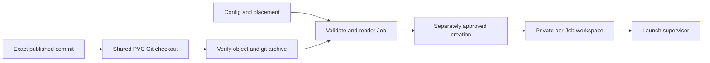

# C8: Source Delivery

## Current Transport (2026-10-10)

New validation Jobs use one source path: the controller maintains a clean Git
checkout at `/data/continuous_validation/c-val`, and each Job verifies its exact
40-hex `job.git_ref` exists there before extracting `git archive` into a private
workspace. This avoids per-release source ConfigMaps, per-Job GitHub credentials
and network fetches from GPU pods. The controller must fast-forward the PVC clone
before initializing a new session; it must not update the checkout while running
Jobs may still need objects from it. Existing ConfigMaps and session snapshots are
retained for historical Jobs, but new Jobs must leave the legacy source-map fields
blank.
Preserve source ConfigMaps referenced by existing Job specs and preserve session snapshots; unreferenced old source maps are eligible for cleanup only after checking all Job and pod consumers. New Jobs leave the legacy source-map fields blank.

The following Phase 5 records describe the previous source-ConfigMap design and
its acceptance evidence; they are historical, not the current transport.

Status: Phase 5 bundle trimming and local packaging checks implemented on 2026-09-25.
Real-node acceptance waits until all phases are implemented. Baseline/counting:
[overview](major-components-overview.md#measurement-method).

## In Simple Terms

Publishing code, making it available to the cluster and starting Jobs with it are
three different actions. Keep proof of the exact code and settings at every step;
a hash only helps when its expected value came from a reviewed source.

## Overview

Make approved validation Jobs run the exact reviewed source from the shared PVC
with a verified, self-contained startup contract. Publication, PVC checkout,
acceptance and activation remain separate stages.

## Details and Purpose

Inputs are an exact published commit, effective config and either targeted or
scheduler-selected placement. Output is a rendered Volcano Job which extracts
that exact commit from the PVC Git object database. C4 authorizes creation; this
component only prepares and validates manifests. C6 owns benchmark dependency
identity.

## Current Process Flow



The PVC checkout is the only new source transport. A branch name is never an
acceptable submitted revision; session intent and the Job manifest bind an exact
commit SHA.

The C8 cleanup validates structured YAML and requires the actual container script
to match the packaged `bootstrap.sh`. Prefer the shared placeholder; an exact
inline copy is also accepted. Extra or modified inline commands are rejected.
This replaces the duplicate textual YAML/ordered-line scanner without removing
source hashes, semantic workload checks or the single-attempt policy.

## Codebase Size

| Kind | Files | Physical Lines |
| --- | ---: | ---: |
| Code | 3 | 757 |
| Configuration | 3 | 241 |
| Tests | 1 | 669 |

Counted: [renderer](../../cval/jobs/renderer.py),
[shared bootstrap](../../cval/jobs/bootstrap.sh),
[targeted template](../../ymls/specific-node-job.yml),
[scheduler-selected template](../../ymls/test-job.yml),
[packaging](../../pyproject.toml), and [renderer/source tests](../../tests/test_renderer.py).
The PVC access template is C9; global configuration is C1.

## Functionality Assessment

| Category | Functionality | Decision |
| --- | --- | --- |
| Critical | Exact commit in PVC Git object database, semantic template checks | Preserve. |
| Good | Per-release offline ConfigMap source delivery | Retired for new Jobs; old objects remain for existing workloads. |
| Retired in C8 | Customized inline bootstrap programs | Use the shared placeholder or an exact copy of the packaged startup program. |
| Removed from runtime bundle | Top-level host regression suite | Retained in the repository; excluded from the archive after isolated packaging checks. |

## Current Issues

1. The old ConfigMap source archive excluded the top-level test suite. The current
   Git archive is extracted from the exact commit in the shared PVC checkout.
   Runtime scripts and complete workload directories remain tracked and available.
2. Image/framework variation is intentional, not a delivery defect. DL uses a
   checked run-local source copy; an exact c-val SHA alone does not fix all inputs.
3. Source publication and runtime activation are distinct but easy to confuse.
   A new source object does not update existing Jobs or an already-running loop.
4. Installation assumes a source checkout for descriptors/templates/scripts;
   editable-install behavior is not proof of a self-contained wheel.

## Design Disposition

Historical implementation: exact-source rendering, immutable ConfigMap transport,
shared bootstrap and the Phase 5 archive exclusion. Current implementation uses
the shared PVC checkout and exact-commit archive extraction. Repository-local
installation, complete runtime directories and selectable environments remain
supported. Wheel packaging, bundle variants and per-file dependency machinery are
deferred without measured need.

The identity chain below remains the release contract. PVC checkout update,
real-node acceptance and controller activation are separate milestones; publishing
a commit does not perform the latter two. Prior source objects and evidence remain
retained for historical workloads.

### Phase 5 Packaging

At `31532cf41a482ad483ace37d3893528cec69231b`, the existing archive contained 118
files and 307,048 compressed bytes. Removing only the top-level `tests/` entry in
an in-memory comparison produced 85 files and 206,666 bytes: 100,382 bytes smaller
(about 33%). All remaining file bytes and the embedded commit were unchanged;
bootstrap, templates, main config, DL lock and cooldown helpers remained present.
Measurement evidence: `run-logs/phase5-review-bundle-20260925.json`.

The renderer now excludes only that top-level test entry. All scripts, complete
workload directories, descriptors, plugin support files, package metadata and
templates remain. One test in the existing renderer suite builds actual Git
archives, checks that excluded members are tests only, and compares all remaining
file bytes at the same commit. It validates immutable manifest/embedded commit
identity and runs imports, config/plugin loading, dynamic helpers, four render
combinations and bootstrap syntax from a temporary extracted tree.

The child Python process runs with isolated import settings and asserts all 43
`cval` modules come from the extracted tree, not the host checkout. Local installed
Python/PyYAML and Bash are still prerequisites; this is not a container execution
or a wheel-installation check. Targeted render inputs use a retained real node/run
identity without claiming its current eligibility. No workload or writer runs.

Retained check: `run-logs/phase5-isolated-bundle-20260925.json`. Reproducible command:

```bash
PYTHONDONTWRITEBYTECODE=1 python3 -m unittest discover -s tests -p test_renderer.py -k test_committed_runtime_bundle_is_self_contained -v
```

Real Jobs and ingestion remain deferred until all phases finish. Archive size alone
does not establish faster startup. No custom image or environment version pin is needed.
The [Phase 5 plan](redesign-development-plan.md#phase-5-harden-delivery) owns task status.

## Identity Chain

| Identity | What It Establishes | What It Does Not Establish |
| --- | --- | --- |
| Published Git SHA | Reviewed source revision in the configured repository | Container/dependency identity or current deployment. |
| PVC Git object ID | Exact requested commit extracted into the Job workspace | Image/dependency identity or current deployment state. |
| Config digest | The admitted effective test/settings definition | Compatibility of every prior run or permission to mutate. |
| Requested-manifest digest | The reviewed create request | Byte-for-byte equality with Kubernetes' defaulted object. |
| Recorded image/framework and run-local DL inputs | The selected experiment environment and prepared source | A fleet-wide fixed version, identical hardware conditions or timings. |
| Observed Job UID | The concrete created resource | Passing tests or complete raw evidence. |

Validate controlled workload fields as well as labels/annotations on readback.
SHA syntax alone is not publication verification. Controller startup must retain
current-remote-tip enforcement; an explicitly approved targeted validation may
use a known-published exact revision. Inspection and rendering remain nonmutating.

## Placement and Packaging Boundaries

Keep targeted and scheduler-selected templates distinct. A scheduler-selected quick
test cannot prove a prechecked target node or c-val priority selection; it is not
a substitute for targeted release acceptance. Record its actual assigned node.

Runtime source extraction must prove the exact PVC commit exists and that the
private workspace is created safely. Validate real Jobs without undeclared network
access; label unexercised paths. Declare interpreter/dependencies through the
reviewed image; do not quietly add downloads to recover missing runtime files.

## Acceptance and Risk

Check exact PVC commit availability locally, then require actual startup, placement,
resources and exact-run evidence on an approved fully free Ready node. Each placement
workflow is a separate real validation scope; do not submit
malformed Jobs or use a local boot simulation as acceptance. Verify active source
separately from object creation and measure bundle size under the
[real-node policy](Redesign.md#real-node-validation-policy).
Priority P2 for size reduction; medium startup/release risk.
