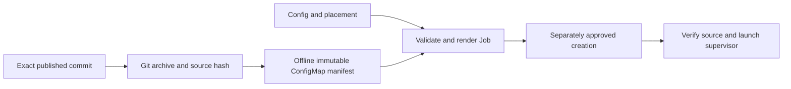

# C8: Source Delivery

Status: proposed redesign. Baseline/counting: [overview](major-components-overview.md#measurement-method).

## Overview

Make approved validation Jobs run the exact reviewed source with a verified,
self-contained startup contract. Prepare artifacts offline; publication,
ConfigMap creation, acceptance and activation remain separate stages.

## Details and Purpose

Inputs are an exact published commit, namespace, effective config and either
targeted or scheduler-selected placement. Outputs are immutable source bundles
and rendered Volcano Jobs. C4 authorizes creation; this component only prepares
and validates manifests. C6 owns benchmark dependency identity.

## Current Process Flow

Git checkout remains a supported alternate source transport; a branch name is
never an acceptable submitted revision. ConfigMap and Git startup converge on
the same checked runtime contract.

## Codebase Size

| Kind | Files | Physical Lines |
| --- | ---: | ---: |
| Code | 3 | 757 |
| Configuration | 3 | 241 |
| Tests | 1 | 669 |

Counted: [renderer](../../cval/jobs/renderer.py),
[shared bootstrap](../../cval/jobs/bootstrap.sh), [source tool](../../scripts/cval-source.py),
[targeted template](../../ymls/specific-node-job.yml),
[scheduler-selected template](../../ymls/test-job.yml),
[packaging](../../pyproject.toml), and [renderer/source tests](../../tests/test_renderer.py).
The PVC access template is C9; global configuration is C1.

## Functionality Assessment

| Category | Functionality | Decision |
| --- | --- | --- |
| Critical | Exact commit, archive hash/identity, immutable source, semantic template checks | Preserve. |
| Good | Offline source delivery and one shared bootstrap | Already implemented; reuse rather than redesign again. |
| Not important | Inline custom bootstrap compatibility | Review real callers before retirement. |
| Useless | Host-only regression files in every runtime archive, once dependency closure proves non-use | Exclude after proof; do not delete the tests. |

## Current Issues

1. The source archive includes host tests and all scripts; runtime dependency
   closure is implicit, including the dynamically loaded DL lock helper.
2. An exact c-val commit does not pin a container tag or shared DL source tree.
3. Source publication and runtime activation are distinct but easy to confuse.
   A new source object does not update existing Jobs or an already-running loop.
4. Installation assumes a source checkout for descriptors/templates/scripts;
   editable-install behavior is not proof of a self-contained wheel.

## Proposed Design

1. Keep the current source renderer, immutable ConfigMap transport and shared
   bootstrap. Maintain a small explicit runtime file allowlist; test it from an
   unpacked bundle with no access to the source checkout.
2. Retain repository-local installation as the supported model initially. Do not
   add a wheel-distribution project solely to move files.
3. Bind source SHA, archive hash, manifest hash and effective config digest in one
   reviewed release receipt. Add pinned image/dependency identities through C6.
4. Separate source preparation, create approval, single-node acceptance and loop
   activation. Verify each observed identity; preserve previous artifacts and
   approval records. Never automatically apply a rollback on failed acceptance.

## Acceptance and Risk

Require clean offline startup from the exact archive, valid placement/resources
for both templates, rejection of unsafe YAML/bootstrap variants and mismatched
archive identity/hash. Measure compressed runtime size before/after exclusions.
Validate the published exact commit on a fully free Ready node only after approval.
Priority P2 for size reduction; medium startup/release risk.
