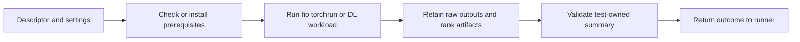

# C6: Test Workloads

Status: Phase 3.4 run-local DL source is implemented; fresh workload acceptance
pending. Other proposals remain scoped by the reviewed plan. Baseline/counting:
[overview](major-components-overview.md#measurement-method).

## In Simple Terms

Each test must say what it ran, what it measured and which files prove the result.
The framework should not guess a test's meaning or create a database just because
a new test was registered.

## Overview

Own what is tested and what each measurement means. The framework supplies
identity, resources, supervision and evidence paths; each test owns setup,
execution, settings, summaries and optional reviewed persistence/export behavior.

## Details and Purpose

| Family | Current Responsibility | Boundary |
| --- | --- | --- |
| Storage | Six FIO workloads, IOPS and bandwidth summaries | Shared-storage behavior, not an exhaustive storage diagnosis. |
| NCCL | Single-node AllReduce and optional HCA transmit sampling | Not full multi-node fabric certification. |
| DL | Numerical, compute, collective and overlap tasks with rank coverage | Uses external DL source; raw numerical observations are not peer-derived health classes. |

The existing plugin contract supplies configuration validation and read-only raw
export. Built-in persistence is currently implemented in C7. A new test can be
canonical-result-only; any additional writer/destination needs an explicit
test-owned contract, not a generic per-test database.

## Current Process Flow

## Codebase Size

| Kind | Files | Physical Lines |
| --- | ---: | ---: |
| Code | 16 | 1,298 |
| Configuration | 9 | 189 |
| Tests | 1 | 1,743 |

Counted: all Python/shell files in the
[storage](../../validation-tests/storage/run-test.sh),
[NCCL](../../validation-tests/nccl/run-test.sh) and
[DL](../../validation-tests/dltest/run-test.sh) test directories, plus
[NCCL summary parsing](../../cval/validation/nccl_summary.py).
Configuration is three descriptors and six FIO job files.
The [validation script suite](../../tests/test_validation_scripts.py) owns the
counted tests; writer tests are C7. External DL source and installed libraries
are not in this repository and are excluded from these numbers.

## Functionality Assessment

| Category | Functionality | Decision |
| --- | --- | --- |
| Critical | Test-owned settings/results, finite metrics, rank completeness, correct exit status | Preserve and contract-test. |
| Good | HCA observations, retained raw artifacts, dependency preflight | Keep explicit cost/resource budgets. |
| Not important | Four shell command aliases across runtime/workloads | Small compatibility surface; retire only after caller review. |
| Useless | Unused workload variants | None proven; do not invent removals or drop coverage for line count. |

## Current Issues

1. [Storage setup](../../validation-tests/storage/setup.sh) can install FIO after
   GPU allocation, adding network dependence and unmeasured reservation overhead.
2. [DL execution](../../validation-tests/dltest/run-test.sh) now copies and compares
   shared inputs before using its run-local source. This is not an atomic snapshot
   of concurrent shared-source edits; fresh GPU execution remains unverified.
3. Built-in-specific settings are projected through framework environment aliases;
   adding a test still requires understanding those compatibility boundaries.
4. Shared storage/network traffic can affect other workloads even when the selected
   node is idle. Serial in-pod tests do not eliminate fleet-wide interference.

## Proposed Design

1. Keep one descriptor plus setup/run/summary code per test; reuse the runner for
   process handling. Avoid a universal benchmark engine or forced rewrite of FIO/PyTorch.
2. Preserve selectable images, CUDA/PyTorch environments and iteration settings:
   varying them and recording their values is part of testing, not a defect.
   Custom-image/FIO packaging is deferred. Phase 3.4 implements only run-local DL
   source/plan isolation; source and plan remain selectable between runs, and no
   identity is backfilled into historical records.
3. Use existing setup, execution and ingestion events before adding measurements.
   Add fields only for a demonstrated gap. Keep bounded controller concurrency as the initial
   shared-resource budget rather than adding a new traffic-scheduling service.
4. Preserve descriptor ordering and required resource checks. Future test-owned
   persistence must reuse authorization and explicit destinations without changing
   existing raw stores or expanding the plugin API silently.

## Phase 3.4 Run-Local DL Source

The existing launcher prepares `artifacts/workdir/src` together with the selected
`test_plans/<plan>/test_plan.json` and optional baseline. Copies dereference links
so execution does not keep following shared-source files. Preparation compares
source, plan and baseline against their copies; a failed copy or observed mismatch
stops before `torchrun`. Setup checks `cp` and `diff` alongside its existing tools.
Preparation is covered by the existing test deadline; no new timeout or setting.

The workload still runs from the existing work directory with the selected plan,
GPU count and iterations. Its `PYTHONPATH` now starts with the run-local `src`, not
the shared tree. The original input path and execution path are logged. Existing
summary field `source_dir` points to the run-local execution copy; `work_dir`,
rank outputs, summary schema and raw writers are unchanged. Existing work directories
are rejected, not removed/reused; partial preparation remains diagnostic evidence.

Setup remains a presence check. Copy/compare at launch defines the run-local input;
it does not guarantee an atomic multi-file revision while another writer edits the
shared tree. After preparation, later shared changes cannot alter the copied inputs.
This is isolation, not a security sandbox or fixed-version policy. Images, CUDA,
PyTorch, iterations, source directory and plan remain configurable between runs.

Read-only inspection found 41 source files (145,377 bytes) with no symlinks, and the
actual package prefers the work-directory plan/baseline. Two focused checks in the
existing script test module used a retained copy of that real package: local import
resolution and file equality, reuse rejection, independence after original files
were removed, and rejection when an input file disappeared during copying. Tests
mutated temporary local copies only and never launched a benchmark or wrote raw DBs.
They require actual source locally via the existing `CVAL_DL_UNIT_TEST_DIR` input
(or the configured path); absent source skips rather than fabricating a workload.

The inspected package had no baseline files, so that branch lacks real-input
execution coverage. Fresh in-pod `torchrun`, rank/metric equivalence, shared-storage
copy cost and concurrent-writer edge cases remain unverified. Evidence is indexed
in `run-logs/phase34-operations-20260924.md`; source creation and workload acceptance
remain independently approval-gated. No shared source or retained live artifact
was modified. No new script, module, setting, database or image was introduced.

## Test-Owned Evidence Requirements

Define these requirements in reviewed test/writer code first; a generic persistence
plugin protocol is not needed for the current three families.

| Result Case | Required Evidence |
| --- | --- |
| Passing built-in test | Canonical outcome, valid summary, required finite metrics, expected ranks/artifacts and its configured raw writes. |
| Fully executed failing test | Canonical phase/outcome, reason and required diagnostic outputs; no fabricated passing metric rows. |
| Setup failure, timeout or interruption | Phase, reason and retained available logs; explicitly incomplete workload coverage. |
| Disabled/unselected test | Explicit selection state; no execution claim and no required metric writes. |
| Registered result-only test | Canonical result and declared artifacts; no implicit new database. |

C6 owns metric units, required keys, rank coverage and parser validity; C7 checks
the corresponding evidence. A summary file existing is not proof that all required
measurements exist. Preserve the current rule that all selected enabled tests
participate in the aggregate outcome; adding optional-pass semantics is separate work.

## Reproducibility Limits

Preserve the existing recorded image, framework and workload settings used for
comparison across environments. Do not pin all runs to one image, CUDA or PyTorch
version. A recorded environment does not freeze host drivers, thermal state or
shared-fabric load, and does not promise identical timings.
Separate dependency upgrades from orchestration refactors and compare equivalent
test settings. Measurements show raw behavior; this does not add classifications.

Setup preflight must not modify shared benchmark source or install dependencies
into the host/PVC as a hidden side effect. Test temporary work stays under its
owned run directory; cleanup must never target another run's retained artifacts.

## Acceptance and Risk

Run the actual selected workloads on approved eligible nodes at the exact published
commit. Compare summaries, rank coverage, raw metrics and dependency identity using
equivalent settings; include real failure records when available. Do not add a
dummy workload or fabricated rank output to replace GPU acceptance. Measure startup
overhead and disclose missing cases under the [real-node policy](Redesign.md#real-node-validation-policy).
Packaging alone does not establish benchmark speedups.
Priority P1; medium risk to reproducibility and benchmark comparability.
