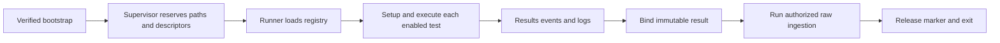

# C5: Validation Runtime

Status: Phase 2.1 logging and Phase 3.1-3.3 reservation/environment/cleanup source
implemented; new-source pod acceptance pending. Baseline/counting:
[overview](major-components-overview.md#measurement-method).

## In Simple Terms

Give each run its own protected output locations, run the selected tests and
keep the records even when something fails. Finish the result before ingestion;
do not keep changing the document that database writes are authorized against.

## Overview

Execute the ordered test catalog inside one Job while retaining trustworthy
evidence. The supervisor owns canonical paths and child lifetimes; the runner
owns test transitions. Neither owns scheduling nor comparative evaluation.

## Details and Purpose

Input is the exact source/config snapshot and assigned node/run identity.
Outputs are canonical result transitions, events, logs, summaries and exit status.
The supervisor invokes C7 ingestion after binding the finished result; writers
remain independently responsible for authorizing every database change.

## Current Process Flow

## Codebase Size

| Kind | Files | Physical Lines |
| --- | ---: | ---: |
| Code | 9 | 3,595 |
| Configuration | 0 | 0 |
| Tests | 5 | 1,973 |

Counted: validation package initialization, [execution](../../cval/validation/execution.py),
[path preflight](../../cval/validation/path_preflight.py),
[results](../../cval/validation/results.py), [runner](../../cval/validation/runner.py),
[secure filesystem](../../cval/validation/secure_fs.py),
[supervisor](../../cval/validation/supervisor.py),
[environment launcher](../../validation-tests/0-env.sh), and
[runner alias](../../validation-tests/run-test.sh).
Tests: runner, results v2, secure supervisor, path preflight and generic registry scaffold.
The registry/environment builder is C1; workload scripts are C6; ingestion is C7.

## Functionality Assessment

| Category | Functionality | Decision |
| --- | --- | --- |
| Critical | Descriptor-bound evidence, no run reuse, deadlines, child cleanup, canonical results | Preserve. |
| Good | Structured progress, isolated setup failures, historical result readers | Retain one implementation per contract. |
| Not important | Legacy text markers and result environment output | Keep as compatibility projections, not write authority. |
| Removed in 3.1 | Independent standalone directory/marker setup | Both entries now use the existing secure reservation helper. |

## Current Issues

1. [The runner](../../cval/validation/runner.py) now shares descriptor reservation
   for supervised and standalone entry; fresh workload equivalence remains unverified.
2. Phase 3.2 shares built-in evidence alias construction and rejects disagreements;
   full in-pod runner-to-ingestion acceptance remains pending.
3. Runtime success, test outcome and ingestion completion are different signals.
   A child exiting zero or a Completed Job cannot alone establish acceptance.
4. Redundant result writes and legacy messages increase transitions to reason about;
   changing them without evidence-order tests could lose failure diagnostics.

## Proposed Design

1. All production execution enters through the supervisor. Reuse its reservation
   primitive for supported standalone callers before retiring alternate path creation.
   Share existing secure/execution helpers; do not introduce a new adapter layer
   unless it removes a real duplicate implementation.
2. Reuse the existing immutable config snapshot, checked catalog and secure layout.
   Map legacy child environment at one boundary; do not add another context framework.
3. Keep phase and outcome separate. Preserve existing phases such as finished,
   setup_failed, timed_out and interrupted, alongside pass/fail/incomplete and
   timestamps/reasons. Disabled is never pass; do not invent replacement raw enums.
4. Keep one process-group/deadline utility for setup and workload children. Signals
   must retain incomplete evidence and terminate only owned descendants.
5. Continue atomic canonical result transitions, immutable ingestion digest binding
   and writer revalidation. Separate terminal test outcome from ingestion outcome
   in reporting; preserve historical formats and paths unchanged.

## Phase 2 Compact Runtime Logs

Reviewed direction (2026-09-24): operators and the normal Job tracker should be able
to understand one run from Kubernetes status plus `kubectl logs` on its owned pod
and container. Improve the existing log producer, not an external interpretation
framework. Phase 2.1 source now implements these producer milestones; the deployed
controller/pods have not been changed or accepted for this source.

| Owner | What It Reports |
| --- | --- |
| Supervisor (C5) | Run identity and start, child exits, retained result/log locations, and one final run summary after ingestion finishes or fails. |
| Runner (C5) | Selected tests, start/end per test, pass/fail/incomplete, elapsed time and a short failure reason. |
| Ingestion coordinator/writers (C7) | Per-required-store commit completion or not-required state, partial failures, and the final ingestion acknowledgement only after required writes finish. |

Reuse `RunLogger`/`CVAL_EVENT` (`cval.event.v1`) and existing descriptor-owned
canonical log files. Add fields/events compatibly rather than renaming historical
events or inventing another output format. Keep `run_finished` as test execution
completion; add a distinct supervisor final-summary event after the ingestion
attempt. The existing `ingestion_finished` event already originates in C7 and is
printed to container stdout as well as retained in the canonical event log.

Useful compact fields are node_name/run identity, source/config identity at start,
test/stage, outcome, elapsed time, short reason, and canonical evidence paths.
The final summary separates test outcome, log/result finalization and ingestion
outcome. Include counts or store-specific receipts only when known by the writer;
never infer a successful commit from process launch or print "all DBs updated"
when only some stores committed. A failed test can have successfully ingested
failure evidence; it is still a failed test. Disabled tests are not passing tests.

Flush milestone lines immediately. Keep raw workload stdout/stderr and artifacts,
but avoid repetitive progress dumps and giant JSON summaries in the informational
stream. Normal tracking reads a bounded log tail/increment, not the entire artifact
tree. Do not log credentials or full secret-bearing environments. Do not emit a
success summary until writes/log finalization actually succeed; if SIGKILL, OOM,
eviction or lost log transport prevents a final event, Kubernetes termination state
and an explicit unconfirmed ingestion status are the honest result.

The supervisor runs each child once; it does not restart failed workloads or pods.
The Job template/renderer owns scheduler-level no-restart policy, not the supervisor.
Phase 2.2 source now requires the explicit
[single-attempt contract](../configuration.md#single-attempt-validation) in both
templates. `Never` alone was insufficient; an actual retained Job had Job/task
`maxRetry=3`. The new source uses inherited termination policies and validates the
decoded manifest. Installed-controller acceptance remains pending, not inferred
from upstream source. Keep approved bounded SQLite lock retries distinct from a
benchmark or Job restart; no ingestion replay after terminal failure is introduced.

### Phase 2.1 Verification

The [event reference](../result-schema.md#compact-runtime-events) describes the
implemented additions. Existing source files own all changes: supervisor, runner,
shared event logger and ingestion coordinator. No new runtime modules, log files,
test scripts, raw schemas or operational settings were introduced.

Local OS pipe checks verified that a child's flushed line reached the supervisor's
console before child exit, and that retained logs matched it after termination.
Existing real historical events/results were read from the PVC, then replayed only
in temporary local files to check append safety, old parser compatibility and the
new acknowledgement contract. The replay is not a new writer execution or a pod
validation. Retained evidence is under `run-logs/phase21-*-20260924.*`.

New-source GPU execution, per-store commit/failure milestones and the complete
supervisor path remain unverified until a separately approved real-node run.
No synthetic benchmark/DB fixtures or fake Kubernetes clients were used. No Job,
pod, controller, source ConfigMap or raw DB was changed during development.
Task 2.2 is implemented in its separate source slice, with acceptance limitations
recorded in the roadmap. Tasks 2.3-2.5, including tracking and retest freshness,
remain outside this logging-only slice.

## Phase 3.1 Shared Reservation

The existing `reserve_secure_run_layout` now supplies both supervisor and standalone
runner entry. Standalone execution acquires the same exclusive directories, private
files and marker, then uses the existing descriptor-backed path readers and built-in
compatibility path helper. The separate mkdir/touch/marker implementation is removed:
three helpers and 149 runner lines, with no new runtime abstraction or setting.
Canonical path computation remains for result fields, not evidence creation.

Ownership stays explicit. A supervised runner borrows the supplied descriptors;
the supervisor retains global stdout/stderr and controls marker release after
ingestion. A standalone runner writes its own global logs, releases only its own
marker after normal test completion, and closes its descriptors on every exit.
Failure retains partial evidence and the marker, and the run ID cannot be reused.
Standalone execution never binds a result for ingestion or starts a DB writer.

The configured evidence root must already exist as a concrete directory, matching
the supervisor contract. Startup no longer creates a missing root or adopts manually
created logs/markers from flags alone. Pre-acquired logging/marker flags or inherited
FDs require a valid secure layout. Existing production bootstrap already supplies
that layout; standalone callers should let the runner reserve fresh evidence.

Three focused checks in the existing runner test file use the real local filesystem,
current registered test definitions and the actual control-host name. They stop
before any benchmark: a closed console verifies both ownership paths and retained
incomplete results, reuse/marker-only attempts leave existing files unchanged, and
a symlinked test directory cannot redirect writes. All descriptors are accounted
for after failure. Additional local checks used retained real run identities and
confirmed unchanged canonical result/workload functions. Evidence is indexed in
`run-logs/phase31-operations-20260924.md`.

Image, CUDA, PyTorch, iterations, test outcomes, raw schemas/writers and result
binding are unchanged. Phase 3.2 still owns further environment consolidation.
Fresh successful standalone/supervised execution and in-pod interruption remain
unverified; local filesystem checks do not substitute for approved real-node
acceptance. No source object, live session, Job or raw DB was changed by these checks.

## Phase 3.2 Environment Projection

The existing runtime module now owns `test_evidence_environment`, using the existing
built-in alias table and registered summary filenames. Supervisor/standalone path
setup and the runner's per-test environment use this same projection. It preserves
storage stdout, NCCL/DL workload logs and `ibbw-<node>-<timestamp>.log`; the runner's
different `ibbw.log` fallback is removed. Custom tests retain their generic
`CVAL_TEST_*` paths without acquiring built-in aliases or a new persistence contract.

The existing secure layout supplies global descriptor/canonical paths. At the
reservation boundary, matching canonical paths may become the corresponding
descriptor paths; other supplied aliases are rejected before any environment update.
Supervisor rejection closes newly owned descriptors while retaining partial evidence.
Borrowed runner global paths must match its layout. Per-test generic and built-in
values are checked rather than silently replaced, including canonical aliases.
Disagreeing node/timestamp alias pairs fail before reservation.

The ingestion shell `0-env.sh` now checks required projected paths instead of
constructing another set of defaults. Enabled tests require their run/output/log/
summary aliases, including NCCL's bandwidth log; disabled tests need no reserved
paths. The existing shell entry point, software-version detection and legacy result
initialization remain. Callers must receive owner-projected paths; sourcing this
file alone is no longer a way to invent evidence locations.

No configuration, test descriptor, image, CUDA/PyTorch, iteration, raw schema or
writer changed. The existing config projection/digest and canonical result/workload
functions are unchanged. Environment versions remain selectable and recorded by
the existing machinery; no new context framework, module, script or setting.

Five focused tests in the existing runner test class passed using real local
directories/descriptors and shell execution, with no benchmark or ingestion launched.
They include existing ownership/reuse/symlink checks, projection consistency and
atomic conflict rejection, missing shell paths, and identity rejection before
reservation. Additional checks compared aliases with the published supervisor,
preserved actual historical software-version values through the shell, and verified
supervisor descriptor cleanup on entry rejection. Evidence is indexed in
`run-logs/phase32-operations-20260924.md`.

Fresh in-pod execution/ingestion and custom-test acceptance remain unverified.
Local handoff checks are not deployed acceptance. The live loop remains paused;
source creation, workloads and activation retain separate exact approval gates.

## Phase 3.3 Child Cleanup

The supervisor now uses the existing execution module's process-group terminator,
removing its leader-only duplicate. The review reproduced a TERM-ignoring descendant
surviving after the group leader exited; the shared helper kills the remaining
owned group even when that leader is gone. The supervisor retains its two-second
termination grace, allowing the runner's own workload cleanup to handle a signal.
No unrelated process groups are targeted and no restart is introduced.

Two required positive `[runtime]` settings bound outer child execution:
`runner_timeout_seconds=6000` and `ingestion_timeout_seconds=300` in the reviewed
main TOML. These are editable run settings, not hidden defaults. They are separate
from read-only monitoring deadlines and inner per-test deadlines. A timeout or a
leader that exits while descendants remain is a supervisor error, not success.
Available log bytes remain retained; both stream drains share the existing
five-second cleanup budget. A drain failure leaves log retention unconfirmed.

The limits apply to child waits, with bounded termination/drain overhead; they do
not promise a hard wall-clock bound on filesystem stalls or processes deliberately
escaping the owned group. Existing result freezing/digest binding and raw writer
authorization are unchanged. Runner timeout does not start ingestion. Ingestion
timeout does not undo already committed stores or authorize a retry; preserve all
partial raw evidence. No image, CUDA, PyTorch, iteration or result-schema changes.

Three focused tests in the existing supervisor test module use actual local OS
processes, pipes and temporary log files: normal/nonzero exits, a TERM-ignoring
timeout, and descendants after leader exit or timeout. All passed and all owned
processes were reaped. Config snapshot round trips and missing/nonpositive-limit
rejection passed; pre-existing config values match the prior published source.
Evidence is indexed in `run-logs/phase33-operations-20260924.md`.

These are process regression checks, not synthetic benchmark/DB acceptance.
Fresh in-pod execution, real signal boundaries, ingestion interruption and detached
workload descendants remain unexercised. The live loop stays paused; creation,
activation and real acceptance each retain their exact approval gates.

## Evidence Lifecycle

| Stage | Allowed Change | Failure Behavior |
| --- | --- | --- |
| Reserve | Create this run's canonical paths and marker through owned descriptors. | Reject reuse or unsafe paths before test execution. |
| Execute | Runner owns result transitions; tests write only their supplied outputs. | Preserve failure/incomplete state and bounded diagnostics. |
| Finalize | Validate the terminal result and bind its immutable digest. | Invalid/missing result cannot authorize ingestion. |
| Ingest | C7 writes authorized stores; progress/logs may append. | Do not mutate the bound result to hide or retry a failed ingestion. |
| Finish | Retain result, raw records and terminal ingestion outcome. | An exit code alone does not establish acceptance. |

If no valid final result can be bound after interruption, retain available evidence
without publishing final raw status. A retry of ingestion needs the same authorized
snapshot and digest; rerunning workloads under the same run ID is not recovery.

Historical files remain readable, but missing historical provenance is reported
as limited evidence rather than synthesized into modern acceptance. Filesystem
guards prevent accidental/path-substitution errors; they do not sandbox malicious
benchmark code running with the same container privileges.

## Acceptance and Risk

Compare registry order, canonical schemas/events, logs and ingestion on approved
real-node runs. Use actual failure records for setup, timeout and interruption
analysis. An ingestion-only retry or signal exercise needs its own approval;
never mutate a canonical result or another run's paths to demonstrate rejection.
Retain descriptor/path safeguards and record unverified cases under the
[real-node policy](Redesign.md#real-node-validation-policy).
Priority P1; high risk because mistakes undermine evidence integrity.
