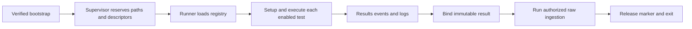

# C5: Validation Runtime

Status: proposed redesign. Baseline/counting: [overview](major-components-overview.md#measurement-method).

## Overview

Execute the ordered test catalog inside one Job while retaining trustworthy
evidence. The supervisor owns canonical paths and child lifetimes; the runner
owns test transitions. Neither owns scheduling nor comparative evaluation.

## Details and Purpose

Input is the exact source/config snapshot and assigned node/run identity.
Outputs are canonical result transitions, events, logs, summaries and exit status.
The supervisor invokes C7 ingestion after binding the finished result; writers
remain independently responsible for authorizing every database change.

## Current Process Flow

## Codebase Size

| Kind | Files | Physical Lines |
| --- | ---: | ---: |
| Code | 9 | 3,595 |
| Configuration | 0 | 0 |
| Tests | 5 | 1,973 |

Counted: validation package initialization, [execution](../../cval/validation/execution.py),
[path preflight](../../cval/validation/path_preflight.py),
[results](../../cval/validation/results.py), [runner](../../cval/validation/runner.py),
[secure filesystem](../../cval/validation/secure_fs.py),
[supervisor](../../cval/validation/supervisor.py),
[environment launcher](../../validation-tests/0-env.sh), and
[runner alias](../../validation-tests/run-test.sh).
Tests: runner, results v2, secure supervisor, path preflight and generic registry scaffold.
The registry/environment builder is C1; workload scripts are C6; ingestion is C7.

## Functionality Assessment

| Category | Functionality | Decision |
| --- | --- | --- |
| Critical | Descriptor-bound evidence, no run reuse, deadlines, child cleanup, canonical results | Preserve. |
| Good | Structured progress, isolated setup failures, historical result readers | Retain one implementation per contract. |
| Not important | Legacy text markers and result environment output | Keep as compatibility projections, not write authority. |
| Useless | Two independent implementations of evidence setup | Replace with one secure reservation path after caller migration. |

## Current Issues

1. [The runner](../../cval/validation/runner.py#L49) supports both supervisor-provided
   descriptors and standalone path construction. Both require extensive protection.
2. Built-in environment aliases are reconstructed in multiple layers; canonical
   and descriptor-backed paths must not diverge.
3. Runtime success, test outcome and ingestion completion are different signals.
   A child exiting zero or a Completed Job cannot alone establish acceptance.
4. Redundant result writes and legacy messages increase transitions to reason about;
   changing them without evidence-order tests could lose failure diagnostics.

## Proposed Design

1. All production execution enters through the supervisor. Reuse its reservation
   primitive for standalone tests/callers through an explicit adapter before
   retiring alternate path creation; do not weaken checks to reduce lines.
2. Define one run context containing immutable identity, checked catalog and owned
   evidence handles. Map legacy child environment at one boundary.
3. Keep a small explicit test state machine: selected, setup, running, then
   pass/fail/incomplete with timestamps and reason. Disabled is never pass.
4. Keep one process-group/deadline utility for setup and workload children. Signals
   must retain incomplete evidence and terminate only owned descendants.
5. Continue atomic canonical result transitions, immutable ingestion digest binding
   and writer revalidation. Separate terminal test outcome from ingestion outcome
   in reporting; preserve historical formats and paths unchanged.

## Acceptance and Risk

Replay dynamic test ordering, timeouts, termination, setup failures and disabled
tests. Reuse [hostile-path/descriptor tests](../../tests/test_secure_supervisor.py)
for symlink swaps, run reuse, file identity changes and interruption. Compare
canonical schemas/events and retained files before/after the refactor.
Priority P1; high risk because mistakes undermine evidence integrity.
