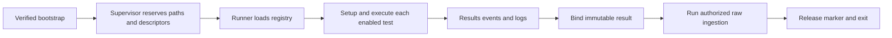

# C5: Validation Runtime

Status: proposed redesign. Baseline/counting: [overview](major-components-overview.md#measurement-method).

## In Simple Terms

Give each run its own protected output locations, run the selected tests and
keep the records even when something fails. Finish the result before ingestion;
do not keep changing the document that database writes are authorized against.

## Overview

Execute the ordered test catalog inside one Job while retaining trustworthy
evidence. The supervisor owns canonical paths and child lifetimes; the runner
owns test transitions. Neither owns scheduling nor comparative evaluation.

## Details and Purpose

Input is the exact source/config snapshot and assigned node/run identity.
Outputs are canonical result transitions, events, logs, summaries and exit status.
The supervisor invokes C7 ingestion after binding the finished result; writers
remain independently responsible for authorizing every database change.

## Current Process Flow

## Codebase Size

| Kind | Files | Physical Lines |
| --- | ---: | ---: |
| Code | 9 | 3,595 |
| Configuration | 0 | 0 |
| Tests | 5 | 1,973 |

Counted: validation package initialization, [execution](../../cval/validation/execution.py),
[path preflight](../../cval/validation/path_preflight.py),
[results](../../cval/validation/results.py), [runner](../../cval/validation/runner.py),
[secure filesystem](../../cval/validation/secure_fs.py),
[supervisor](../../cval/validation/supervisor.py),
[environment launcher](../../validation-tests/0-env.sh), and
[runner alias](../../validation-tests/run-test.sh).
Tests: runner, results v2, secure supervisor, path preflight and generic registry scaffold.
The registry/environment builder is C1; workload scripts are C6; ingestion is C7.

## Functionality Assessment

| Category | Functionality | Decision |
| --- | --- | --- |
| Critical | Descriptor-bound evidence, no run reuse, deadlines, child cleanup, canonical results | Preserve. |
| Good | Structured progress, isolated setup failures, historical result readers | Retain one implementation per contract. |
| Not important | Legacy text markers and result environment output | Keep as compatibility projections, not write authority. |
| Useless | Two independent implementations of evidence setup | Replace with one secure reservation path after caller migration. |

## Current Issues

1. [The runner](../../cval/validation/runner.py#L49) supports both supervisor-provided
   descriptors and standalone path construction. Both require extensive protection.
2. Built-in environment aliases are reconstructed in multiple layers; canonical
   and descriptor-backed paths must not diverge.
3. Runtime success, test outcome and ingestion completion are different signals.
   A child exiting zero or a Completed Job cannot alone establish acceptance.
4. Redundant result writes and legacy messages increase transitions to reason about;
   changing them without evidence-order tests could lose failure diagnostics.

## Proposed Design

1. All production execution enters through the supervisor. Reuse its reservation
   primitive for supported standalone callers before retiring alternate path creation.
   Share existing secure/execution helpers; do not introduce a new adapter layer
   unless it removes a real duplicate implementation.
2. Define one run context containing immutable identity, checked catalog and owned
   evidence handles. Map legacy child environment at one boundary.
3. Keep phase and outcome separate. Preserve existing phases such as finished,
   setup_failed, timed_out and interrupted, alongside pass/fail/incomplete and
   timestamps/reasons. Disabled is never pass; do not invent replacement raw enums.
4. Keep one process-group/deadline utility for setup and workload children. Signals
   must retain incomplete evidence and terminate only owned descendants.
5. Continue atomic canonical result transitions, immutable ingestion digest binding
   and writer revalidation. Separate terminal test outcome from ingestion outcome
   in reporting; preserve historical formats and paths unchanged.

## Evidence Lifecycle

| Stage | Allowed Change | Failure Behavior |
| --- | --- | --- |
| Reserve | Create this run's canonical paths and marker through owned descriptors. | Reject reuse or unsafe paths before test execution. |
| Execute | Runner owns result transitions; tests write only their supplied outputs. | Preserve failure/incomplete state and bounded diagnostics. |
| Finalize | Validate the terminal result and bind its immutable digest. | Invalid/missing result cannot authorize ingestion. |
| Ingest | C7 writes authorized stores; progress/logs may append. | Do not mutate the bound result to hide or retry a failed ingestion. |
| Finish | Retain result, raw records and terminal ingestion outcome. | An exit code alone does not establish acceptance. |

If no valid final result can be bound after interruption, retain available evidence
without publishing final raw status. A retry of ingestion needs the same authorized
snapshot and digest; rerunning workloads under the same run ID is not recovery.

Historical files remain readable, but missing historical provenance is reported
as limited evidence rather than synthesized into modern acceptance. Filesystem
guards prevent accidental/path-substitution errors; they do not sandbox malicious
benchmark code running with the same container privileges.

## Acceptance and Risk

Compare registry order, canonical schemas/events, logs and ingestion on approved
real-node runs. Use actual failure records for setup, timeout and interruption
analysis. An ingestion-only retry or signal exercise needs its own approval;
never mutate a canonical result or another run's paths to demonstrate rejection.
Retain descriptor/path safeguards and record unverified cases under the
[real-node policy](Redesign.md#real-node-validation-policy).
Priority P1; high risk because mistakes undermine evidence integrity.
