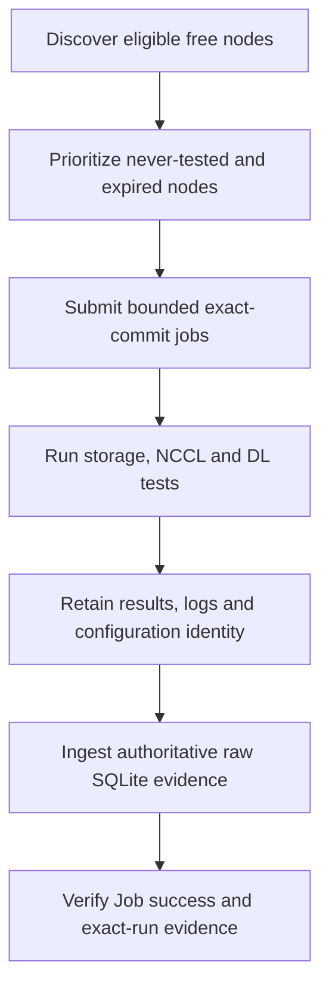

# C-VAL: Progress and Next Steps

**Scope updated:** September 23, 2026.

c-val ends at successful validation and verified raw evidence on the PVC.
Downstream evaluation, classification, scoring, ticketing and automatic repair
workflows are not repository responsibilities. Removing their code does not
delete historical data or stop already deployed workloads.

## Raw Validation

### Offline Validation and Major Components

Offline validation runs a controlled diagnostic workload when a node is available,
rather than adding stress tests to a running user job. It checks selected AI
operations and retains evidence to reproduce and inspect the result.

| Component | Technical walkthrough |
| --- | --- |
| Discovery and prioritization | Check readiness, schedulability and free GPU/CPU/memory/RDMA capacity; select never-tested nodes, then expired results, oldest first |
| CLI and live loop | Inspect and plan work, submit bounded batches with explicit confirmation, track progress and enforce submission cooldowns |
| Test runtime | Execute registered tests with their own setup, configuration, deadlines and artifacts; disabled tests are not counted as passed |
| Raw evidence | Preserve canonical results, logs and run identity; validate configuration/digests before writing seven authoritative SQLite stores |
| Operator interface | Inspect results and evidence gaps; run targeted validation when an eligible node needs investigation or acceptance |

The framework records test-owned pass/fail/incomplete outcomes and measurements;
it does not infer node-health classes from them.

| Current test family | Coverage |
| --- | --- |
| DL unit tests | Selected numerical, compute, collective and compute/communication-overlap observations across eight GPU ranks |
| NCCL IB loopback with bandwidth tracking | Single-node AllReduce over IB, with HCA transmit-bandwidth observations; not full multi-node fabric qualification |
| Shared-storage FIO | Read/write performance, bandwidth and IOPS relevant to dataset and checkpoint I/O; not a complete application checkpoint test |

The default retest age is seven days with a four-hour submission cooldown; these
are not freshness guarantees. Full-suite phase deadlines total 90 minutes.
Scheduler-selected quick testing changes placement, not the profile or deadlines.

## Recorded Verification

On September 23, the scheduler-selected quick test at
`fe4d405afca710c0625125982f8c1d26e586d77a` ran on `slc01-cl02-hgx-0192`, timestamp
`1790178532`. Assignment took 35 seconds; the Job completed in 13m50s with exit 0
and no restarts. Storage, NCCL and DL passed, and ingestion finished in 25.363
seconds. The audit verified 38 canonical files and all seven raw databases,
including 7,128 DL metric rows across eight ranks with complete receipts.

This is dated evidence for that commit, not acceptance of later changes or a
fleet-health claim. The record remains under local `run-logs/quick-test-1790178532/`.
The subsequent evaluator removal needs its own published exact-commit acceptance.
No current deployment state is inferred from these records.

## Next Work

Use the [improvement plan](cval-improvement-plan.md) for bounded raw-framework
work: consistent discovery configuration, pre-submit eligibility, exact-run
reporting, simpler monitoring, reproducible dependencies and evidence recovery.

Require approved exact-commit tests and matching canonical/raw evidence before
rollout. Then inspect fresh loop Jobs, source identity, cooldown/resume decisions,
logs/results and ingestion. Missing capacity leaves live-run verification open;
it is not permission to lower resource requirements or claim a pass.

## References

- [Architecture](architecture.md)
- [Configuration](configuration.md)
- [Operations and quick tests](operations-runbook.md)
- [Results and raw DBs](result-schema.md)