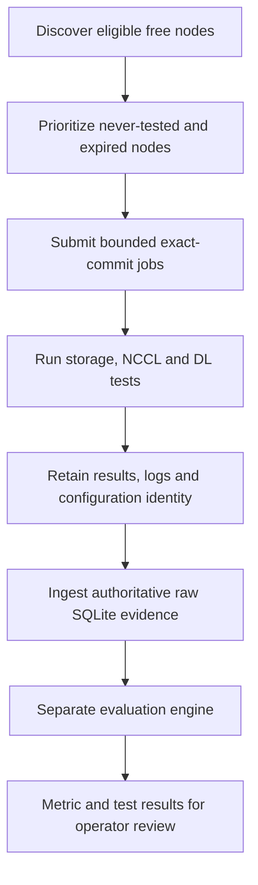
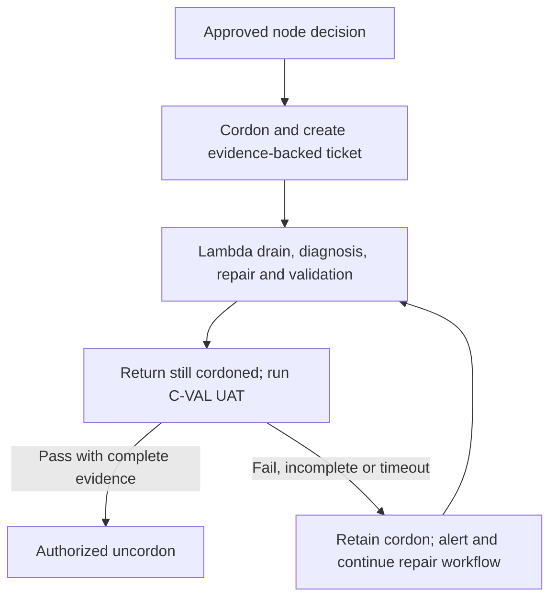

# C-VAL: Progress and Next Steps

**As of:** September 9, 2026.

**Offline validation is live. The current development focus is automating the response to unsuitable nodes and validating their return after repair. Online validation is the next major backlog priority.**

| Milestone | Status | Outcome |
| --- | --- | --- |
| **C-VAL 2.0: Offline validation** | **Done / Live** | Discover available nodes, run repeatable tests, retain raw evidence and evaluate compatible results through a separate service |
| **C-VAL 3.0: Automation** | **In Progress** | Automatic node cordoning, support ticketing, vendor handoff and post-repair user acceptance tests |
| **C-VAL 4.0: Online validation** | **Backlog Priority** | Detect hardware and performance anomalies during user workloads and connect them to offline verification |

These are capability milestones. Completing offline validation does not mean every node has current passing evidence or that automatic remediation is already enabled.

## 1. Cluster Health

### Node Health Definition

**A node is fit for an AI workload when its relevant components have no unresolved material fault signals and it can execute representative work correctly and at acceptable performance.** That assessment depends on the workload, software environment and age of the evidence.

| Evidence | Examples | What it establishes |
| --- | --- | --- |
| Component signals | DCGM, GPU/HBM errors, clocks, temperature, power, host and network telemetry | Whether the underlying components show faults or abnormal behavior |
| Representative tests | DL numerical/compute tests, NCCL communication and storage I/O | Whether selected operations execute correctly and perform as expected |
| Production behavior | Training step times, useful throughput, collective stalls and retries | Whether the node remains suitable under actual workload conditions |

Kubernetes Ready status or normal telemetry alone is insufficient. A node can remain operational but slow an entire synchronous training job. Conversely, application imbalance, data loading and shared congestion can resemble hardware degradation. Missing or stale evidence is an evidence gap, not proof of health.

### GPU Cluster Study: Meta Llama 3

Meta's *The Llama 3 Herd of Models* provides a public reference for large-scale training reliability. Its infrastructure used up to **16,384 H100 GPUs**, with eight GPUs per server. A **54-day snapshot** recorded the following. [R1]

| Observation | Result |
| --- | --- |
| Job interruptions | 466 total: 47 planned and **419 unexpected** |
| Unexpected interruption frequency | **7.76/day**, averaging **one every 3.09 hours** across the training job |
| Hardware attribution | Approximately **78%**, including confirmed and suspected hardware-related causes |
| Published component shares | Faulty GPU approximately 30%; GPU HBM3 memory approximately 17% |
| Effective training time | More than **90%**; significant manual intervention required only three times in the snapshot |

The engineering takeaway is that validation, fast diagnosis, checkpointing and automated recovery must work together. C-VAL contributes validation evidence; it does not replace training checkpoint/restart resilience. The paper is a reference point, not an industry failure-rate standard.

The component percentages are quoted as published: Table 5 contains an inconsistent faulty-GPU count/share. The calculations below use the narrative total of 419, not the inconsistent category count.

### Health Events and MTTF Expectations

The cluster sizing basis is **3,832 B200 GPUs across 479 eight-GPU nodes**. The connectivity description includes 13 IB links, eight of them 400 Gb/s NDR compute links; the remaining links and per-node mapping need inventory confirmation.

For a simple exposure-based comparison, assume Meta's full 2,048-node configuration participated throughout the 54-day snapshot:

$$
\lambda = \frac{419}{54 \times 2{,}048}
  = 0.003789\ \text{unexpected interruptions per node-day}.
$$

For $N$ similarly exposed nodes, the illustrative event frequency is $N\lambda$ per day, and the mean interval is $24/(N\lambda)$ hours.

| Scenario | Events per day | Mean interval between events |
| --- | --- | --- |
| Meta's observed job interruptions | 7.76 | 3.09 hours |
| 479-node linear scaling, all unexpected causes | **1.81** | **13.22 hours** |
| 479-node scaling, hardware-attributed subset at 78% | **1.42** | **16.95 hours** |

These intervals are **MTTF planning proxies, more precisely mean intervals between interruptions**, not measured node lifetimes. The two projected rows are an all-cause scenario and its subset, not a confidence range. The normalization is 3.79 events per 1,000 node-days; it is not a measured individual-node daily failure probability.

Actual B200 event rates depend on hardware generation, workload scale, utilization, software, network topology and correlated failures. Exact exposure for Meta's snapshot is not provided, and its RoCE environment differs from this cluster's IB. A 479-node cluster also need not run one 479-node job. **No local incident-derived MTTF is established by this comparison.**

### Recovery SLA and Spare Capacity

The reported operating position adds an important constraint: current node recovery takes much longer than the illustrative inter-event intervals above.

| Item | Current position | Interpretation |
| --- | --- | --- |
| Hardware provider | Lambda | Owns hardware diagnosis and remediation |
| Ticket acknowledgement SLA | **Within 24 hours of filing a ticket** for an identified unhealthy node | Acknowledgement is not mitigation or restoration |
| Mitigation/restoration SLA | **No committed SLA** | The acknowledgement deadline does not bound time out of service |
| Mean Time to Recovery/Remediation (MTTR) | **Approximately 7 days**, from cordoning to a healthy node ready for customer workloads | End-to-end recovery, including handoffs, repair and acceptance; a current mean, not a maximum or promised deadline |
| Spare capacity | **3 nodes / 24 GPUs**, or **0.63%** of 479 nodes | Only three simultaneous node outages can be fully covered, assuming healthy, compatible, available spares |

The seven-day MTTR already spans acknowledgement and subsequent recovery; the 24-hour window is not added again. A spare can help a workload resume before the original node is repaired, so node MTTR is not necessarily the workload's downtime.

#### Capacity Impact of Seven-Day Recovery

For stable operation, average unavailable capacity follows the arrival-rate/recovery-time relationship:

$$
	ext{Mean unavailable nodes}
\approx \text{new node-removal episodes per day} \times \text{mean recovery days}.
$$

**Conditional scenario:** if each hardware-attributed interruption projected above caused one new node-removal episode, the mean unavailable capacity would be **1.42 x 7 = approximately 9.9 nodes**, or **2.07% of the cluster** (using the unrounded event rate). That is approximately seven nodes beyond the three-spare pool at the mean level, before allowing for incident bursts or long repairs.

This is a sensitivity calculation, not a measured repair backlog: job interruptions do not map one-to-one to node removals. Repeated interruptions may share one cause, while a correlated fault may affect several nodes. A production forecast needs the local rate of distinct removal episodes and the full recovery-time distribution.

| Reserve scenario | Whole nodes / GPUs | Increase over current pool |
| --- | --- | --- |
| Current: 0.63% | **3 / 24** | None |
| 2% planning target | **10 / 80** | **7 nodes / 56 GPUs** |
| 5% planning target | **24 / 192** | **21 nodes / 168 GPUs** |

Targets are rounded up to whole nodes using 479 as the sizing denominator. **Treat 2-5% as a provisional planning range, not a verified universal industry recommendation.** Required reserve depends on removal rates, repair delays, correlated incidents, placement compatibility and the acceptable risk of exhausting the pool. Ten spares would only approximately cover the scenario's mean demand; even 24 would not establish a service guarantee without tail-risk analysis.

**Operational implications:**

- **Recovery and reserves must be sized together.** At seven-day MTTR, three spares cover mean removal demand only up to **0.43 nodes/day**, approximately one every 56 hours. At the conditional 1.42/day rate, a three-spare mean balance would require MTTR of **about 2.12 days / 51 hours**, still without a safety margin.
- **Measure restoration, not acknowledgement alone.** Track cordon, ticket, acknowledgement, repair completion, acceptance and customer-ready timestamps; report average and tail recovery times alongside the age of unresolved cases. Agree a restoration objective and escalation path with Lambda in addition to the acknowledgement SLA.
- **Automation helps, but cannot replace repair capacity.** C-VAL 3.0 can reduce ticketing, handoff and acceptance delays. It cannot by itself bound vendor repair time; spare-pool sizing and remediation commitments need separate decisions. Limited spares must not bypass the passing-acceptance gate.

## 2. C-VAL Overview

### Offline Validation and Major Components

Offline validation runs a controlled diagnostic workload when a node is available, rather than adding stress tests to a running user job. It checks selected AI operations and retains enough evidence to reproduce and investigate the result. [C1]

| Component | Technical walkthrough |
| --- | --- |
| Discovery and prioritization | Check readiness, schedulability and free GPU/CPU/memory/RDMA capacity; select never-tested nodes, then expired results, oldest first |
| CLI and live loop | Inspect and plan work, submit bounded batches with explicit confirmation, track progress and enforce submission cooldowns |
| Test runtime | Execute registered tests with their own setup, configuration, deadlines and artifacts; disabled tests are not counted as passed |
| Raw evidence | Preserve canonical results, logs and run identity; validate configuration/digests before writing seven authoritative SQLite stores |
| Evaluation service | Read raw evidence without modifying it; compare compatible cohorts and publish separate metric/test classifications with baseline provenance |
| Operator interface | Inspect results and evidence gaps; run targeted validation when an eligible node needs investigation or acceptance |

The **raw framework collects evidence**. The **separate evaluator interprets it**. Final node-policy decisions and automated operational actions belong to a downstream layer, not the raw ingestion path.

| Current test family | Coverage |
| --- | --- |
| DL unit tests | Selected numerical, compute, collective and compute/communication-overlap observations across eight GPU ranks |
| NCCL IB loopback with bandwidth tracking | Single-node AllReduce over IB, with HCA transmit-bandwidth observations; not full multi-node fabric qualification |
| Shared-storage FIO | Read/write performance, bandwidth and IOPS relevant to dataset and checkpoint I/O; not a complete application checkpoint test |

The default retest age is seven days, with a four-hour submission cooldown. These are scheduling controls, not freshness guarantees. Busy nodes may remain untested, and test traffic can still affect shared storage/fabric. Full-suite phase timeout budgets total 90 minutes; a comprehensive five-minute check would require a separate quick profile. [C2]

### Guard Paper Review: Takeaways

Guard combines workload-aware online monitoring with offline single-node and multi-node sweeps. It uses training step time as the primary performance signal, supported by GPU and communication telemetry, and looks for sustained deviations among peers in the same job. [R2]

| Approach | Strength | Gap |
| --- | --- | --- |
| Offline | Controlled, reproducible diagnostics and post-repair acceptance | Misses some transient, long-running and workload-specific behavior; needs available capacity |
| Online | Observes real workloads on busy nodes and detects fail-slow behavior | Noise, workload differences and instrumentation overhead require careful interpretation |
| Hybrid | Online detection identifies suspects; offline verification reproduces/localizes issues and gates return | Requires correlated identities, calibrated policies and a safe operational handoff |

**Why hybrid is the best fit for C-VAL:** it preserves the completed offline foundation while closing the visibility gap during long-running workloads. Detection can happen online, diagnosis can use controlled tests, and repaired nodes can return only after acceptance.

Key implications for the roadmap:

- Correlate telemetry with step-time and throughput impact; do not infer hardware failure from one noisy counter.
- Use sustained, multi-signal comparisons within compatible workloads to reduce false alarms.
- Add event-driven validation after suspicious behavior or repair, alongside the existing age-based queue.
- Extend communication coverage beyond single-node loopback; Guard reports useful detection with two-node sweeps and sustained one-to-two-hour validation.

Guard Table 4 reports mean time to failure improving from **8.1 hours with node sweeps**, to **9.2 hours with online monitoring added**, to **16.7 hours with enhanced sweeps**; corresponding model FLOPs utilization is 10%, 14% and 17%. Its reported false-positive/false-negative rates are 12.4%/7.8% on separate 1,000-sample sets. These are deployment-specific research results, **not C-VAL's measured outcomes or promised gains**.

## 3. Where We Stand: C-VAL 2.0 [Done]

**The offline-validation capability is implemented and live.** It provides a repeatable path from available-node discovery to retained evidence and separate evaluation.

| Work completed | Practical outcome |
| --- | --- |
| Resource-aware discovery and deterministic scheduling | Available nodes are selected using capacity and validation history |
| Three enabled test families | DL, IB-loopback NCCL and shared-storage I/O exercise complementary parts of the AI stack |
| Registry-driven runtime and exact-run provenance | Tests retain configuration, timestamps, canonical results and diagnostic artifacts |
| CLI, continuous loop and targeted validation | Operators can inspect ongoing work and validate an eligible individual node |
| Raw result ingestion and persistence | Original observations remain available independently of evaluation policy |
| Separate baseline/evaluation worker | Compatible metrics and tests can be evaluated without changing raw results |

Recorded September 9 operating evidence includes an active local validation loop and a Running/Ready evaluator processing bounded batches. The detailed observation times and implementation baseline are retained in the [technical overview][C1]. These establish operation, not a fleet-wide pass rate.

**Remaining qualification work is distinct from 2.0 feature completion:** measure fresh fleet coverage, verify complete ingestion and active baseline coverage, and calibrate interpretation. A completed Job alone is not proof of passing tests; missing or incompatible evaluation evidence remains unclassified. Final node-level policy, multi-node/MoE coverage and automated repair workflows are not claimed as completed 2.0 features. [C3] [C4]

## 4. In Progress: C-VAL 3.0 Automation

**Objective:** turn validated evidence into a controlled repair-and-return workflow, reducing repeated scheduling onto unsuitable nodes and manual handoffs.

| Workstream | Target behavior | Completion gate |
| --- | --- | --- |
| Automatic node cordoning | An approved downstream node decision prevents new scheduling | Rate limits, circuit breakers, idempotent actions and auditability |
| Automatic ticketing | Create a vendor ticket with durable failure context | One workflow ID, deduplicated retries and traceable evidence |
| Vendor handoff | Track acknowledgement, diagnosis, repair and vendor validation | Agreed state transitions and clear Lambda ownership of drain/repair |
| Automatic user acceptance tests (UAT) | Retest repaired nodes while they remain cordoned | Eligible free node, current exact-run evidence and complete required results |
| Controlled return to service | Uncordon only after the acceptance gate succeeds | Failures, missing evidence and timeouts cannot bypass acceptance |

Cordoning prevents new scheduling; it does not drain or terminate running workloads. The raw validation framework is not the actuation controller. A timeout or controller outage must never cause unconditional uncordoning.

**Next completion checkpoint:** finalize the state/ownership contract, demonstrate idempotent dry-run behavior, then validate the complete vendor-to-UAT lifecycle in a bounded pilot. End-to-end automated operation is not yet claimed complete; no delivery percentage or date is inferred.

## 5. Backlog Priority: C-VAL 4.0 Online Validation

**Priority after the 3.0 automation milestone:** continuous visibility while user workloads are running, using online evidence to trigger appropriate diagnosis and offline verification.

| Planned capability | Purpose |
| --- | --- |
| Continuous signal collection | Collect GPU/host/network telemetry, logs and error signals, reusing existing monitoring where practical |
| Workload correlation | Attach node, job, rank and time context to throughput, step-time and communication anomalies |
| Sustained anomaly detection | Distinguish persistent degradation from transient noise and application imbalance |
| Hybrid response | Feed confirmed observations into the approved 3.0 workflow and offline acceptance path |
| Bounded overhead and accuracy checks | Measure collection cost, detection latency and adjudicated false alarms before expanding automation |

A DaemonSet is a possible collection mechanism, not the complete online-validation service. Workload context, detection policy, data quality and operational ownership remain separate deliverables.

**Interim input:** Ben's Lattice node-health report can support read-only human triage while 4.0 is developed. Confirm its coverage, freshness and ownership before use; it is not a completed integration or an automatic cordoning authority.

Supporting test backlog includes **DeepSeek MoE readiness**, **topology-aware multi-node fabric validation**, **dedicated sustained straggler-GPU detection**, and a **validated quick on-demand profile**. These extend diagnostic coverage; they do not replace the priority of closing the online visibility gap.

Progress should be measured through fresh validation coverage, evidence completeness, evaluation lag, detection quality, repair/acceptance turnaround and workload impact. The next demonstrated outcome is the complete **3.0 repair-and-acceptance loop**; the next major capability is **4.0 online validation integrated with the existing offline foundation**.

## References

- [R1] Meta, *The Llama 3 Herd of Models*: Sections 3.3.1 and 3.3.4, Tables 4-5.
- [R2] Amazon researchers, *Guard: Scalable Straggler Detection and Node Health Management for Large-Scale Training*: Sections 4-7, Tables 3-4.
- [C1] C-VAL technical overview, implementation baseline and operating observations.
- [C2] Operator configuration; [C3] targeted validation and evidence-acceptance logic; [C4] separate evaluator design and operations.

[R1]: https://arxiv.org/pdf/2407.21783
[R2]: https://arxiv.org/pdf/2605.17879
[C1]: cval-technical-overview.md
[C2]: ../config/cval.toml
[C3]: ../cval/orchestrator/validate.py
[C4]: ../deploy/evaluation-engine/README.md