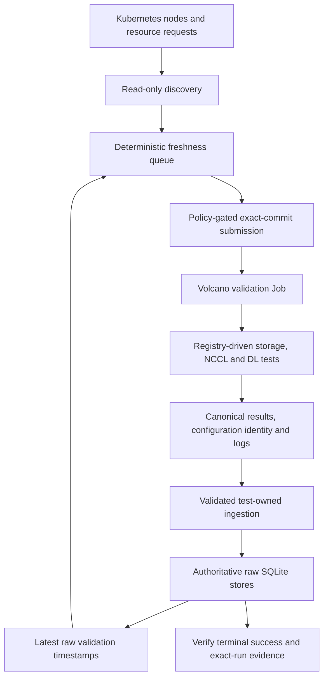

# C-VAL: Raw Validation Overview

**Scope updated:** September 23, 2026. Implementation and effective configuration,
not this overview, determine the behavior of a particular published run.

## 1. Overview and Goals

C-VAL (Continuous Validation) runs repeatable, application-level tests on available GPU nodes and preserves the results for diagnosis and performance analysis. It complements infrastructure monitoring: Kubernetes readiness and normal hardware telemetry do not establish numerical correctness, expected throughput, or suitability for distributed training.

The repository owns discovery, validation, raw ingestion and verification that the
Job and its evidence completed successfully. Its scope stops there: no downstream
baseline, classification, scoring, repair or remediation controller is included.

### Goals

- Detect selected numerical, compute, communication and storage problems before they disrupt user workloads.
- Expose fail-slow behavior: nodes that remain operational but reduce the throughput of synchronous training.
- Make investigations reproducible through exact source identity, effective configuration, timestamps and retained artifacts.
- Use available capacity with bounded jobs and deterministic scheduling, while accounting for shared network and storage impact.
- Supply traceable evidence for operators inspecting a test or an explicitly requested retest.

## 2. Validation Boundary

Kubernetes Ready is a scheduling prerequisite, not proof of test success or node
health. Tests exercise selected operations and retain their outcomes and metrics;
an old pass or incomplete result must never substitute for the current run.
Validation consumes reserved capacity and can still affect shared storage/network
services. It is not comprehensive hardware certification or a workload diagnosis.

## 3. Architecture

  The [architecture](architecture.md) owns the runtime map and component boundaries.

| Component | Responsibility | Design benefit |
| --- | --- | --- |
| Discovery and scheduler | Read cluster state, check capacity, prioritize never-tested and expired nodes | Deterministic selection with explicit eligibility reasons |
| CLI and live loop | Inspect, plan, submit bounded jobs, track progress and apply cooldowns | Common operator interface and controlled use of available capacity |
| Validation runtime | Execute registered tests with setup, deadlines, structured results and artifacts | Tests extend the system through their own configuration and plugins |
| Raw ingestion | Validate run identity, configuration and destinations; persist test-owned measurements | Preserves original observations and exact-run receipts |
| Acceptance checks | Confirm terminal Job success, canonical artifacts and matching raw rows | Separates completed testing from successful persistence |

Reproducibility depends on more than a Git commit: image identity, external test
dependencies and effective configuration also matter. Coverage and evidence
completeness must be measured rather than inferred from a running controller.

## 4. Process Logic

1. **Discover eligible capacity.** Inspect node readiness, schedulability and active Kubernetes resource requests. Ordinary discovery excludes unsuitable nodes and checks GPU, CPU, memory and RDMA availability. GPU idleness alone is insufficient. [C2]
2. **Build the priority queue.** Select never-tested nodes first, followed by nodes whose latest validation timestamp is older than the configured threshold. Sort by timestamp, then node name for deterministic ties. This is scheduling priority, not health ranking. [C3] [C4]
3. **Plan and authorize submission.** Inspect candidates without rendering Jobs; render only selected nodes at confirmed submission. Execution requires an exact published commit; the default placeholder fails closed. [C1] [C7]
4. **Run enabled tests.** The registry controls order, setup, timeout, artifacts and continuation behavior. Disabled tests are skipped/incomplete, never recorded as passed. [C5]
5. **Preserve canonical evidence.** Retain structured results, progress events, logs, summaries and configuration identity. The supervisor protects canonical evidence paths and file descriptors. [C5] [C6]
6. **Ingest raw results.** Verify result identity/digest, the immutable configuration snapshot and approved database targets. Storage/NCCL metrics precede the atomic built-in status set; DL stores carry receipt/generation evidence. There is no single transaction spanning all seven raw databases. [C6]
7. **Verify completion.** Check terminal success, readable canonical logs/results, the ingestion event and exact-run raw rows. Retests require a new identity and explicit approval.

**Successful validation requires more than a completed Job:** a successful terminal phase, passing required tests, canonical result evidence, successful ingestion and matching exact-timestamp raw rows must agree. [C7]

## 5. Test Coverage and Runtime Configuration

### Enabled Test Families

The profiles below are checked-in defaults. Individual runs retain their effective configuration. [S1] [S2] [S3]

| Test family | Profile and measurements | Coverage boundary |
| --- | --- | --- |
| Storage FIO | Order 10; 30-minute timeout. Shared-storage read/write profiles; 12 raw bandwidth/IOPS fields across depth, parallel-file and random I/O patterns | Not application checkpoint validation or a latency acceptance policy; shared-service contention influences results |
| NCCL and HCA bandwidth | Order 20; 20-minute timeout. Eight GPUs, 20 iterations, `data_size_gb=8`, IB transport, P2P/shared-memory paths disabled, IB bandwidth tracker enabled. Bus bandwidth, latency and eight HCA transmit-bandwidth fields | Single-node IB loopback; does not qualify the entire fabric, topology or cross-node all-to-all behavior |
| Deep-learning unit test | Order 30; 40-minute timeout. Eight ranks, `80gb-example`, 100 iterations. Numerical norms/parameters, CPU/GPU forward/backward timings, collective timings and compute/communication overlap | Selected primitives, not a complete training workload or certified numerical reference; exact task coverage depends on the external benchmark plan |

The suite exercises host and communication paths through these operations, but does not constitute comprehensive CPU/RAM/HBM diagnostics or dedicated all-pairs NVLink qualification. Sustained straggler detection, MoE readiness and multi-node fabric tests remain additional coverage goals.

Phase timeouts total **90 minutes**; the configured monitoring timeout is **100
minutes**. These are budgets, not measured durations. The scheduler-selected
[quick workflow](operations-runbook.md#quick-test-workflow) uses the same full
profile; it changes placement, not test coverage or guaranteed completion time.

### Scheduling and Resources

| Setting | Default | Meaning |
| --- | --- | --- |
| Retest age | 7 days | Eligibility threshold, not a weekly coverage guarantee |
| Batch size / policy maximum | 3 / 5 jobs | Bounded submission; live-loop overrides may differ |
| Submission cooldown | 4 hours per node | Limits repeat submissions; separate from result freshness |
| Job resources | 8 GPUs, 100 CPU, 1,500 GiB memory, 256 GiB shared-memory volume, one RDMA allocation | Full-node-scale reservation; RDMA resource count is not a physical-link count |
| Image | `nvcr.io/nvidia/pytorch:26.05-py3` | Configured tag, not an immutable image digest |
| Monitoring | 60-second polling; 1,200-second (20-minute) pending-start timeout | Execution/observation controls, not performance thresholds |

Opportunism limits direct competition for busy GPUs but can leave those nodes with stale evidence. Diagnostic traffic can still affect shared storage and fabric. [C1] [C3]

## 6. Raw Evidence

### Persistence Boundaries

| Layer | Contents and contract |
| --- | --- |
| Authoritative raw stores | Seven SQLite files under `metadata/`: validation status, storage, NCCL, and four DL stores for numerical, compute, collective and overlap observations |
| Canonical artifacts | `cval.results`, `cval.event.v1` progress, logs, summaries, run identity and configuration identity; historical result formats remain readable |
Strict audit queries require SQLite `mode=ro` and `query_only=ON`. Bounded reads,
retry policy, exact identities, POSIX locks and DELETE journaling protect raw
ingestion on shared storage. See the [raw database contract](components_design/raw-database-design.md)
and [result schema](result-schema.md). No derived store or evaluation cursor is
part of the current framework.

## 7. Operational Measures and Limitations

| Measure | Definition |
| --- | --- |
| Fresh coverage | Nodes with complete required evidence inside the agreed window / all in-scope nodes; separate busy and untestable nodes |
| Evidence completeness | Terminal runs with canonical results, successful ingestion and matching exact-timestamp raw rows / terminal runs |
| Capacity cost | Validation GPU-hours, startup and queue delays, shared-storage/network traffic |

Keep forbidden, unavailable, empty, stale and incomplete evidence distinct.
Busy nodes can remain untested; single-node short-duration tests do not qualify
every multi-node workload. See [progress](cval-progress.md) for dated verification
and the [improvement plan](cval-improvement-plan.md) for raw-framework proposals.

## References

- [C1] Operator configuration; [C2] node discovery; [C3] priority logic; [C4] workflow planning.
- [C5] Validation runner; [C6] raw ingestion; [C7] targeted validation and evidence acceptance.
- [S1] Storage profile; [S2] NCCL profile; [S3] DL profile.
[C1]: ../config/cval.toml
[C2]: ../cval/k8s/discovery.py
[C3]: ../cval/scheduler/priority.py
[C4]: ../cval/orchestrator/workflow.py
[C5]: ../cval/validation/runner.py
[C6]: ../validation-tests/db-update.sh
[C7]: ../cval/orchestrator/validate.py
[S1]: ../validation-tests/storage/test_config.toml
[S2]: ../validation-tests/nccl/test_config.toml
[S3]: ../validation-tests/dltest/test_config.toml